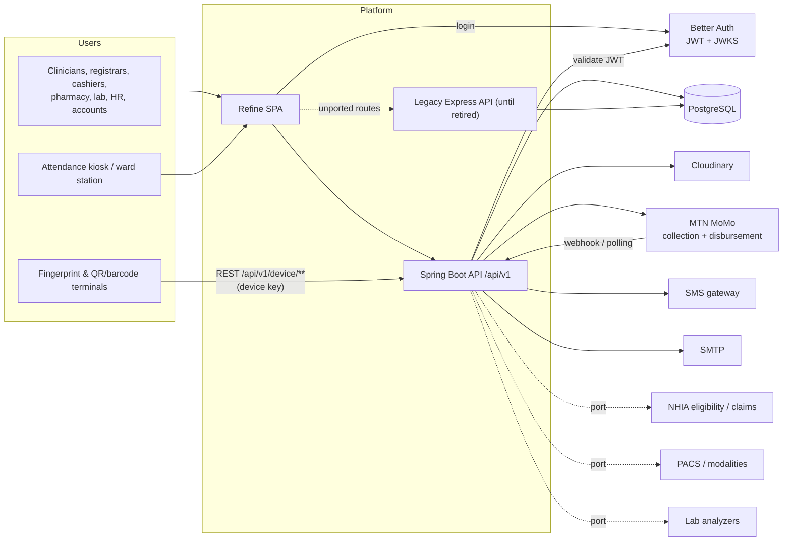
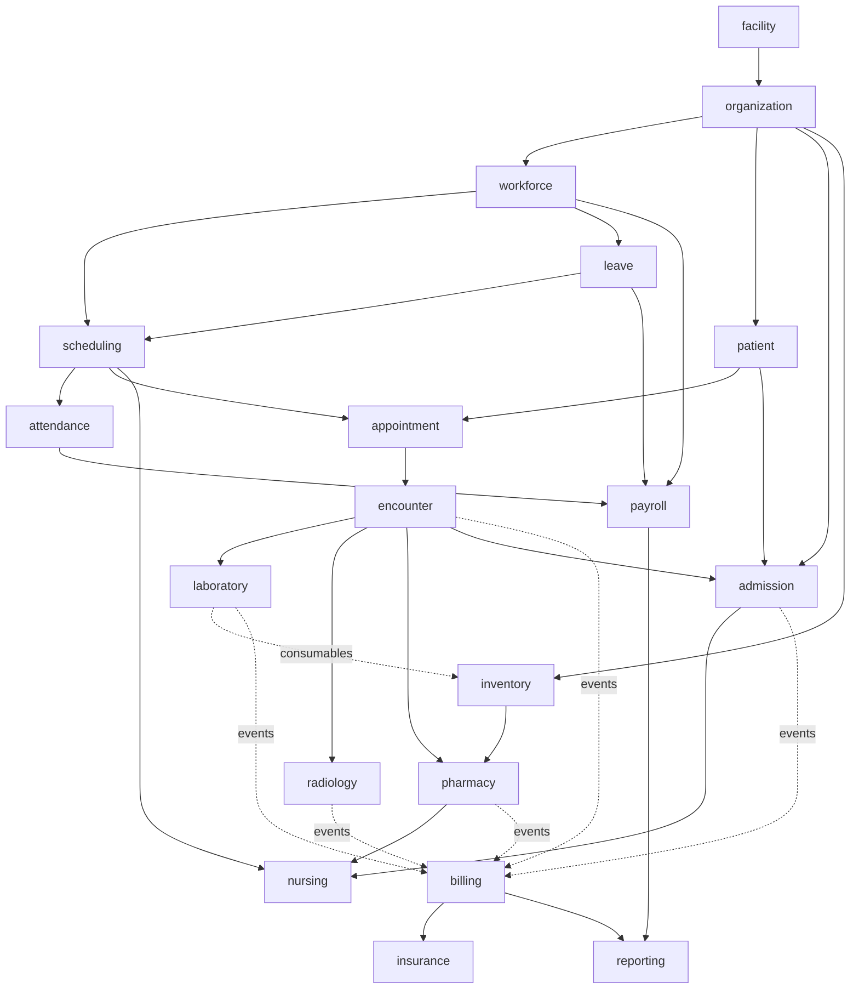

# 01 — Architecture & Environment Setup

## 1. Target repository layout

```
my-bmc/
├── docs/                                  # this guide
├── backend/                               # EXISTS — legacy Express API, frozen (bug-fixes only)
├── backend-spring/                        # NEW — HAMS API (Spring Boot 3, Java 21, Maven)
│   ├── pom.xml
│   ├── Dockerfile
│   ├── docker-compose.yml                 # postgres, mailpit, wiremock (local only)
│   ├── .env.example
│   ├── openapi/openapi.json               # generated, committed, CI-checked (ADR-005)
│   └── src/
│       ├── main/java/org/bmc/hams/
│       │   ├── HamsApplication.java
│       │   ├── shared/                    # kernel: BaseEntity, Money, Clock/ZoneId, errors, paging, audit, security utils
│       │   ├── identity/                  # app_user_role, JWT mapping, break-glass
│       │   ├── facility/                  # facility_setup, public holidays, settings, document_sequence
│       │   ├── organization/              # org_unit tree
│       │   ├── workforce/                 # staff, job_role, license, credentials, assignments
│       │   ├── scheduling/                # shift types, rosters, swaps, fixed-schedule materialiser
│       │   ├── attendance/                # devices, punches, records, exceptions, corrections
│       │   ├── leave/                     # leave types, balances, requests, overtime
│       │   ├── payroll/                   # pay elements, runs, payslips + EXISTING payout batches
│       │   ├── patient/                   # MPI, identifiers, contacts, allergies, consent, merge
│       │   ├── appointment/               # clinics, slots, appointments, visits, queue, triage
│       │   ├── encounter/                 # OPD encounters, notes, vitals, diagnoses, orders, referrals
│       │   ├── admission/                 # wards/beds, admissions, bed assignments, discharge
│       │   ├── nursing/                   # assessments, care plans, MAR, I/O, handover, allocation
│       │   ├── laboratory/                # catalogue, orders, specimens, results, validation
│       │   ├── radiology/                 # procedures, orders, reports, PACS links
│       │   ├── inventory/                 # stores, items, batches, ledger, requisitions, POs, GRN
│       │   ├── pharmacy/                  # formulary, prescriptions, dispensing, controlled drugs
│       │   ├── billing/                   # price lists, bills, patient payments, cashier sessions, deposits
│       │   ├── insurance/                 # payers, patient cover, pre-auth, claims, remittance
│       │   ├── reporting/                 # read models, KPIs, statutory returns, exports
│       │   └── integration/               # adapters: device, momo, sms, email, nhia, pacs, analyzer
│       ├── main/resources/
│       │   ├── application.yml  application-{local,staging,prod}.yml
│       │   ├── db/migration/              # Flyway: V1__baseline.sql, V2__…, R__views.sql
│       │   ├── db/seed/                   # reference data (idempotent MERGE scripts)
│       │   └── templates/                 # Thymeleaf/PDF templates: receipts, labels, wristbands, payslips
│       └── test/java/…                    # unit, Testcontainers, Modulith, ArchUnit, API tests
└── frontend/                              # EXISTS — Refine + shadcn/ui, extended per sprint
    └── src/
        ├── App.tsx                        # <Refine> root (existing)
        ├── constants/resources.ts         # resource registry (existing; grows per sprint)
        ├── providers/{data,auth}.ts       # existing; + accessControl.ts, auditLog.ts
        ├── pages/<resource>/{list,create,edit,show}.tsx
        ├── components/                    # refine-ui/*, ui/*, + patient-banner, roster-grid, bed-board …
        ├── types/api.d.ts                 # generated from openapi.json (ADR-005)
        └── lib/ hooks/
```

Each module inside `org.bmc.hams.<module>` follows one template:

```
<module>/
├── <Module>Api.java            # public interfaces other modules may call   (package root = published API)
├── events/                     # public domain events (records)
└── internal/
    ├── domain/                 # entities, value objects, state machines, domain services
    ├── repo/                   # Spring Data repositories (+ native queries)
    ├── service/                # application services (@Transactional)
    ├── web/                    # @RestController + request/response DTO records
    └── jobs/                   # @Scheduled jobs
```

Anything under `internal/` is invisible to other modules (Spring Modulith enforces it).

## 2. System context



Dotted lines are ports (ADR-013) that ship with a fake/manual implementation first.

## 3. Module dependency rules



Rules (enforced by `ArchitectureTest` + `ApplicationModules.verify()`):

1. `A --> B` means **B may call A's published API** (A is upstream of B); the reverse
   direction is forbidden. Dotted arrows mean B only *listens to A's events*.
2. **No cycles.** Where two modules need each other, one publishes an event instead (dotted
   arrows: clinical modules never import `billing`; billing *listens* to their events).
3. `reporting` reads only from its own read models (views owned by `reporting`) — it never calls other modules' services.
4. Entities are never exposed across modules; cross-module data is a record DTO returned by the `*Api`.

## 4. Domain event catalogue

Published via Spring Modulith's event publication registry (ADR-012). Listeners are
`@ApplicationModuleListener` (async, after-commit, retried) and **must be idempotent**.

| Event | Publisher | Consumers | Effect |
|---|---|---|---|
| `StaffTransferred`, `StaffDeactivated` | workforce | scheduling, identity | Re-point/cancel future roster entries; disable login |
| `RosterPublished`, `RosterEntryChanged` | scheduling | attendance, notification | Re-evaluate records; notify staff |
| `PunchAccepted` | attendance | attendance | Process punch into record |
| `AttendanceClosed` | attendance | payroll, reporting | Feed allowance/overtime calculation, KPIs |
| `LeaveApproved`, `LeaveCancelled` | leave | scheduling | Cancel/restore roster entries; block scheduling |
| `PatientRegistered` | patient | appointment, billing, insurance, reporting | Seed derived records |
| `AppointmentBooked`, `AppointmentCancelled` | appointment | notification | SMS reminder (if consented) |
| `VisitOpened` | appointment | billing | Create open bill; capture registration/consultation charge |
| `OrderPlaced` (lab / imaging / medication / procedure) | encounter | billing, laboratory, radiology, pharmacy | Charge capture + work-queue item |
| `OrderCancelled` | encounter | billing, laboratory, radiology, pharmacy | Void unstarted charge; cancel work item |
| `OrderGated(orderId, amount)` / `OrderCleared(orderId)` | billing | laboratory, radiology, pharmacy | Show / lift the pay-before-service hold (never for emergency/STAT/inpatient) |
| `PaymentConfirmed`, `BillFinalised` | billing | billing (gate clearing), admission | Release holds; discharge financial advisory |
| `AdmissionRequested` | encounter | admission | Create `bed_request` from a disposition of ADMITTED |
| `BedDayAccrued(admissionId, date)` | admission | billing | Midnight-census bed charge |
| `SpecimenRejected`, `LabResultValidated`, `CriticalResultRaised` | laboratory | encounter, notification | Alert ordering clinician; critical-value call log |
| `ImagingReportVerified` | radiology | encounter, notification | Alert ordering clinician |
| `PrescriptionIssued` | encounter | pharmacy | Pharmacy queue |
| `DispenseCompleted`, `DispenseReturned` | pharmacy | inventory, billing, nursing | Ledger posting; charge; ward stock |
| `AdmissionCreated`, `BedAssigned`, `PatientAdmitted`, `PatientTransferred`, `PatientDischarged`, `PatientDeceased` | admission | billing, nursing, encounter, patient, reporting | Bed-day accrual; nursing worklist; close encounters; mark patient deceased |
| `PatientMerged(survivorId, mergedId)` | patient | appointment, encounter, billing, insurance, admission, laboratory, radiology, pharmacy | Each module re-points its own rows (idempotent) and reports to `merge_task` |
| `StockBelowReorderLevel`, `BatchNearingExpiry` | inventory | notification, pharmacy | Reorder & expiry alerts |
| `GoodsReceived` | inventory | accounts (payment batch) | Supplier invoice 3-way match |
| `ClaimSubmitted`, `ClaimAdjudicated`, `RemittanceReceived` | insurance | billing, reporting | Post insurer portion & write-offs |
| `PayrollPeriodLocked`, `PayrollApproved` | payroll | payroll (payout batch), reporting | Create `payments` payout batch (existing engine) |

## 5. Request pipeline (must not be reordered)

```
reverse proxy (TLS, request size limit, coarse rate limit, X-Forwarded-*)
  → RequestIdFilter                        sets/propagates X-Request-Id + MDC
  → CORS                                   allow-list from FRONTEND_URL
  → /api/v1/device/**  chain               DeviceKeyAuthFilter → rate-limit (Bucket4j)
  → /api/v1/** chain                       BearerTokenAuthenticationFilter (JWT via JWKS)
      → ActiveUserFilter                   reject inactive staff/users
      → MethodSecurity (@PreAuthorize)     roles + @unitAccess + @sensitive
      → AuditInterceptor                   audit_log for writes + restricted reads
  → controllers → services → repositories
  → GlobalExceptionHandler                 ProblemDetail (RFC 7807) + code
```

Public surfaces are deliberately minimal in v1: `/actuator/health` (liveness/readiness) and
the **device** chain. A future patient portal or payment webhook mounts under
`/api/public/**` with its own chain and IP-keyed rate limit; MoMo callbacks use
signature/secret verification on `/api/v1/integrations/momo/callback`.

## 6. Environments

| Environment | Frontend | Backend | Database | Purpose |
|---|---|---|---|---|
| Local | `localhost:5173` | `localhost:8080` | Docker Postgres 16 | Development |
| Preview (per PR) | preview URL | preview container | Ephemeral DB (Neon branch or Testcontainers snapshot) `pr-<n>` | Review & QA |
| Staging | `staging.<domain>` | `api-staging.<domain>` | Anonymised copy; synthetic patients only | UAT, training, device pilot |
| Production | `<domain>` | `api.<domain>` | Managed Postgres with PITR | Live |

**Never** copy production patient data to any non-production environment; staging uses the
synthetic generator (`seed/synthetic`, from Sprint 3; patients from Sprint 7). Preview/staging use sandbox MoMo and fake
NHIA/PACS/analyzer ports.

## 7. Configuration

Spring maps environment variables to properties (`HAMS_FACILITY_ZONE` → `hams.facility-zone`).

### `backend-spring/.env.example` (create in Sprint 0)

```dotenv
# Core
SPRING_PROFILES_ACTIVE=local
SERVER_PORT=8080
SPRING_DATASOURCE_URL=jdbc:postgresql://localhost:5432/hams
SPRING_DATASOURCE_USERNAME=hams
SPRING_DATASOURCE_PASSWORD=
SPRING_FLYWAY_BASELINE_ON_MIGRATE=true

# Auth (ADR-015, option A)
SPRING_SECURITY_OAUTH2_RESOURCESERVER_JWT_JWK_SET_URI=http://localhost:8000/api/auth/jwks
HAMS_AUTH_ROLE_CLAIM=roles
FRONTEND_URL=http://localhost:5173

# Facility
HAMS_FACILITY_ZONE=Africa/Accra
HAMS_CURRENCY=GHS
HAMS_PRIVACY_POLICY_VERSION=2026-01
HAMS_DPO_EMAIL=privacy@hospital.example

# Attendance
HAMS_ATTENDANCE_DEBOUNCE_SECONDS=60
HAMS_ATTENDANCE_MAX_SKEW_MINUTES=5
HAMS_ATTENDANCE_AUTOCLOSE_AFTER_MINUTES=120
HAMS_ROSTER_MIN_REST_HOURS=11
HAMS_ROSTER_MATERIALIZE_DAYS=60

# Clinical safety
HAMS_BREAK_GLASS_REASON_MIN_CHARS=15
HAMS_CRITICAL_RESULT_ACK_MINUTES=30
HAMS_NOTE_AMEND_WINDOW_MINUTES=0          # 0 = always amend via new version
HAMS_PRESCRIPTION_VALID_DAYS=30
HAMS_LAB_REQUIRE_VALIDATION=true          # validator must differ from result enterer
HAMS_RAD_REQUIRE_VERIFY=true
HAMS_PATIENT_DUP_BLOCK=0.85
HAMS_PATIENT_DUP_WARN=0.60
HAMS_MINOR_AGE_THRESHOLD=18

# Appointments & visits
HAMS_APPOINTMENT_HORIZON_DAYS=30
HAMS_APPOINTMENT_CANCEL_CUTOFF_HOURS=2
HAMS_VISIT_AUTOCLOSE_HOURS=18

# Billing & insurance
HAMS_RECEIPT_PREFIX=RCP
HAMS_PAY_BEFORE_SERVICE_OPD=true
HAMS_CASHIER_VARIANCE_TOLERANCE=5.00
HAMS_CLAIM_SUBMISSION_DEADLINE_DAYS=30

# Inventory
HAMS_EXPIRY_ALERT_DAYS=90
HAMS_NEAR_EXPIRY_BLOCK_DISPENSE_DAYS=0
HAMS_MIN_SHELF_LIFE_DAYS=90

# Payroll
HAMS_PAYROLL_REQUIRE_FOUR_EYES=true

# Reporting
HAMS_REPORT_REFRESH_CRON=0 30 2 * * *

# Integrations (all optional; fakes are used when empty)
MOMO_BASE_URL=
MOMO_COLLECTION_SUBSCRIPTION_KEY=
MOMO_DISBURSEMENT_SUBSCRIPTION_KEY=
MOMO_API_USER=
MOMO_API_KEY=
MOMO_TARGET_ENVIRONMENT=sandbox
SMS_PROVIDER=fake
SMS_API_KEY=
SMS_SENDER_ID=
SPRING_MAIL_HOST=localhost
SPRING_MAIL_PORT=1025
NHIA_GATEWAY=manual
PACS_GATEWAY=none
CLOUDINARY_CLOUD_NAME=

# Feature flags
HAMS_FEATURE_DEVICE_INGEST=true
HAMS_FEATURE_NHIA_ELECTRONIC=false
HAMS_FEATURE_BIOMETRIC_ENROLMENT=true
```

### `frontend/.env.example` (extend)

```dotenv
VITE_API_URL=http://localhost:8080
VITE_AUTH_URL=http://localhost:8000/api/auth
VITE_LEGACY_API_URL=http://localhost:8000
VITE_APP_NAME=BMC HAMS
VITE_CLOUDINARY_CLOUD_NAME=
VITE_CLOUDINARY_UPLOAD_PRESET=
VITE_SENTRY_DSN=
```

> Secrets live in the platform's secret store per environment. `.env*` files are git-ignored;
> only `.env.example` is committed. **Rotate any secret that has ever been committed**
> (check `backend/.env` and `frontend/.env` history before the first production deploy).

## 8. Build baseline (`backend-spring/pom.xml`)

```xml
<properties>
  <java.version>21</java.version>
  <spring-modulith.version>1.3.x</spring-modulith.version> <!-- align to Boot release -->
</properties>
<dependencies>
  <!-- web & security -->
  <dependency><groupId>org.springframework.boot</groupId><artifactId>spring-boot-starter-web</artifactId></dependency>
  <dependency><groupId>org.springframework.boot</groupId><artifactId>spring-boot-starter-validation</artifactId></dependency>
  <dependency><groupId>org.springframework.boot</groupId><artifactId>spring-boot-starter-security</artifactId></dependency>
  <dependency><groupId>org.springframework.boot</groupId><artifactId>spring-boot-starter-oauth2-resource-server</artifactId></dependency>
  <dependency><groupId>org.springframework.boot</groupId><artifactId>spring-boot-starter-actuator</artifactId></dependency>
  <!-- persistence -->
  <dependency><groupId>org.springframework.boot</groupId><artifactId>spring-boot-starter-data-jpa</artifactId></dependency>
  <dependency><groupId>org.springframework.boot</groupId><artifactId>spring-boot-starter-jdbc</artifactId></dependency>
  <dependency><groupId>org.postgresql</groupId><artifactId>postgresql</artifactId><scope>runtime</scope></dependency>
  <dependency><groupId>org.flywaydb</groupId><artifactId>flyway-core</artifactId></dependency>
  <dependency><groupId>org.flywaydb</groupId><artifactId>flyway-database-postgresql</artifactId></dependency>
  <dependency><groupId>org.springframework.data</groupId><artifactId>spring-data-envers</artifactId></dependency>
  <!-- modularity, events, jobs -->
  <dependency><groupId>org.springframework.modulith</groupId><artifactId>spring-modulith-starter-jpa</artifactId></dependency>
  <dependency><groupId>net.javacrumbs.shedlock</groupId><artifactId>shedlock-spring</artifactId></dependency>
  <dependency><groupId>net.javacrumbs.shedlock</groupId><artifactId>shedlock-provider-jdbc-template</artifactId></dependency>
  <!-- productivity -->
  <dependency><groupId>org.mapstruct</groupId><artifactId>mapstruct</artifactId></dependency>
  <dependency><groupId>com.bucket4j</groupId><artifactId>bucket4j-core</artifactId></dependency>
  <dependency><groupId>org.springdoc</groupId><artifactId>springdoc-openapi-starter-webmvc-ui</artifactId></dependency>
  <!-- documents & exports -->
  <dependency><groupId>org.apache.poi</groupId><artifactId>poi-ooxml</artifactId></dependency>        <!-- XLSX -->
  <dependency><groupId>com.github.librepdf</groupId><artifactId>openpdf</artifactId></dependency>      <!-- receipts, payslips, reports -->
  <dependency><groupId>com.google.zxing</groupId><artifactId>core</artifactId></dependency>            <!-- QR / barcode (ID cards, labels, wristbands) -->
  <dependency><groupId>org.springframework.boot</groupId><artifactId>spring-boot-starter-thymeleaf</artifactId></dependency>
  <dependency><groupId>org.springframework.boot</groupId><artifactId>spring-boot-starter-mail</artifactId></dependency>
  <!-- observability -->
  <dependency><groupId>io.micrometer</groupId><artifactId>micrometer-registry-prometheus</artifactId></dependency>
  <dependency><groupId>net.logstash.logback</groupId><artifactId>logstash-logback-encoder</artifactId></dependency>
  <!-- test -->
  <dependency><groupId>org.springframework.boot</groupId><artifactId>spring-boot-starter-test</artifactId><scope>test</scope></dependency>
  <dependency><groupId>org.springframework.security</groupId><artifactId>spring-security-test</artifactId><scope>test</scope></dependency>
  <dependency><groupId>org.testcontainers</groupId><artifactId>postgresql</artifactId><scope>test</scope></dependency>
  <dependency><groupId>org.springframework.modulith</groupId><artifactId>spring-modulith-starter-test</artifactId><scope>test</scope></dependency>
  <dependency><groupId>com.tngtech.archunit</groupId><artifactId>archunit-junit5</artifactId><scope>test</scope></dependency>
  <dependency><groupId>org.wiremock</groupId><artifactId>wiremock-standalone</artifactId><scope>test</scope></dependency>
</dependencies>
```

Versions are managed by the Spring Boot BOM (and the Modulith BOM); pin the rest in
`<dependencyManagement>`. Static analysis: `spotless` (google-java-format), `spotbugs`,
`checkstyle` (minimal), `jacoco` (≥ 80 % lines on `domain` + `service` packages).

## 9. Local bootstrap

```bash
# 1. Infra
cd backend-spring
cp .env.example .env
docker compose up -d                       # postgres:16 (>= 15 needed for NULLS NOT DISTINCT), mailpit, wiremock

# 2. Backend
./mvnw spotless:apply verify               # compile + unit + Testcontainers tests
./mvnw spring-boot:run -Dspring-boot.run.profiles=local
#   Flyway runs on start; baseline-on-migrate adopts an existing Drizzle-built DB at V1

# 3. Reference data & demo data
./mvnw -Pseed exec:java -Dexec.args="reference"     # roles, shift types, org tree, Ghana holidays, ICD-10, price list skeleton
./mvnw -Pseed exec:java -Dexec.args="demo"          # ~200 staff, rosters, 5k synthetic patients, stock (Sprint 7+)
./mvnw -Pseed exec:java -Dexec.args="admin"         # super_admin account

# 4. Legacy API (only while unported routes are in use)
cd ../backend && npm install && npm run dev          # http://localhost:8000

# 5. Frontend
cd ../frontend && cp .env.example .env && npm install && npm run dev   # http://localhost:5173
```

Verification:

```bash
curl -s localhost:8080/actuator/health                       # {"status":"UP"}
curl -i localhost:8080/api/v1/org-units                      # 401 before sign-in
curl -s -H "Authorization: Bearer $JWT" localhost:8080/api/v1/shift-types | jq '.data|length'   # 4
```

OpenAPI UI: `http://localhost:8080/swagger-ui.html` (disabled in production unless authenticated as `super_admin`).

## 10. Device & network topology (attendance pilot)

```
  ┌──────────────┐  LAN/VLAN "devices"   ┌───────────────┐  HTTPS  ┌──────────────┐
  │ Fingerprint  │──────────────────────▶│  HAMS gateway │────────▶│ HAMS API     │
  │ terminals    │ (vendor push/ADMS)    │  (optional,   │ /device │ /api/v1/     │
  │ QR/barcode   │                       │  on-prem)     │ /punches│ device/**    │
  │ scanners     │──── direct HTTPS ─────┴───────────────┘────────▶│              │
  └──────────────┘                                                  └──────────────┘
```

- Terminals sit on an isolated VLAN with egress only to the gateway/API; NTP from the same
  internal source as servers (clock skew is audited).
- Each device has its own key (hash stored); keys are rotated from the UI and shown once.
- A gateway is only needed when the vendor protocol is not plain HTTPS/JSON; it holds an
  on-disk buffer so punches survive WAN outages.

## 11. Branching, commits, releases

- Trunk-based: short-lived branches from `main`, PR + 1 approval + green checks; squash merge.
- Conventional Commits (`feat(attendance): …`, `fix(billing): …`) with the story ID in the footer.
- Flyway migrations: one per PR per module, versioned `V<n>__<module>_<what>.sql`; **never edit a
  released migration**; repeatable `R__*.sql` only for views/functions; destructive changes follow
  *expand → migrate → contract* over two releases.
- Image tags: `hams-api:<git-sha>`; release tags `v<major>.<minor>.<patch>`; production
  deploys are promoted staging images (never rebuilt).

## 12. Scheduled jobs (all ShedLock-guarded; full list in [07](07-testing-quality-cicd.md#5-scheduled-jobs))

| Job | Module | Cadence |
|---|---|---|
| `FixedScheduleMaterializer` | scheduling | nightly 01:15 |
| `PunchRetryJob`, `AutoCloseJob`, `AbsenceDetectionJob`, `DeviceHealthJob` | attendance | 1–15 min |
| `AppointmentReminderJob`, `NoShowSweepJob` | appointment | 15 min / nightly |
| `BedDayAccrualJob` | admission | nightly 00:05 (facility zone) |
| `ExpiryAlertJob`, `ReorderPointJob` | inventory | nightly |
| `BillAgeingJob`, `ClaimDeadlineJob` | billing / insurance | nightly |
| `LeaveAccrualJob` | leave | monthly |
| `LicenceExpiryJob` | workforce | weekly |
| `ReportRefreshJob` | reporting | nightly 02:30 |
| `RetentionJob`, `AuditPartitionJob` | shared | nightly / monthly |
