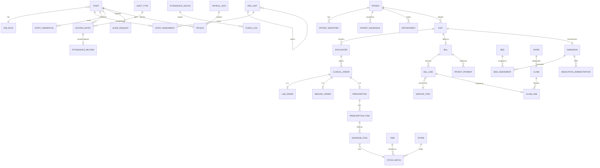

# 02 — Data Model

This document holds the **conventions, ER overview, table inventory, platform DDL, enum
registry, indexing strategy, migration sequence and seed plan**. Module-specific DDL lives with
the module spec so that rules and tables are read together:

| Module group | DDL & rules |
|---|---|
| Workforce (organization, workforce, scheduling, attendance) | [09-module-workforce.md](09-module-workforce.md) §5–§8 |
| Clinical (patient, appointment/OPD, admission, nursing, laboratory, radiology) | [10-module-clinical.md](10-module-clinical.md) |
| Supply & revenue (inventory, pharmacy, billing, insurance) | [11-module-supply-and-revenue.md](11-module-supply-and-revenue.md) |
| Corporate (leave, payroll, reporting) | [12-module-hr-payroll-reporting.md](12-module-hr-payroll-reporting.md) |

## 1. Conventions

| Topic | Rule |
|---|---|
| Naming | `snake_case`, singular table names (`patient`, `bill_line`); FK column `<table>_id`; booleans `is_/has_` where ambiguous |
| Primary keys | `uuid PRIMARY KEY DEFAULT gen_random_uuid()`. Exceptions: `punch_log`/`audit_log`/`stock_ledger` use `uuid` too, but are partitioned/indexed by time |
| Human numbers | MRN, visit, admission, bill, receipt, claim, PO, payslip numbers via `next_doc_number()` (§4.2, ADR-016); stored in a `UNIQUE` column |
| Time | `timestamptz` for instants; `date` for business dates; shift wall-clock `time` + computed instants (ADR-009) |
| Money | `numeric(14,2)`; quantities `numeric(14,3)`; rates/percent `numeric(7,4)`; currency `char(3)` default `'GHS'` (ADR-008) |
| Enums | `varchar(n)` + named `CHECK`, mapped with `@Enumerated(STRING)`. **No Postgres `ENUM` types** in new tables (adding a value is a one-line `CHECK` replace, no `ALTER TYPE`) |
| Audit columns | Every table: `created_at`, `created_by`, `updated_at`, `updated_by`, `version int` (optimistic lock). Ledgers/logs omit `updated_*` and `version` |
| Constraint names | **Always name constraints**: `<table>_<what>_<pk|fk|uq|ck|ex>` (e.g. `roster_entry_staff_overlap_ex`). The API maps names to business error codes (§1.2) |
| Deletion | People/clinical/financial rows are never hard-deleted. Reference data uses `active boolean`. Clinical content uses `status='ENTERED_IN_ERROR'` (ADR-011). Hard delete only through the privacy routines ([06](06-security-privacy-compliance.md) §7) |
| JSON | `jsonb` only for raw device/integration payloads, audit before/after, report parameter bags, and **versioned form payloads whose queryable outcomes are promoted to columns** (nursing assessments) — never for queryable business facts |
| Text search | `pg_trgm` + `unaccent` (+ `fuzzystrmatch` for sounds-like) — see §6 |
| Required extensions | `btree_gist`, `pg_trgm`, `unaccent`, `fuzzystrmatch`, `citext` |
| Foreign keys | Always declared. `ON DELETE` is `RESTRICT` (default) except parent→child ownership (`CASCADE`) |
| Tenancy | Single facility per database (`facility_setup` has one row). Multi-facility is post-v1 |

### 1.1 JPA mapping guidance

```java
@MappedSuperclass
@EntityListeners(AuditingEntityListener.class)
public abstract class BaseEntity {
    @Id @GeneratedValue(strategy = GenerationType.UUID) protected UUID id;
    @Version protected int version;
    @CreatedDate  @Column(updatable = false) protected Instant createdAt;
    @CreatedBy    @Column(updatable = false) protected String createdBy;
    @LastModifiedDate protected Instant updatedAt;
    @LastModifiedBy   protected String updatedBy;
}
```

- `Money` is an `@Embeddable` (`BigDecimal amount`, `String currency`); never use `double`.
- Aggregate roots own their children with `@OneToMany(cascade = ALL, orphanRemoval = true)` only
  when the children cannot exist alone (`bill → bill_line`, `roster_period → …` is *not* owned).
- Prefer **explicit queries/projections** for lists; no entity graphs returned from controllers.
- Hibernate Envers (`@Audited`) on `staff`, `staff_assignment`, `roster_entry`, `attendance_record`,
  `patient`, `bill`, `price_list_item`, `payslip`; clinical content uses its own version rows.

### 1.2 Constraint → error code mapping

| SQLSTATE | Meaning | API response |
|---|---|---|
| `23505` unique violation | Duplicate | `409 DUPLICATE_<CONSTRAINT>` (e.g. `DUPLICATE_PATIENT_IDENTIFIER`) |
| `23P01` exclusion violation | Overlap | `409 OVERLAP_<CONSTRAINT>` (`ROSTER_OVERLAP`, `BED_ALREADY_OCCUPIED`, `PRIMARY_ASSIGNMENT_OVERLAP`) |
| `23503` FK violation | Missing/in-use reference | `409 REFERENCE_IN_USE` / `422 REFERENCE_NOT_FOUND` |
| `23514` check violation | Domain rule | `422 <CONSTRAINT>` (e.g. `STAFF_NONCLINICAL_FIXED`) |
| `40001` / optimistic lock | Concurrent edit | `409 CONCURRENT_MODIFICATION` |

## 2. Entity relationship overview



## 3. Table inventory by module

`*` = already exists in the repo today. Migration numbers are in §8.

| Module | Tables | Migration |
|---|---|---|
| identity / platform | `user*`, `session*`, `account*`, `verification*`, `app_user_role`, `user_unit_scope`, `consent`, `audit_log`, `break_glass_access`, `attachment`, `notification`, `idempotency_record`, `document_sequence`, `shedlock`, `event_publication` (Modulith) | V2 |
| facility | `facility_setup*` (+timezone etc.), `public_holiday` | V3, V8 |
| organization | `org_unit` | V4 |
| scheduling | `shift_type`, `roster_period`, `roster_entry`, `unit_staffing_requirement`, `shift_swap_request` | V5, V8 |
| workforce | `staff*` (extended), `job_role`, `staff_license`, `staff_assignment`, `transfer_batch`, `staff_credential` | V6, V7, V9 |
| attendance | `attendance_device`, `punch_log`, `attendance_record`, `attendance_exception`, `attendance_correction` | V9 |
| patient | `patient`, `patient_identifier`, `patient_contact`, `patient_allergy`, `patient_condition`, `patient_merge_log`, `patient_merge_task`, `patient_duplicate_candidate` | V10, V11 |
| billing (catalogue) | `service_item`, `price_list`, `price_list_item` | V12 |
| appointment | `clinic_session_template`, `appointment_slot`, `appointment`, `visit`, `queue_ticket`, `triage_assessment` | V13 |
| encounter | `encounter`, `clinical_note`, `vital_sign`, `diagnosis`, `clinical_order`, `referral`, `icd10_code`, `medical_certificate` | V14 |
| pharmacy (prescribing) | `drug`, `drug_interaction`, `prescription`, `prescription_item` | V15 |
| billing | `bill`, `bill_line`, `patient_payment`, `cashier_session`, `cashier_ledger`, `patient_deposit`, `refund`, `waiver_request`, `credit_note`, `receipt` | V16 |
| laboratory | `lab_test`, `lab_panel`, `lab_panel_item`, `lab_reference_range`, `lab_order`, `lab_order_item`, `specimen`, `lab_result`, `critical_result_notification` | V17 |
| radiology | `imaging_modality`, `imaging_procedure`, `imaging_order`, `imaging_study`, `imaging_report` | V18 |
| admission | `room`, `bed`, `bed_request`, `admission`, `bed_assignment`, `discharge_summary`, `bed_block` | V19 |
| nursing | `nursing_assessment`, `care_plan`, `care_plan_task`, `medication_administration`, `intake_output`, `nursing_note`, `shift_handover`, `handover_item`, `nurse_patient_allocation` | V20 |
| inventory | `store`, `item_category`, `item`, `supplier`, `stock_batch`, `stock_ledger`, `requisition`, `requisition_line`, `purchase_order`, `purchase_order_line`, `goods_received_note`, `grn_line`, `stock_take`, `stock_take_line`, `supplier_invoice` | V21 |
| pharmacy (dispensing) | `dispense`, `dispense_item`, `dispense_return`, `controlled_drug_register`, `pharmacy_intervention`, `ward_stock_issue` | V22 |
| insurance | `payer`, `insurance_plan`, `coverage_rule`, `patient_insurance`, `eligibility_check`, `preauthorization`, `claim`, `claim_line`, `claim_batch`, `remittance`, `remittance_allocation`, `claim_rejection_code` | V23 |
| leave | `leave_type`, `leave_balance`, `leave_request`, `leave_approval`, `overtime_request` | V24 |
| payroll | `salary_scale`, `staff_compensation`, `pay_element`, `staff_pay_element`, `allowance_rule`, `statutory_rate`, `payroll_period`, `payroll_run`, `payslip`, `payslip_line`, `attendance_snapshot`, `categories*`, `payments*`, `payment_recipients*` | V25 |
| reporting | materialised views `mv_*`, `report_definition`, `report_run`, `dhims2_mapping`, `kpi_snapshot` | V26 |
| privacy | `data_subject_request`, `retention_policy`, `retention_run` | V27 |

≈ 150 tables. Ownership rule: **a table is written only by its owning module**; others read
through the module's API or a reporting view.

## 4. Platform DDL

### 4.1 Identity, roles, scope (V2)

```sql
-- V2__platform.sql
CREATE EXTENSION IF NOT EXISTS btree_gist;
CREATE EXTENSION IF NOT EXISTS pg_trgm;
CREATE EXTENSION IF NOT EXISTS unaccent;
CREATE EXTENSION IF NOT EXISTS fuzzystrmatch;
CREATE EXTENSION IF NOT EXISTS citext;

CREATE TABLE app_user_role (
  user_id    text        NOT NULL REFERENCES "user"(id) ON DELETE CASCADE,
  role       varchar(30) NOT NULL,
  granted_by text,
  granted_at timestamptz NOT NULL DEFAULT now(),
  CONSTRAINT app_user_role_pk PRIMARY KEY (user_id, role),
  CONSTRAINT app_user_role_ck CHECK (role IN (
    'SUPER_ADMIN','HOSPITAL_ADMIN','HR_MANAGER','PAYROLL_OFFICER','UNIT_MANAGER','ROSTER_OFFICER',
    'REGISTRAR','RECORDS_OFFICER','CASHIER','ACCOUNTS','BILLING_OFFICER',
    'DOCTOR','NURSE','PHARMACIST','PHARMACY_TECH','LAB_SCIENTIST','RADIOGRAPHER','RADIOLOGIST',
    'STORE_KEEPER','PROCUREMENT_OFFICER','REPORT_VIEWER','AUDITOR','DPO','STAFF'))
);
-- Backfill from the legacy single-role column
INSERT INTO app_user_role(user_id, role)
SELECT id, CASE role WHEN 'admin' THEN 'SUPER_ADMIN' ELSE 'ACCOUNTS' END FROM "user";
-- "user".role is kept (read-only) until Express no longer reads it (Sprint 19).

CREATE TABLE user_unit_scope (                   -- which units a manager/roster officer may act on
  user_id     text NOT NULL REFERENCES "user"(id) ON DELETE CASCADE,
  org_unit_id uuid NOT NULL,                     -- FK added in V4 (org_unit)
  scope       varchar(8) NOT NULL DEFAULT 'MANAGE' CHECK (scope IN ('MANAGE','VIEW')),
  include_descendants boolean NOT NULL DEFAULT true,
  PRIMARY KEY (user_id, org_unit_id, scope)
);
```

`DEVICE` is **not** a user role: devices authenticate on their own chain
([09](09-module-workforce.md) §7.6).

### 4.2 Document numbers (V2)

```sql
CREATE TABLE document_sequence (
  doc_type   varchar(20) NOT NULL,          -- MRN, VISIT, ADM, BILL, RCP, CLM, PO, GRN, PAYSLIP, LAB, RAD, RX
  period_key varchar(8)  NOT NULL,          -- '2026', '202610', or 'ALL'
  last_value bigint      NOT NULL DEFAULT 0,
  PRIMARY KEY (doc_type, period_key)
);

CREATE FUNCTION next_doc_number(p_type text, p_period text) RETURNS bigint
LANGUAGE sql AS $$
  INSERT INTO document_sequence(doc_type, period_key, last_value) VALUES (p_type, p_period, 1)
  ON CONFLICT (doc_type, period_key) DO UPDATE SET last_value = document_sequence.last_value + 1
  RETURNING last_value;
$$;
```

The row lock is held until the caller's transaction ends, so numbers are **gapless** (a rollback
rolls the counter back) and concurrent allocations of the same type serialise — acceptable
at this volume. Formatting is done in Java: `String.format("%s-%s-%06d", prefix, period, n)`
→ `MRN-2026-000123`.

### 4.3 Consent (V2)

```sql
CREATE TABLE consent (
  id uuid PRIMARY KEY DEFAULT gen_random_uuid(),
  subject_type varchar(8) NOT NULL CHECK (subject_type IN ('PATIENT','STAFF')),
  subject_id   uuid NOT NULL,
  consent_type varchar(30) NOT NULL CHECK (consent_type IN
    ('TREATMENT','DATA_PROCESSING','SMS_CONTACT','INSURER_SHARING','RESEARCH','PHOTOGRAPHY',
     'BIOMETRIC_ATTENDANCE','STAFF_DATA_PROCESSING')),
  status       varchar(10) NOT NULL CHECK (status IN ('GRANTED','WITHDRAWN','DECLINED')),
  policy_version varchar(20) NOT NULL,
  granted_at   timestamptz, withdrawn_at timestamptz,
  capture_method varchar(20) NOT NULL CHECK (capture_method IN ('PAPER','ELECTRONIC','VERBAL_WITNESSED')),
  captured_by  text NOT NULL,
  witness_staff_id uuid,                                 -- required for VERBAL_WITNESSED
  guardian_name varchar(150), guardian_relationship varchar(40),   -- consent given for a minor/incapacitated adult
  evidence_attachment_id uuid,
  note text,
  created_at timestamptz NOT NULL DEFAULT now()
);
CREATE INDEX consent_subject_idx ON consent(subject_type, subject_id, consent_type, status);
```

The *effective* consent for a type is the latest row for `(subject, type)`. Message sending
and insurer-data sharing call `ConsentApi.isGranted(subject, type)`; biometric enrolment is
refused without `BIOMETRIC_ATTENDANCE` (or a documented non-biometric alternative, i.e. card
only).

### 4.4 Audit, break-glass, attachments, notifications (V2)

```sql
CREATE TABLE audit_log (                           -- append-only, range-partitioned monthly
  id uuid NOT NULL DEFAULT gen_random_uuid(),
  occurred_at timestamptz NOT NULL DEFAULT now(),
  actor_user_id text, actor_staff_id uuid, actor_roles text[],
  action varchar(20) NOT NULL CHECK (action IN
    ('CREATE','UPDATE','DELETE','STATUS_CHANGE','READ_RESTRICTED','BREAK_GLASS','LOGIN','LOGOUT',
     'EXPORT','PRINT','OVERRIDE','APPROVE','REJECT','DEVICE_ACTION')),
  entity_type varchar(40) NOT NULL, entity_id text,
  patient_id uuid,                                 -- set whenever the entity belongs to a patient
  org_unit_id uuid,
  request_id varchar(40), ip inet, user_agent text,
  reason text,                                     -- mandatory for BREAK_GLASS / OVERRIDE / corrections
  before jsonb, after jsonb,                       -- PII redacted by the AuditSerializer
  PRIMARY KEY (id, occurred_at)
) PARTITION BY RANGE (occurred_at);
CREATE INDEX audit_entity_idx  ON audit_log(entity_type, entity_id, occurred_at DESC);
CREATE INDEX audit_patient_idx ON audit_log(patient_id, occurred_at DESC) WHERE patient_id IS NOT NULL;
CREATE INDEX audit_actor_idx   ON audit_log(actor_user_id, occurred_at DESC);

CREATE TABLE break_glass_access (
  id uuid PRIMARY KEY DEFAULT gen_random_uuid(),
  user_id text NOT NULL, patient_id uuid NOT NULL,
  reason varchar(500) NOT NULL,
  granted_at timestamptz NOT NULL DEFAULT now(),
  expires_at timestamptz NOT NULL,                 -- default now() + 4 h
  reviewed_by text, reviewed_at timestamptz,
  review_outcome varchar(12) CHECK (review_outcome IN ('JUSTIFIED','UNJUSTIFIED','ESCALATED'))
);

CREATE TABLE attachment (
  id uuid PRIMARY KEY DEFAULT gen_random_uuid(),
  entity_type varchar(40) NOT NULL, entity_id uuid NOT NULL,
  file_name varchar(255) NOT NULL, content_type varchar(100) NOT NULL, size_bytes bigint NOT NULL,
  storage_provider varchar(12) NOT NULL DEFAULT 'CLOUDINARY' CHECK (storage_provider IN ('CLOUDINARY','S3','LOCAL')),
  storage_key text NOT NULL, public_id text,
  classification varchar(12) NOT NULL DEFAULT 'GENERAL' CHECK (classification IN ('GENERAL','CLINICAL','HR','FINANCIAL')),
  uploaded_by text NOT NULL, uploaded_at timestamptz NOT NULL DEFAULT now()
);
CREATE INDEX attachment_entity_idx ON attachment(entity_type, entity_id);

CREATE TABLE notification (
  id uuid PRIMARY KEY DEFAULT gen_random_uuid(),
  channel varchar(8) NOT NULL CHECK (channel IN ('SMS','EMAIL','IN_APP')),
  recipient_type varchar(8) NOT NULL CHECK (recipient_type IN ('PATIENT','STAFF','USER','EXTERNAL')),
  recipient_id uuid, to_address varchar(255),
  template varchar(60) NOT NULL, payload jsonb NOT NULL DEFAULT '{}',
  status varchar(20) NOT NULL DEFAULT 'QUEUED'
     CHECK (status IN ('QUEUED','SENT','FAILED','SKIPPED_NO_CONSENT','CANCELLED')),
  attempts int NOT NULL DEFAULT 0, last_error text,
  scheduled_for timestamptz NOT NULL DEFAULT now(), sent_at timestamptz,
  related_entity_type varchar(40), related_entity_id uuid,
  created_at timestamptz NOT NULL DEFAULT now()
);
CREATE INDEX notification_due_idx ON notification(scheduled_for) WHERE status = 'QUEUED';

CREATE TABLE idempotency_record (                  -- generic replay protection for POSTs ([03] §5)
  idempotency_key varchar(80) NOT NULL, user_id text NOT NULL, endpoint varchar(120) NOT NULL,
  request_hash char(64) NOT NULL, response_status smallint, response_body jsonb,
  created_at timestamptz NOT NULL DEFAULT now(), expires_at timestamptz NOT NULL,
  PRIMARY KEY (idempotency_key, user_id, endpoint)
);

CREATE TABLE shedlock (                            -- ShedLock JDBC provider schema
  name varchar(64) PRIMARY KEY, lock_until timestamptz NOT NULL,
  locked_at timestamptz NOT NULL, locked_by varchar(255) NOT NULL
);
```

Spring Modulith's `event_publication` table is created by its JDBC schema initialiser (`spring.modulith.events.jdbc.schema-initialization.enabled=true`) in dev/test and
copied into a Flyway migration for staging/production so Flyway stays the single owner of the schema.

`audit_log` partitions are created ahead by `AuditPartitionJob` (3 months ahead). Writes to
the audit table happen in the **same transaction** as the change for domain events and
after-commit (best effort + retry) for read audits.

### 4.5 Facility settings (V3)

```sql
-- V3__facility_settings.sql
ALTER TABLE facility_setup
  ADD COLUMN timezone varchar(60) NOT NULL DEFAULT 'UTC',          -- set to 'Africa/Accra'
  ADD COLUMN currency char(3) NOT NULL DEFAULT 'GHS',
  ADD COLUMN locale varchar(10) NOT NULL DEFAULT 'en-GH',
  ADD COLUMN privacy_policy_version varchar(20),
  ADD COLUMN financial_year_start_month smallint NOT NULL DEFAULT 1 CHECK (financial_year_start_month BETWEEN 1 AND 12),
  ADD COLUMN nhia_facility_code varchar(30),
  ADD COLUMN gps_digital_address varchar(20),
  ADD COLUMN registration_number varchar(40);                      -- HeFRA / licensing number
CREATE UNIQUE INDEX facility_setup_singleton_ux ON facility_setup ((true));   -- exactly one row
```

## 5. Enumeration & state-machine registry

One place for every status vocabulary (kept identical in DB `CHECK`s, Java enums and OpenAPI).
Legal transitions are implemented in the entity (`canTransitionTo`) and tested exhaustively.

| Aggregate | States → transitions |
|---|---|
| `roster_period` | `DRAFT → PUBLISHED → LOCKED` |
| `attendance_record` | `OPEN → CLOSED \| AUTO_CLOSED`; `CLOSED/AUTO_CLOSED → CORRECTED` |
| `leave_request` | `DRAFT → SUBMITTED → APPROVED_L1 → APPROVED \| REJECTED`; `SUBMITTED/APPROVED_L1/APPROVED → CANCELLED`; `APPROVED → RECALLED` |
| `appointment` | `BOOKED → CONFIRMED → CHECKED_IN → IN_PROGRESS → COMPLETED`; `BOOKED/CONFIRMED → CANCELLED \| NO_SHOW \| RESCHEDULED` |
| `visit` | `OPEN → CLOSED \| ADMITTED \| CANCELLED` |
| `queue_ticket` | `WAITING → CALLED → SERVING → DONE`; `CALLED → SKIPPED → WAITING` (recall) |
| `encounter` | `OPEN → SIGNED → AMENDED*`; `OPEN → ENTERED_IN_ERROR` |
| `clinical_order` | `DRAFT → ORDERED → IN_PROGRESS → COMPLETED \| CANCELLED \| REJECTED` |
| `prescription` | `DRAFT → ISSUED → PARTIALLY_DISPENSED → DISPENSED`; `ISSUED → CANCELLED \| EXPIRED` |
| `lab_order_item` | `ORDERED → COLLECTED → RECEIVED → IN_PROGRESS → RESULTED → VALIDATED`; `* → REJECTED \| CANCELLED`; `VALIDATED → AMENDED` |
| `imaging_order` | `ORDERED → SCHEDULED → IN_PROGRESS → REPORTED → VERIFIED`; `* → CANCELLED` |
| `admission` | `PENDING_BED → ADMITTED → DISCHARGE_PLANNED → DISCHARGED \| DECEASED \| LAMA \| ABSCONDED \| REFERRED_OUT`; `PENDING_BED → CANCELLED` |
| `bed` | `AVAILABLE ↔ OCCUPIED`; `OCCUPIED → CLEANING → AVAILABLE`; `AVAILABLE → RESERVED \| BLOCKED \| MAINTENANCE` |
| `medication_administration` | `SCHEDULED → GIVEN \| HELD \| REFUSED \| MISSED` |
| `bill` | `OPEN → FINALISED → PARTIALLY_PAID → PAID`; `OPEN → CANCELLED`; `FINALISED/PARTIALLY_PAID → WRITTEN_OFF` |
| `patient_payment` | `PENDING → CONFIRMED \| FAILED`; `CONFIRMED → REVERSED` |
| `cashier_session` | `OPEN → CLOSED → RECONCILED` |
| `claim` | `DRAFT → READY → SUBMITTED → QUERIED ↔ SUBMITTED → ACCEPTED → PAID \| PARTIALLY_PAID`; `SUBMITTED → REJECTED → DRAFT` (resubmit); `* → WRITTEN_OFF` |
| `purchase_order` | `DRAFT → APPROVED → SENT → PARTIALLY_RECEIVED → RECEIVED → CLOSED`; `* → CANCELLED` |
| `requisition` | `DRAFT → SUBMITTED → APPROVED → ISSUED → RECEIVED`; `SUBMITTED → REJECTED` |
| `payroll_period` | `OPEN → CALCULATED → REVIEWED → APPROVED → LOCKED → PAID` |
| `payslip` | `DRAFT → APPROVED → PAID`; `APPROVED → REISSUED` (via new run line, never edited) |
| `payments` (payout batch, existing) | `draft → pending_approval → approved → processing → completed \| cancelled` |

## 6. Indexing & search strategy

| Need | Approach |
|---|---|
| Patient search by name (typos, order, case) | `GIN (immutable_unaccent(lower(last_name \|\| ' ' \|\| first_name)) gin_trgm_ops)`; query uses `%` + `similarity()`; ranked; top 20 |
| Sounds-like (Akan/Ewe names, spelling variants) | Indexed `dmetaphone(last_name)` and `soundex(first_name)` columns on `patient` for the *duplicate detector* and "advanced search" |
| Exact identifiers (MRN, NHIS, Ghana Card, phone) | `UNIQUE` / btree; phone stored normalised E.164 in `phone_e164` |
| Time-range queries on rosters/beds | GiST exclusion constraints double as indexes |
| Work queues (lab, pharmacy, queue, MAR due) | **Partial indexes** on the open statuses (e.g. `WHERE status IN ('ORDERED','COLLECTED')`) |
| Patient chart timeline | `(patient_id, occurred_at DESC)` on `vital_sign`, `clinical_note`, `encounter`, `lab_result` |
| Large append-only tables | `audit_log` partitioned monthly; `punch_log`, `stock_ledger`, `cashier_ledger` indexed by `(entity, time)` and archived by the retention job after the policy period |
| Reporting | Materialised views with unique indexes so `REFRESH … CONCURRENTLY` works ([12](12-module-hr-payroll-reporting.md) §3) |

`immutable_unaccent` is a thin `IMMUTABLE` SQL wrapper around `unaccent()` created in V10 so the
function can be used in an index expression.

## 7. Cross-module reference rules

1. **Cross-module foreign keys point at the owner's table id** (e.g. `visit.patient_id →
   patient.id`) and are declared in SQL, but entities hold only the raw `UUID` (no `@ManyToOne`
   across modules).
2. **Snapshots over joins for historical truth:** `roster_entry.org_unit_id`, `bill_line.description`/
   `unit_price`, `payslip_line.rate`, `lab_result.reference_text` copy the value at event time
   so later master-data edits cannot change history.
3. **Idempotent integration keys:** `bill_line UNIQUE (source_type, source_id)`,
   `punch_log UNIQUE (device_id, device_event_id)`, `stock_ledger UNIQUE (ref_type, ref_id, line_no)`.
4. **Soft cross-module deletes are forbidden:** deactivate the master record and keep history.

## 8. Migration sequence

One migration per PR/module; the sprint column says when it ships. `V1` is a dump of the
current Drizzle-built schema (`user, session, account, verification, staff, categories, payments,
payment_recipients, facility_setup`).

| Version | Name | Sprint | Contents |
|---|---|---|---|
| V1 | `baseline` | 0 | Existing schema as of cut-over |
| V2 | `platform` | 1 | Roles, unit scope, consent, audit, break-glass, attachment, notification, document sequence, ShedLock, extensions |
| V3 | `facility_settings` | 1 | `facility_setup` extensions |
| V4 | `org_unit` | 2 | Org tree (+ `user_unit_scope` FK) |
| V5 | `shift_type` | 2 | Shift types + seed (needed by `staff.default_shift_type_id`) |
| V6 | `staff_extension` | 2 | Staff category/mode/role/badge/user link; `job_role`; `staff_license` |
| V7 | `staff_assignment` | 3 | Temporal assignments, transfer batches |
| V8 | `roster` | 4 | Periods, entries, requirements, swaps, `public_holiday` |
| V9 | `attendance` | 5 | Credentials, devices, `punch_log`, records, exceptions, corrections |
| V10 | `patient_core` | 7 | `patient`, identifiers, contacts, allergies, conditions, search indexes |
| V11 | `patient_merge` | 7 | Merge log, duplicate candidates |
| V12 | `charge_master` | 8 | `service_item`, `price_list`, `price_list_item` |
| V13 | `appointment_visit` | 8 | Clinic sessions, slots, appointments, visits, queue, triage |
| V14 | `encounter` | 9 | Encounters, notes, vitals, diagnoses, `clinical_order`, referrals, `icd10_code` |
| V15 | `prescribing` | 9 | `drug`, interactions, prescriptions |
| V16 | `billing_core` | 10 | Bills, payments, cashier sessions/ledger, deposits, refunds, waivers, receipts |
| V17 | `laboratory` | 11 | Lab catalogue, orders, specimens, results |
| V18 | `radiology` | 11 | Imaging catalogue, orders, reports, study links |
| V19 | `admission` | 12 | Rooms, beds, requests, admissions, bed assignments, discharge |
| V20 | `nursing` | 13 | Assessments, care plans, MAR, I/O, handover, allocation |
| V21 | `inventory` | 14 | Stores, items, batches, ledger, requisitions, POs, GRN, stock-take |
| V22 | `pharmacy_dispensing` | 15 | Dispense, returns, controlled-drug register, ward issues |
| V23 | `insurance` | 16 | Payers, plans, patient cover, pre-auth, claims, remittance |
| V24 | `leave` | 17 | Leave types/balances/requests, overtime |
| V25 | `payroll` | 18 | Compensation, elements, rules, runs, payslips, snapshots |
| V26 | `reporting` | 20 | Materialised views, report definitions/runs, DHIMS2 mapping |
| V27 | `privacy_retention` | 21 | DSR, retention policy/run |
| `R__views.sql` | repeatable | each | Non-materialised views / functions |

Rollback policy: Flyway Community has no automatic undo, so each migration PR includes a
tested **forward fix** note (and for destructive steps, a restore-from-PITR note). Data
migrations that cannot be repeated (e.g. converting `staff.department` text into `org_unit`
rows) are Java-based Flyway migrations with a dry-run mode.

## 9. Seed data (`src/main/resources/db/seed/`)

Idempotent (`INSERT … ON CONFLICT DO NOTHING/UPDATE`), run by the `seed` Maven profile or
the `ReferenceDataLoader` on startup in non-production profiles.

| Seed | Contents | Sprint |
|---|---|---|
| Roles & permissions matrix | 24 roles ([06](06-security-privacy-compliance.md) §3) | 1 |
| Org tree starter | Hospital → Clinical Services / Nursing / Pharmacy / Laboratory / Radiology / Finance / HR / Administration / Support; sample wards & clinics | 2 |
| Job roles | Medical Officer, Specialist, House Officer, Staff Nurse, Midwife, Pharmacist, Lab Scientist, Radiographer, Accountant, Records Officer, Driver, Porter, Security… (category + licence requirement) | 2 |
| Shift types | `STD`, `MORNING`, `AFTERNOON`, `NIGHT` ([09](09-module-workforce.md) §5.3) | 2 |
| Public holidays | Ghana statutory holidays for the next 2 years; movable feasts entered by HR yearly | 4 |
| Categories | `PAYROLL`, `ALLOWANCE`, `SUPPLIER`, `STAFF_ADVANCE` (payout batches) | 1 |
| ICD-10 | WHO ICD-10 (licence/permitted use confirmed by the facility) | 9 |
| Service catalogue & price list | Registration, consultation types, procedures, bed classes, lab/imaging tests, consumables — **supplied by the hospital**; starter CSV import template | 8 |
| Formulary | Imported from the national Essential Medicines List / NHIS medicines list; do not hand-key | 9 |
| Lab catalogue + reference ranges | ~120 common tests with age/sex ranges, **validated by the lab head** | 11 |
| Imaging procedures | X-ray, ultrasound, CT, MRI procedure list | 11 |
| Wards, rooms, beds | Facility floor plan CSV import | 12 |
| Leave types | Annual, sick, maternity, paternity, study, compassionate, unpaid — per Labour Act 2003 (Act 651) **minimums** and facility conditions of service | 17 |
| Statutory rates | SSNIT and PAYE bands as dated, editable `statutory_rate` rows — **not hard-coded**; Finance confirms values | 18 |
| NHIS claim rejection codes | Reason catalogue | 16 |
| Synthetic data | Generator for demo/staging: staff, rosters, patients, encounters, stock (never real data) | 7+ |

## 10. Data lifecycle (summary)

| Data | Hot | Archive | Disposal |
|---|---|---|---|
| Audit log | 13 months online | cold partitions to object storage | per policy ([06](06-security-privacy-compliance.md) §6) |
| Punch log / attendance | 3 years | summarised in `attendance_snapshot` | with HR retention |
| Clinical records | Life of patient file | — | per MoH/GHS guidance & counsel; **never** by default job |
| Financial records | 7+ years | — | statutory |
| Biometric metadata | While employed | — | deleted at termination + grace |

Detailed schedule and the retention job design are in [06](06-security-privacy-compliance.md) §6.
