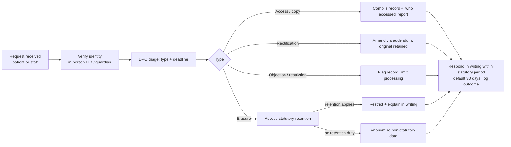

# 06 — Security, Privacy & Compliance

> This is an engineering plan, **not legal advice**. Statute references and every retention period below are
> defaults to be confirmed by counsel and the facility's Data Protection Officer (DPO) in Sprint 0 (S0-2) and Sprint 21.

## 1. Legal and regulatory context (Ghana — assumption Q1)

| Instrument | Relevance to HAMS |
|---|---|
| **Data Protection Act, 2012 (Act 843)** and the Data Protection Commission | Governs all personal data. **Health data is special personal data** (stricter conditions); the facility is a *data controller*, must register with the Commission, appoint a DPO (recommended), honour data-subject rights, secure data, notify breaches |
| **Health Institutions and Facilities Act, 2011 (Act 829)** / HeFRA licensing | Facility licensing and record-keeping expectations |
| **Public Health Act, 2012 (Act 851)** | Notifiable-disease reporting → `icd10_code.is_notifiable`, DHIMS2 returns; permitted disclosure basis |
| **Mental Health Act, 2012 (Act 846)** | Extra confidentiality and safeguards for mental-health records (RESTRICTED class) |
| **National Health Insurance Act, 2012 (Act 852)** / NHIA rules | Claims, eligibility, filing deadlines, minimum-necessary disclosure to the scheme |
| **Labour Act, 2003 (Act 651)** | Leave entitlements, working hours/overtime (leave & payroll rules) |
| **Cybersecurity Act, 2020 (Act 1038)** | Incident reporting, critical information infrastructure expectations |
| **Electronic Transactions Act, 2008 (Act 772)** | Validity of electronic records, signatures, receipts |
| Professional council rules (Medical & Dental Council, Nursing & Midwifery Council, Pharmacy Council) | Licence-gated acts, professional confidentiality, record keeping |
| Mobile money (MTN MoMo) / Bank of Ghana rules | Collection & disbursement flows; reconciliation, KYC handled by provider |

Lawful bases used (to be confirmed): **medical purposes** under a duty of confidentiality (treatment, care administration), **contract**
(employment/payroll), **legal obligation** (statutory reporting, tax, SSNIT), **consent** (SMS, research, photography, biometrics where optional),
**vital interests** (emergencies).

## 2. Data classification

| Class | Examples | Handling |
|---|---|---|
| **P0 Public** | Facility name, clinic hours | No restriction |
| **P1 Internal** | Org tree, shift types, price lists, aggregated KPIs | Authenticated staff |
| **P2 Confidential** | Staff HR record, attendance, leave, supplier & financial records, bills | Role + scope; audited writes |
| **P3 Sensitive-health** | Patient demographics, encounters, results, prescriptions, nursing, admissions | Role + care-relationship; all access logged (reads of RESTRICTED); masked in logs/exports |
| **P4 Restricted-health** | HIV/STI, mental health, adolescent SRH, GBV/abuse, forensic, VIP/staff-patient records | Break-glass with reason; separate note `sensitivity=SENSITIVE`; small-cell suppression in reports |
| **P5 Payroll / identity** | Salary, bank/MoMo numbers, SSNIT/TIN, Ghana Card PIN | Payroll roles only; application-level encryption for account & ID numbers; masked in UI |
| **P6 Secrets** | Device keys, API keys, JWKS keys, MoMo credentials, DB passwords | Secret manager only; never in code/logs; rotation procedure |
| **Biometric** | Fingerprint templates | **Never stored in HAMS** — templates stay on terminals; HAMS stores badge PIN + enrolment metadata only |

## 3. RBAC matrix

`R` read · `W` create/update · `X` workflow actions (approve, sign, dispense, validate, publish) · `s` scoped to own unit subtree ·
`o` own record only · `m` minimal (identity + allergies + what the role needs) · `·` none.
*Roles are additive (a user can be DOCTOR + UNIT_MANAGER).* The server is authoritative ([03](03-api-contract.md)).

| Role | Patient registry | Appts & visits | Clinical record | Lab / Imaging | Wards & nursing | Pharmacy & stores | Billing & cash | Insurance | Workforce (staff, roster, attendance) | Leave | Payroll | Reports | Admin & audit |
|---|---|---|---|---|---|---|---|---|---|---|---|---|---|
| SUPER_ADMIN | · | · | · | · | · | · | · | · | RW | R | · | R | RWX |
| HOSPITAL_ADMIN | Rm | R | · | · | R | R | R | R | RWX | RX | X (approve) | R | RW |
| HR_MANAGER | · | · | · | · | · | · | · | · | RWX | RWX | R X (review) | R (HR) | · |
| PAYROLL_OFFICER | · | · | · | · | · | · | · | · | R (comp.) | R | RWX | R | · |
| UNIT_MANAGER | Rm s | R s | · | · | R s | R s | · | · | RWX s | X s | · | R s | · |
| ROSTER_OFFICER | · | · | · | · | · | · | · | · | W s (rosters) | · | · | · | · |
| REGISTRAR | RW | RWX | · | · | R (board names) | · | R | W (capture) | · | · | · | · | · |
| RECORDS_OFFICER | RWX (merge) | R | R (chart) | · | · | · | · | · | · | · | · | R (quality) | · |
| CASHIER | Rm | R | · | · | · | · | RWX | R | · | · | · | R (own till) | · |
| ACCOUNTS | · | · | · | · | · | R (invoices) | RX | RX | R | · | X (approve) | R | · |
| BILLING_OFFICER | Rm | R | · | · | · | · | RWX | RWX | · | · | · | R | · |
| DOCTOR | R (care) | R | RWX | RW (orders) R | RWX | R | R (own patients) | · | o | o | o | R s | · |
| NURSE | R (care) | R | RW (vitals, nursing, not diagnoses) | RW (collect) R | RWX | R | · | · | o | o | o | R s | · |
| PHARMACIST | Rm | · | R (Rx only) | R | R (MAR) | RWX | R | · | o | o | o | R s | · |
| PHARMACY_TECH | Rm | · | R (Rx only) | · | · | RW (no verify) | · | · | o | o | o | · | · |
| LAB_SCIENTIST | Rm | · | R (request) | RWX (lab) | · | R (reagents) | · | · | o | o | o | R s | · |
| RADIOGRAPHER | Rm | · | R (request) | RW (imaging) | · | · | · | · | o | o | o | · | · |
| RADIOLOGIST | Rm | · | R (request) | RWX (imaging) | · | · | · | · | o | o | o | R s | · |
| STORE_KEEPER | · | · | · | · | · | RWX (stores) | · | · | o | o | o | R s | · |
| PROCUREMENT_OFFICER | · | · | · | · | · | RWX (PO) | · | · | o | o | o | R | · |
| REPORT_VIEWER | · | · | · | · | · | · | · | · | · | · | · | R (aggregates) | · |
| AUDITOR | · (purpose-bound) | · | · | · | · | R | R | R | R | R | R | R | R (audit) |
| DPO | R (DSR, purpose) | · | · | · | · | · | · | · | R | · | · | R | RWX (privacy) |
| STAFF | · | · | · | · | · | · | · | · | o | Wo | Ro | · | · |

Further rules that the matrix cannot express:
- **Care relationship:** DOCTOR/NURSE read access beyond *their unit's* patients is allowed (hospital reality) but **audited and reviewable**; RESTRICTED/VIP patients require break-glass for everyone.
- **SUPER_ADMIN is a technical role** with no clinical or payroll data by default; granting itself clinical access requires another SA/HA to approve (two-person rule) and is audited.
- **Separation of duties** (enforced in code and DB): creator ≠ approver for payments/refunds/waivers/PO/stock write-offs/leave/payroll/attendance corrections; lab enterer ≠ validator; pharmacy preparer ≠ verifier; roster publisher is the unit manager.
- **Self-access:** a user opening a patient record linked to their own `STAFF_ID` identifier (or a family flag) is blocked unless break-glass.

## 4. Security controls

### Authentication
- OIDC/JWT via Better Auth bridge (ADR-015); tokens short-lived (≤ 15 min) with silent refresh; session cap 8 h; **idle lock 10 min** in clinical UIs.
- **MFA required** for SUPER_ADMIN, HOSPITAL_ADMIN, HR_MANAGER, PAYROLL_OFFICER, ACCOUNTS, DPO, AUDITOR, and any role approving payments (Better Auth 2FA plugin or IdP). Password policy ≥ 12 chars, breached-password check, lockout/backoff on failures, generic error messages.
- Public sign-up disabled; accounts created by admins; offboarding (`StaffDeactivated`) disables the login within one minute.
- **Devices** authenticate with per-device keys (hashed at rest, rotatable, disable-able) over TLS (optionally mTLS); the kiosk is a registered device.

### Authorization
- Default deny; `@EnableMethodSecurity`; every handler has `@PreAuthorize`; unit scope via `UnitAccessEvaluator`; sensitivity via `SensitiveAccessPolicy`.
- **Break-glass:** `POST /break-glass { patientId, reason ≥ 15 chars }` → 4 h grant (`break_glass_access`), banner shown on the chart, `audit_log(action=BREAK_GLASS)`, automatic notification to the DPO/unit manager; **every grant is reviewed within 2 working days** (`JUSTIFIED/UNJUSTIFIED/ESCALATED`); unjustified access triggers HR process; monthly review report.
- Clinical authority checks (licence valid, role) in the service layer (ADR-004a).
- Object-level checks on every `:id` route (IDOR): load → authorise against scope → then act.

### Input & output
- Bean Validation on every DTO; strict JSON (`FAIL_ON_UNKNOWN_PROPERTIES`), size limits, ICD/drug codes validated against reference tables.
- Output via role-aware record DTOs — restricted fields are **absent**; error messages never echo PHI.
- File uploads: allow-list content types, max size, antivirus scan hook, random storage keys, signed URLs with short expiry; images re-encoded; PDFs never executed.
- PDF/HTML generation uses templated escaping (Thymeleaf) — no raw HTML from users.

### Transport & storage
- TLS 1.2+ end-to-end (HSTS, secure cookies where used); internal service traffic over private network.
- Database encryption at rest (provider-managed) **plus application-level AES-256-GCM** for P5 fields (bank account, SSNIT/TIN, Ghana Card PIN) with envelope keys from the secret manager/KMS and an HMAC **blind index** for lookups.
- Backups encrypted, restore-tested quarterly; PITR 7 days; object-store exports expire.
- Secrets only in the secret manager/CI secrets; `.env*` never committed — **rotate any secret that appears in git history** before production.

### Rate limiting & abuse
Bucket4j limits ([03](03-api-contract.md) §6); patient-search throttling (anti-harvesting); device endpoint per-key limits; login/MFA throttling; alerts on anomalous access (≥ 30 distinct patient charts opened in 10 min by one user).

### Auditing
- `audit_log` (append-only, partitioned): actor, roles, action, entity, **patient_id**, unit, request id, IP, reason, redacted before/after.
- Always audited: writes to clinical/financial/HR/payroll data, state transitions, overrides, break-glass, exports, prints of sensitive documents, role changes, device-key rotations, manual attendance edits, failed logins.
- Reads audited for RESTRICTED/VIP patients, payroll, and **bulk reads** (list > 100 rows of personal data).
- Tamper evidence: optional per-partition hash chain (`row_hash = sha256(prev_hash ‖ canonical_row)`) verified nightly (Sprint 21).
- Per-patient **"who accessed my record"** report (needed for DSRs) from `audit_log(patient_id)`.

### Logging & telemetry
Structured JSON logs; **no PHI/PII in logs, metrics labels or traces** (IDs only); request/response bodies are never logged; Sentry scrubbing rules; log retention per §6.

### OWASP Top 10 (2021) coverage

| # | Risk | Control |
|---|---|---|
| A01 | Broken access control | Method security, unit scope, sensitivity gates, object-level checks, tests per role (403 matrix) |
| A02 | Cryptographic failures | TLS, AES-GCM for P5 fields, hashed device keys, no custom crypto |
| A03 | Injection | Parameterised JPA/JDBC only; `JdbcClient` named params; no string-built SQL; list-query whitelists |
| A04 | Insecure design | Threat model per module (Sprint 0 + each epic), state machines, separation of duties by DB constraints |
| A05 | Security misconfiguration | Hardened profiles, actuator locked down, Swagger off in prod, security headers, CORS allow-list |
| A06 | Vulnerable components | Dependabot/Renovate, OWASP dependency-check + SBOM (CycloneDX), image scanning |
| A07 | Identification & auth failures | MFA, lockout, short tokens, idle lock |
| A08 | Software & data integrity | Signed images, protected `main`, checksum-verified Flyway, append-only ledgers, hash-chain audit |
| A09 | Logging & monitoring failures | Central audit + alerts (break-glass, spikes, failed logins, device offline, ledger drift) |
| A10 | SSRF | No user-supplied URLs fetched server-side; integration hosts allow-listed |

### Biometric attendance safeguards
Consent recorded (`BIOMETRIC_ATTENDANCE`) with a **non-biometric alternative** (ID card) always offered; templates remain on terminals, removed within 7 days of termination; badge PIN is not a secret but is
useless without the finger/card; punches cannot be created without device auth; manual punches/corrections require reason + approval; staff can view their own punch history; purpose limitation — attendance data is not
used for performance surveillance beyond HR policy.

## 5. Consent model in practice

Single `consent` table ([02](02-data-model.md) §4.3); the **latest row per (subject, type)** is effective.

| Consent type | Required for | Gate |
|---|---|---|
| `TREATMENT` | Non-emergency care | Registration completes without it only as *emergency* (documented); consent can be verbal-witnessed or by guardian |
| `DATA_PROCESSING` | Holding the record | Captured at registration with the privacy-notice version shown |
| `SMS_CONTACT` | Appointment/result reminders | `NotificationService` checks before queuing; else `SKIPPED_NO_CONSENT`; SMS never contains diagnosis/test names |
| `INSURER_SHARING` | Claim exports, eligibility queries | `ClaimExporter` refuses without it (statutory basis may be recorded instead) |
| `RESEARCH` | Any secondary use | Default **not granted**; research exports need ethics reference + consent |
| `PHOTOGRAPHY` | Patient photo, kiosk snapshots | Optional |
| `BIOMETRIC_ATTENDANCE` / `STAFF_DATA_PROCESSING` | Staff biometrics / HR data | Captured at hire; card-only alternative |

```sql
-- effective consent
SELECT DISTINCT ON (consent_type) consent_type, status, policy_version, granted_at
FROM consent WHERE subject_type = 'PATIENT' AND subject_id = :id
ORDER BY consent_type, created_at DESC;
```

- **Minors/incapacity:** consent given by a guardian (`guardian_name/relationship`); at age of majority the patient is asked to re-consent on next visit.
- **Emergency:** care proceeds under vital interests; consent regularised afterwards; payment never gates care.
- **Withdrawal** stops future gated processing (e.g. SMS) immediately; it does **not** delete clinical records (statutory retention).

## 6. Retention schedule (defaults — confirm with counsel/MoH guidance)

| Data | Default retention | Disposal |
|---|---|---|
| Adult clinical record (encounters, results, Rx, admissions, nursing) | ≥ 10 years after last contact | Archive → reviewed destruction by DPO + medical records head; **never automatic** |
| Children's record | until age 25 or 10 years after last contact (later) | as above |
| Mental-health / maternity / occupational-injury records | longer period per Act/guidance | as above |
| Deceased patients | 10 years after death | as above |
| Audit log | 7 years (13 months online) | partition drop after export |
| Break-glass & DSR records | 7 years / 6 years | |
| Billing, receipts, claims, cash-ups | 7 years (statutory confirm) | anonymise patient identity if erasure applies, keep amounts |
| Payroll, payslips, HR file | employment + 7 years | |
| Attendance punches | 3 years online; monthly summaries 7 years | |
| Biometric metadata (badge PIN enrolment) | until termination + 30 days | delete; terminals purged ≤ 7 days |
| Notifications/SMS logs | 12 months | |
| Report export files | 7 days | auto-expire |
| Backups | 35 days rolling; quarterly restore test | |

`RetentionJob` runs **dry-run by default** (writes `retention_run` with counts) and acts only on classes marked `auto_dispose = true` after DPO sign-off. Clinical records are marked `auto_dispose = false`.

## 7. Data-subject request (DSR) workflow



- Tracked in `data_subject_request` (V27): type, subject, verified_by, due date, outcome, evidence.

```sql
-- V27__privacy_retention.sql
CREATE TABLE data_subject_request (
  id uuid PRIMARY KEY DEFAULT gen_random_uuid(), request_no varchar(20) NOT NULL UNIQUE,
  subject_type varchar(8) NOT NULL CHECK (subject_type IN ('PATIENT','STAFF')), subject_id uuid NOT NULL,
  request_type varchar(14) NOT NULL CHECK (request_type IN
    ('ACCESS','RECTIFICATION','OBJECTION','RESTRICTION','ERASURE','PORTABILITY')),
  status varchar(12) NOT NULL DEFAULT 'RECEIVED' CHECK (status IN
    ('RECEIVED','VERIFYING','IN_PROGRESS','FULFILLED','REJECTED','WITHDRAWN')),
  received_at timestamptz NOT NULL DEFAULT now(), due_at timestamptz NOT NULL,
  identity_verified_by text, identity_verified_at timestamptz, handled_by text,
  outcome varchar(10) CHECK (outcome IN ('FULFILLED','RESTRICTED','PARTIAL','REJECTED')),
  outcome_note text, response_attachment_id uuid, closed_at timestamptz
);
CREATE INDEX data_subject_request_open_ix ON data_subject_request(due_at) WHERE status NOT IN ('FULFILLED','REJECTED','WITHDRAWN');

CREATE TABLE retention_policy (
  id uuid PRIMARY KEY DEFAULT gen_random_uuid(), data_class varchar(40) NOT NULL UNIQUE,   -- e.g. AUDIT_LOG, PUNCH_LOG, NOTIFICATION
  retention_months int NOT NULL CHECK (retention_months > 0),
  auto_dispose boolean NOT NULL DEFAULT false,                                           -- false for all clinical classes
  disposal_action varchar(10) NOT NULL DEFAULT 'ARCHIVE' CHECK (disposal_action IN ('ARCHIVE','ANONYMISE','DELETE')),
  approved_by text, approved_at timestamptz, note varchar(300)
);
CREATE TABLE retention_run (
  id uuid PRIMARY KEY DEFAULT gen_random_uuid(), policy_id uuid NOT NULL REFERENCES retention_policy(id),
  run_at timestamptz NOT NULL DEFAULT now(), dry_run boolean NOT NULL DEFAULT true,
  candidates int NOT NULL DEFAULT 0, processed int NOT NULL DEFAULT 0,
  status varchar(10) NOT NULL DEFAULT 'COMPLETED' CHECK (status IN ('COMPLETED','FAILED')),
  report_attachment_id uuid, run_by text
);
```
- **Erasure of clinical records is restricted** by statutory retention; the system supports *restriction*, *addendum correction*, and *anonymisation of non-statutory fields* (contact details, photos, marketing consents) instead.
- Anonymisation routine replaces identity fields with tokens, keeps clinical/financial facts, and writes an `ERASURE` audit entry.

## 8. Incident response

| Phase | Actions |
|---|---|
| **Detect** | Alerts: anomalous access, break-glass spikes, exfiltration patterns, ledger drift, device-key misuse, malware |
| **Triage (≤ 1 h)** | On-call engineer + DPO classify: **P1** confirmed PHI/payroll exposure, ransomware, financial fraud; **P2** attempted/limited; **P3** policy breach |
| **Contain** | Revoke tokens/keys, disable accounts/devices, block IPs, isolate hosts, preserve logs/snapshots |
| **Notify** | For breaches involving personal data: DPO notifies the **Data Protection Commission** and affected individuals within the statutory time (confirm; plan for ≤ 72 h readiness), plus Cybersecurity Authority where applicable; NHIA/insurers if their data is involved |
| **Recover** | Restore from clean backups (offline copy kept), rotate all secrets, verify ledgers/audit chain |
| **Learn** | Post-incident review within 5 working days; corrective actions tracked as backlog items |

Downtime procedures (paper downtime kits, back-entry with reason) are in [07](07-testing-quality-cicd.md) §8. Run a tabletop drill twice a year (ransomware; wrong-patient disclosure).

## 9. Hospital-specific safeguards

| Area | Safeguard |
|---|---|
| **VIP / staff-as-patient / relatives** | `confidentiality = RESTRICTED|VIP`; search masks identity; chart requires break-glass; staff self-access blocked; access reports sent to the DPO |
| **Minors & safeguarding** | Guardian contact mandatory; child-protection flag on chart restricted to clinicians; abuse reports follow the facility safeguarding policy |
| **Mental health, HIV/STI, adolescent SRH, GBV** | `sensitivity = SENSITIVE` notes and orders visible only to treating team; excluded from default summaries/printouts; suppressed small counts in reports; insurer exports use coded categories only |
| **Telephone / front-desk disclosures** | Never disclose over phone without verification (two identifiers + callback); no results by SMS; queue displays show **ticket numbers only** |
| **Printouts** | Patient name/MRN/prints audited (`PRINT`); sensitive prints watermarked with user and time; labels and wristbands carry minimum identifiers |
| **Medical certificates** | Verification QR/code confirms authenticity **without** revealing diagnosis |
| **Police, court, employer, insurer requests** | Routed through the DPO/legal workflow; recorded as a disclosure (`audit_log`, `reason`); minimum necessary |
| **Research & teaching** | Needs ethics approval + consent or anonymisation; exports blocked otherwise |
| **Emergency access** | Emergency visits never blocked by identity, consent or payment; unidentified-patient protocol |
| **Controlled drugs & high-alert drugs** | Witnessed, append-only registers; daily reconciliation; discrepancy incident |
| **Financial integrity** | Maker-checker everywhere money moves; cashier blind cash-up; refund/waiver/write-off thresholds; segregation between cashier, billing, and approver |
| **Payroll** | Three distinct people for a run; masked bank/MoMo data; access reviews quarterly |
| **Clinical decision support** | Alerts are advisory aids; clinical governance approves rule content (EWS charts, dose limits, interaction list); versioned and auditable |
| **Staff monitoring** | Attendance data used only for rostering/payroll/HR per policy; staff may view their own punches; biometric alternatives offered |
| **Third parties** | Data-processing agreements with SMS, cloud, MoMo, hosting providers; sub-processor list maintained; data-residency per Q12 |
