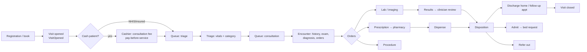
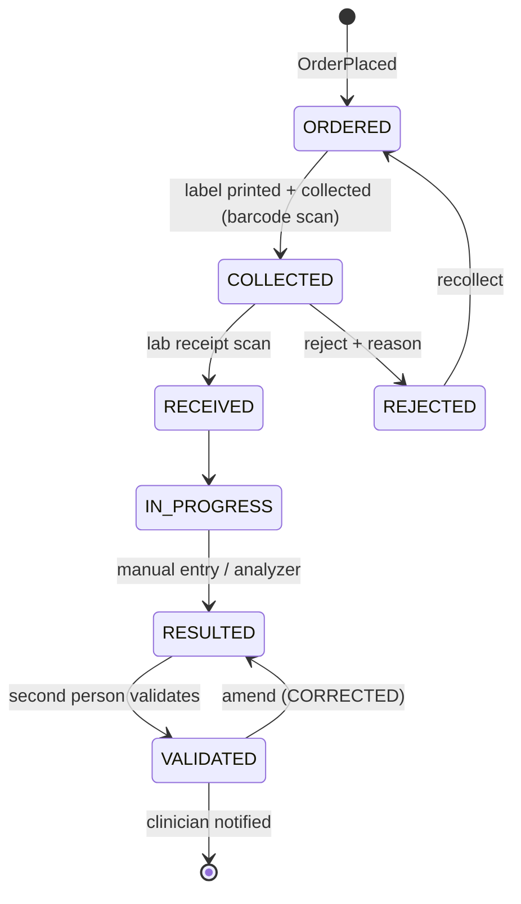

# 10 — Clinical Modules

Patients, appointments & OPD, admissions & beds, nursing, laboratory, radiology.
Conventions: [02](02-data-model.md) §1. Status vocabularies: [02](02-data-model.md) §5.
Event names: [01](01-architecture-and-setup.md) §4. Endpoints: [03](03-api-contract.md).

> **Clinical safety principles applied in every module below**
> 1. **Payment never blocks emergency care, STAT work, or clinical discharge.** Pay-before-service
>    applies only to routine cash-patient services and is overridable with an audited reason.
> 2. **Signed clinical content is amended, not edited** (ADR-011).
> 3. **Only licensed staff perform licensed acts** (ADR-004a) — checked server-side.
> 4. **Identify the patient twice** at point of care: name + MRN/DOB on every screen
>    (`PatientBanner`), barcode scan for specimens, medications and wristbands.
> 5. **Alerts must be actionable and overridable with a reason**; every override is audited.

---

## 1. Patient (MPI) — Sprint 7

### 1.1 Tables (V10, V11)

```sql
-- V10__patient_core.sql
CREATE FUNCTION immutable_unaccent(text) RETURNS text LANGUAGE sql IMMUTABLE PARALLEL SAFE
AS $$ SELECT public.unaccent('public.unaccent', $1) $$;

CREATE TABLE patient (
  id uuid PRIMARY KEY DEFAULT gen_random_uuid(),
  mrn varchar(20) NOT NULL,
  first_name varchar(100) NOT NULL, middle_name varchar(100), last_name varchar(100) NOT NULL,
  preferred_name varchar(100),
  sex varchar(10) NOT NULL CHECK (sex IN ('MALE','FEMALE','INTERSEX','UNKNOWN')),
  date_of_birth date, dob_estimated boolean NOT NULL DEFAULT false, estimated_age_years smallint,
  marital_status varchar(15) CHECK (marital_status IN ('SINGLE','MARRIED','DIVORCED','WIDOWED','SEPARATED','OTHER')),
  nationality varchar(60) DEFAULT 'Ghanaian', religion varchar(40), occupation varchar(100),
  blood_group varchar(4) CHECK (blood_group IN ('A+','A-','B+','B-','AB+','AB-','O+','O-')),
  phone varchar(25), phone_e164 varchar(16), alt_phone varchar(25), email varchar(255),
  address_line varchar(200), town varchar(100), district varchar(100), region varchar(60),
  digital_address varchar(20),                           -- Ghana Post GPS code
  photo_url varchar(255), photo_public_id varchar(255),
  status varchar(10) NOT NULL DEFAULT 'ACTIVE' CHECK (status IN ('ACTIVE','INACTIVE','DECEASED','MERGED')),
  merged_into_id uuid REFERENCES patient(id),
  deceased_at timestamptz,
  confidentiality varchar(10) NOT NULL DEFAULT 'NORMAL' CHECK (confidentiality IN ('NORMAL','RESTRICTED','VIP')),
  is_unidentified boolean NOT NULL DEFAULT false,        -- emergency "unknown patient" until identified
  registered_at timestamptz NOT NULL DEFAULT now(), registered_unit_id uuid REFERENCES org_unit(id),
  name_key text GENERATED ALWAYS AS (
     immutable_unaccent(lower(last_name || ' ' || first_name || ' ' || coalesce(middle_name,'')))) STORED,
  surname_phonetic text GENERATED ALWAYS AS (dmetaphone(last_name)) STORED,
  created_at timestamptz NOT NULL DEFAULT now(), created_by text, updated_at timestamptz NOT NULL DEFAULT now(),
  updated_by text, version int NOT NULL DEFAULT 0,
  CONSTRAINT patient_mrn_uq UNIQUE (mrn),
  CONSTRAINT patient_age_ck CHECK (date_of_birth IS NOT NULL OR estimated_age_years IS NOT NULL),
  CONSTRAINT patient_merge_ck CHECK ((status = 'MERGED') = (merged_into_id IS NOT NULL))
);
CREATE INDEX patient_name_trgm_ix ON patient USING gin (name_key gin_trgm_ops);
CREATE INDEX patient_phone_ix     ON patient(phone_e164);
CREATE INDEX patient_dob_ix       ON patient(date_of_birth);
CREATE INDEX patient_phonetic_ix  ON patient(surname_phonetic, date_of_birth);

CREATE TABLE patient_identifier (
  id uuid PRIMARY KEY DEFAULT gen_random_uuid(),
  patient_id uuid NOT NULL REFERENCES patient(id),
  id_type varchar(20) NOT NULL CHECK (id_type IN
    ('NHIS','GHANA_CARD','PASSPORT','DRIVERS_LICENCE','VOTER_ID','SSNIT','STAFF_ID','EXTERNAL_MRN')),
  id_value varchar(60) NOT NULL, issuer varchar(100), valid_to date,
  verified boolean NOT NULL DEFAULT false, verified_at timestamptz, verified_by text,
  status varchar(10) NOT NULL DEFAULT 'ACTIVE' CHECK (status IN ('ACTIVE','INACTIVE'))
);
CREATE UNIQUE INDEX patient_identifier_active_uq ON patient_identifier(id_type, id_value) WHERE status = 'ACTIVE';

CREATE TABLE patient_contact (
  id uuid PRIMARY KEY DEFAULT gen_random_uuid(),
  patient_id uuid NOT NULL REFERENCES patient(id),
  contact_type varchar(15) NOT NULL CHECK (contact_type IN ('NEXT_OF_KIN','EMERGENCY','GUARDIAN','EMPLOYER')),
  name varchar(150) NOT NULL, relationship varchar(40), phone varchar(25), address varchar(255),
  is_primary boolean NOT NULL DEFAULT false, can_consent boolean NOT NULL DEFAULT false
);

CREATE TABLE patient_allergy (
  id uuid PRIMARY KEY DEFAULT gen_random_uuid(),
  patient_id uuid NOT NULL REFERENCES patient(id),
  category varchar(8) NOT NULL CHECK (category IN ('DRUG','FOOD','LATEX','ENVIRON','OTHER')),
  substance varchar(150) NOT NULL, drug_id uuid,                -- FK to drug added in V15
  reaction varchar(200), severity varchar(18) CHECK (severity IN ('MILD','MODERATE','SEVERE','LIFE_THREATENING')),
  status varchar(18) NOT NULL DEFAULT 'ACTIVE' CHECK (status IN ('ACTIVE','RESOLVED','ENTERED_IN_ERROR')),
  noted_on date, recorded_by text NOT NULL, recorded_at timestamptz NOT NULL DEFAULT now()
);
CREATE INDEX patient_allergy_patient_ix ON patient_allergy(patient_id) WHERE status = 'ACTIVE';

CREATE TABLE patient_condition (                                  -- chronic / problem list
  id uuid PRIMARY KEY DEFAULT gen_random_uuid(),
  patient_id uuid NOT NULL REFERENCES patient(id),
  icd10_code varchar(10), description varchar(200) NOT NULL, onset_date date,
  is_chronic boolean NOT NULL DEFAULT false,
  status varchar(18) NOT NULL DEFAULT 'ACTIVE' CHECK (status IN ('ACTIVE','RESOLVED','ENTERED_IN_ERROR')),
  recorded_by text NOT NULL, recorded_at timestamptz NOT NULL DEFAULT now()
);

-- V11__patient_merge.sql
CREATE TABLE patient_merge_log (
  id uuid PRIMARY KEY DEFAULT gen_random_uuid(),
  survivor_id uuid NOT NULL REFERENCES patient(id), merged_id uuid NOT NULL REFERENCES patient(id),
  merged_by text NOT NULL, merged_at timestamptz NOT NULL DEFAULT now(),
  reason varchar(500) NOT NULL, snapshot jsonb NOT NULL,           -- full pre-merge demographics of both records
  CONSTRAINT patient_merge_distinct_ck CHECK (survivor_id <> merged_id)
);
CREATE TABLE patient_duplicate_candidate (
  id uuid PRIMARY KEY DEFAULT gen_random_uuid(),
  patient_a_id uuid NOT NULL REFERENCES patient(id), patient_b_id uuid NOT NULL REFERENCES patient(id),
  score numeric(4,3) NOT NULL, reasons text[] NOT NULL,
  status varchar(10) NOT NULL DEFAULT 'PENDING' CHECK (status IN ('PENDING','DISMISSED','MERGED')),
  reviewed_by text, reviewed_at timestamptz,
  CONSTRAINT patient_dup_pair_uq UNIQUE (patient_a_id, patient_b_id),
  CONSTRAINT patient_dup_order_ck CHECK (patient_a_id < patient_b_id)
);
CREATE TABLE patient_merge_task (                         -- one row per module that must re-point its rows
  id uuid PRIMARY KEY DEFAULT gen_random_uuid(),
  merge_log_id uuid NOT NULL REFERENCES patient_merge_log(id), module varchar(30) NOT NULL,
  status varchar(10) NOT NULL DEFAULT 'PENDING' CHECK (status IN ('PENDING','DONE','FAILED','MANUAL_REVIEW')),
  rows_moved int, last_error varchar(500), completed_at timestamptz,
  UNIQUE (merge_log_id, module)
);
```

### 1.2 Registration rules

| Rule | Detail |
|---|---|
| Required | Name, sex, DOB **or** estimated age (`dob_estimated`), at least one phone **or** next-of-kin |
| MRN | `MRN-YYYY-NNNNNN` via `next_doc_number('MRN', year)` (gapless) — barcode (Code 128) on card/wristband/labels |
| Consent | `TREATMENT` + `DATA_PROCESSING` recorded at registration; `SMS_CONTACT`/`INSURER_SHARING`/`PHOTOGRAPHY` optional ([02](02-data-model.md) §4.3). Minors (< `HAMS_MINOR_AGE_THRESHOLD`) need a guardian contact flagged `can_consent` |
| Identifiers | NHIS number & Ghana Card PIN validated for format, unique among ACTIVE identifiers; NHIS validity checked through the eligibility port (Sprint 16) |
| Unidentified patient | Emergency: create `is_unidentified = true` with generated placeholder name (`UNKNOWN MALE 20261012-03`); `identify()` later updates demographics (audited) or merges into an existing record |
| Death | `PatientDeceased` (from admission/encounter) → `status = DECEASED`, `deceased_at` set; booking new appointments is refused |
| Restricted/VIP | `confidentiality ≠ NORMAL` → search results show masked identity unless the user holds break-glass ([06](06-security-privacy-compliance.md) §4) |

### 1.3 Duplicate detection

`DuplicateDetector.findCandidates(draft)` runs on **create** and by a nightly sweep:

```sql
SELECT p.id,
       similarity(p.name_key, :key)                                              AS name_sim,
       (p.date_of_birth = :dob)                                                  AS dob_match,
       (p.phone_e164 = :phone)                                                   AS phone_match,
       (p.surname_phonetic = dmetaphone(:last_name))                             AS phonetic_match,
       EXISTS (SELECT 1 FROM patient_identifier i WHERE i.patient_id = p.id AND i.status='ACTIVE'
               AND (i.id_type, i.id_value) IN (:identifiers))                    AS id_match
FROM patient p
WHERE p.status IN ('ACTIVE','INACTIVE')
  AND (p.name_key % :key OR p.phone_e164 = :phone OR p.surname_phonetic = dmetaphone(:last_name))
```

```java
double score = id_match ? 1.0
  : 0.50*name_sim + 0.30*(dob_match?1:0) + 0.15*(phone_match?1:0) + 0.05*(phonetic_match?1:0);
// score >= 0.85  → BLOCK: registrar must open the existing record (or provide an audited override reason)
// 0.60 – 0.85    → WARN: show candidates; "none of these" is a recorded choice
```

Thresholds are configuration (`hams.patient.dup.block|warn`) and tuned during UAT with real
(anonymised) name distributions.

### 1.4 Merge procedure

1. `RECORDS_OFFICER` selects survivor + duplicate from `patient_duplicate_candidate` or search.
2. Pre-checks: not both with an OPEN admission; identifier conflicts resolved; no pending claim on both.
3. In one transaction: write `patient_merge_log` (snapshot), set duplicate `status = MERGED`,
   `merged_into_id`; union allergies/conditions (survivor wins on conflict); publish `PatientMerged(survivorId, mergedId)`.
4. Each module's `@ApplicationModuleListener` re-points **its own** rows (`UPDATE … SET patient_id = :survivor
   WHERE patient_id = :merged`) idempotently; a `merge_task` row per module tracks completion and
   alerts if a listener keeps failing (bills are *not* re-pointed if a claim is already submitted —
   they stay under the merged id with a pointer, and the claim is flagged for manual review).
5. Search by the old MRN returns the survivor with a banner. **Unmerge is not supported in v1**
   (restore from the snapshot is a documented manual runbook).

### 1.5 Tests (must exist)
Search finds "Kwame Mensah" for "Kwame Mensa" / "Mensah Kwame"; duplicate block at ≥ 0.85; unidentified → identify → merge;
merge re-points bills/encounters/appointments; restricted record read without break-glass → 403 + audit; MRN gapless under 50 concurrent registrations.

---

## 2. Appointments, Visits & OPD — Sprints 8–9

### 2.1 Tables

```sql
-- V12__charge_master.sql (owned by billing; needed now so visits/orders can reference services)
CREATE TABLE service_item (
  id uuid PRIMARY KEY DEFAULT gen_random_uuid(),
  code varchar(30) NOT NULL UNIQUE, name varchar(200) NOT NULL,
  category varchar(15) NOT NULL CHECK (category IN
    ('REGISTRATION','CONSULTATION','PROCEDURE','LAB','IMAGING','DRUG','CONSUMABLE','BED_DAY','NURSING','OTHER')),
  default_org_unit_id uuid REFERENCES org_unit(id),
  inventory_item_id uuid,                              -- FK added in V21 (drugs/consumables)
  nhis_tariff_code varchar(30), gdrg_code varchar(15), -- insurer mapping (Sprint 16)
  is_billable boolean NOT NULL DEFAULT true, allow_discount boolean NOT NULL DEFAULT true,
  active boolean NOT NULL DEFAULT true
);
CREATE TABLE price_list (
  id uuid PRIMARY KEY DEFAULT gen_random_uuid(),
  code varchar(20) NOT NULL UNIQUE, name varchar(100) NOT NULL,
  payer_type varchar(12) NOT NULL CHECK (payer_type IN ('CASH','NHIS','PRIVATE','CORPORATE','STAFF','EXEMPT')),
  payer_id uuid, currency char(3) NOT NULL DEFAULT 'GHS',
  is_default boolean NOT NULL DEFAULT false, active boolean NOT NULL DEFAULT true
);
CREATE TABLE price_list_item (
  id uuid PRIMARY KEY DEFAULT gen_random_uuid(),
  price_list_id uuid NOT NULL REFERENCES price_list(id), service_item_id uuid NOT NULL REFERENCES service_item(id),
  price numeric(14,2) NOT NULL CHECK (price >= 0),
  effective_from date NOT NULL, effective_to date,
  CONSTRAINT price_list_item_period_ck CHECK (effective_to IS NULL OR effective_to >= effective_from),
  CONSTRAINT price_list_item_overlap_ex EXCLUDE USING gist
    (price_list_id WITH =, service_item_id WITH =, daterange(effective_from, effective_to, '[]') WITH &&)
);

-- V13__appointment_visit.sql
CREATE TABLE clinic_session_template (
  id uuid PRIMARY KEY DEFAULT gen_random_uuid(),
  org_unit_id uuid NOT NULL REFERENCES org_unit(id),             -- a CLINIC unit
  provider_staff_id uuid REFERENCES staff(id),                   -- null = pooled clinic (any rostered clinician)
  weekday smallint NOT NULL CHECK (weekday BETWEEN 1 AND 7),     -- ISO: Mon=1
  start_time time NOT NULL, end_time time NOT NULL CHECK (end_time > start_time),
  slot_minutes smallint NOT NULL CHECK (slot_minutes BETWEEN 5 AND 120),
  capacity_per_slot smallint NOT NULL DEFAULT 1, overbook_limit smallint NOT NULL DEFAULT 0,
  consultation_service_id uuid REFERENCES service_item(id),
  valid_from date NOT NULL, valid_to date, active boolean NOT NULL DEFAULT true
);
CREATE TABLE appointment_slot (
  id uuid PRIMARY KEY DEFAULT gen_random_uuid(),
  template_id uuid REFERENCES clinic_session_template(id),
  org_unit_id uuid NOT NULL REFERENCES org_unit(id),
  provider_staff_id uuid REFERENCES staff(id), roster_entry_id uuid REFERENCES roster_entry(id),
  starts_at timestamptz NOT NULL, ends_at timestamptz NOT NULL,
  capacity smallint NOT NULL, booked_count smallint NOT NULL DEFAULT 0,
  status varchar(8) NOT NULL DEFAULT 'OPEN' CHECK (status IN ('OPEN','CLOSED','BLOCKED')),
  CONSTRAINT appointment_slot_booked_ck CHECK (booked_count >= 0),
  CONSTRAINT appointment_slot_uq UNIQUE NULLS NOT DISTINCT (org_unit_id, provider_staff_id, starts_at)
);
CREATE INDEX appointment_slot_open_ix ON appointment_slot(org_unit_id, starts_at) WHERE status = 'OPEN';

CREATE TABLE appointment (
  id uuid PRIMARY KEY DEFAULT gen_random_uuid(),
  patient_id uuid NOT NULL REFERENCES patient(id),
  slot_id uuid REFERENCES appointment_slot(id),
  org_unit_id uuid NOT NULL REFERENCES org_unit(id),
  provider_staff_id uuid REFERENCES staff(id),
  appointment_type varchar(10) NOT NULL CHECK (appointment_type IN ('NEW','FOLLOW_UP','REVIEW','PROCEDURE','WALK_IN')),
  scheduled_start timestamptz NOT NULL, scheduled_end timestamptz NOT NULL,
  status varchar(12) NOT NULL DEFAULT 'BOOKED' CHECK (status IN
    ('BOOKED','CONFIRMED','CHECKED_IN','IN_PROGRESS','COMPLETED','NO_SHOW','CANCELLED','RESCHEDULED')),
  reason varchar(300), booked_via varchar(12) NOT NULL DEFAULT 'FRONT_DESK'
    CHECK (booked_via IN ('FRONT_DESK','PHONE','ONLINE','REFERRAL','CLINIC')),
  booked_by text NOT NULL, cancelled_reason varchar(300), rescheduled_from_id uuid REFERENCES appointment(id),
  reminder_sent_at timestamptz, checked_in_at timestamptz, visit_id uuid,        -- FK to visit below
  CONSTRAINT appointment_patient_overlap_ex EXCLUDE USING gist
    (patient_id WITH =, tstzrange(scheduled_start, scheduled_end) WITH &&)
    WHERE (status IN ('BOOKED','CONFIRMED','CHECKED_IN','IN_PROGRESS'))
);

CREATE TABLE visit (
  id uuid PRIMARY KEY DEFAULT gen_random_uuid(),
  visit_no varchar(20) NOT NULL UNIQUE,
  patient_id uuid NOT NULL REFERENCES patient(id),
  visit_type varchar(10) NOT NULL CHECK (visit_type IN ('OPD','EMERGENCY','INPATIENT','DAY_CASE','OUTREACH')),
  visit_date date NOT NULL,
  payer_type varchar(12) NOT NULL DEFAULT 'CASH' CHECK (payer_type IN ('CASH','NHIS','PRIVATE','CORPORATE','STAFF','EXEMPT')),
  patient_insurance_id uuid,                                       -- FK added in V23
  exempt_reason varchar(100),
  registration_unit_id uuid REFERENCES org_unit(id), current_unit_id uuid REFERENCES org_unit(id),
  appointment_id uuid REFERENCES appointment(id), referral_id uuid,
  is_new_attendance boolean NOT NULL DEFAULT false,                -- DHIMS2: new vs re-attendance
  opened_at timestamptz NOT NULL DEFAULT now(), closed_at timestamptz,
  status varchar(10) NOT NULL DEFAULT 'OPEN' CHECK (status IN ('OPEN','CLOSED','ADMITTED','CANCELLED')),
  disposition varchar(20)
);
ALTER TABLE appointment ADD CONSTRAINT appointment_visit_fk FOREIGN KEY (visit_id) REFERENCES visit(id);
CREATE UNIQUE INDEX visit_one_open_opd_ux ON visit(patient_id, visit_date)
  WHERE visit_type = 'OPD' AND status = 'OPEN';

CREATE TABLE queue_ticket (
  id uuid PRIMARY KEY DEFAULT gen_random_uuid(),
  visit_id uuid NOT NULL REFERENCES visit(id), org_unit_id uuid NOT NULL REFERENCES org_unit(id),
  stage varchar(12) NOT NULL CHECK (stage IN ('CASHIER','TRIAGE','CONSULTATION','LAB','IMAGING','PHARMACY')),
  ticket_no varchar(10) NOT NULL, priority smallint NOT NULL DEFAULT 3 CHECK (priority BETWEEN 1 AND 4), -- 1 emergency
  status varchar(8) NOT NULL DEFAULT 'WAITING' CHECK (status IN ('WAITING','CALLED','SERVING','DONE','SKIPPED')),
  issued_at timestamptz NOT NULL DEFAULT now(), called_at timestamptz, started_at timestamptz, completed_at timestamptz,
  counter varchar(20), called_by text, recall_count smallint NOT NULL DEFAULT 0
);
CREATE INDEX queue_ticket_waiting_ix ON queue_ticket(org_unit_id, stage, priority, issued_at) WHERE status IN ('WAITING','CALLED');

CREATE TABLE triage_assessment (
  id uuid PRIMARY KEY DEFAULT gen_random_uuid(),
  visit_id uuid NOT NULL REFERENCES visit(id), assessed_by_staff_id uuid NOT NULL REFERENCES staff(id),
  assessed_at timestamptz NOT NULL DEFAULT now(),
  triage_category varchar(8) NOT NULL CHECK (triage_category IN ('RED','ORANGE','YELLOW','GREEN','BLUE')),
  chief_complaint varchar(300) NOT NULL, vital_sign_id uuid,                -- FK added in V14
  isolation_required boolean NOT NULL DEFAULT false, pregnant boolean, mobility varchar(15),
  notes text
);
```

### 2.2 OPD patient journey



- **Emergency:** `visit_type = EMERGENCY`, triage first, queue priority 1, **no payment gate**; bill accrues, patient may be unidentified.
- **Walk-in (no appointment):** creates an `appointment` of type `WALK_IN` (so reporting has one source of truth) with `slot_id = NULL`.
- **Visit auto-close:** `VisitSweepJob` closes OPD visits idle for > `HAMS_VISIT_AUTOCLOSE_HOURS` (default 18) with disposition `LEFT_WITHOUT_COMPLETION` so queues and open bills stay clean.

### 2.3 Slot generation from the duty roster (links workforce ↔ OPD)

A provider can only be booked when **rostered**. `SlotGenerator` (nightly + on `RosterEntryChanged`)
builds slots for the next `hams.appointment.horizon-days` (default 30):

```java
for (ClinicSessionTemplate t : templates.activeFor(date)) {
    List<RosterWindow> windows = t.providerId() != null
        ? roster.windowsFor(t.providerId(), date)                   // ACTIVE roster_entry covering the session
        : roster.pooledWindows(t.orgUnitId(), date, JobCategory.CLINICAL); // any rostered clinicians in the unit
    if (windows.isEmpty() || holidays.isHoliday(date) && !t.worksOnHolidays()) continue;
    for (Instant s = clip(t.start(date), windows).start(); s.plus(t.slot()).compareTo(windowEnd) <= 0; s = s.plus(t.slot())) {
        int capacity = t.providerId() != null ? t.capacityPerSlot()
                                              : t.capacityPerSlot() * windows.size();    // pooled clinic
        slots.upsert(t, s, s.plus(t.slot()), capacity, windows.first().entryId());
    }
}
```

When a roster entry is cancelled/moved (`RosterEntryChanged`), affected **future** slots are
closed; booked patients get a *re-book task* (`appointment.status` unchanged until the clerk
reschedules) and an SMS if consented — never silently dropped.

**Atomic booking** (no double-booking under concurrency):

```sql
UPDATE appointment_slot
   SET booked_count = booked_count + 1
 WHERE id = :slotId AND status = 'OPEN'
   AND booked_count < capacity + :overbookLimit
RETURNING id;          -- 0 rows → 409 SLOT_FULL
```

The patient-overlap exclusion constraint prevents the same patient holding two overlapping appointments.

### 2.4 Appointment rules
| Rule | Default |
|---|---|
| Cancel/reschedule cut-off | ≥ 2 h before start (front desk can override with reason) |
| Reminder | SMS 24 h before **only if** `SMS_CONTACT` consent is GRANTED; status → `SKIPPED_NO_CONSENT` otherwise |
| No-show | `NoShowSweepJob` marks `NO_SHOW` 30 min after `scheduled_end` without check-in; 3 no-shows in 6 months → flag on booking screen (never blocks) |
| Check-in | Opens the `visit`, applies the payer, captures consultation charge, issues queue ticket |
| Follow-up booking | Encounter disposition `FOLLOW_UP` + `follow_up_date` offers the next free slot with the same provider |

### 2.5 Encounter / OPD tables (V14)

```sql
-- V14__encounter.sql
CREATE TABLE icd10_code (
  code varchar(10) PRIMARY KEY, title varchar(300) NOT NULL, chapter varchar(10), block varchar(20),
  is_notifiable boolean NOT NULL DEFAULT false, sex_restriction varchar(6) CHECK (sex_restriction IN ('MALE','FEMALE')),
  active boolean NOT NULL DEFAULT true
);

CREATE TABLE encounter (
  id uuid PRIMARY KEY DEFAULT gen_random_uuid(),
  visit_id uuid NOT NULL REFERENCES visit(id), patient_id uuid NOT NULL REFERENCES patient(id),
  encounter_type varchar(15) NOT NULL CHECK (encounter_type IN
    ('TRIAGE','CONSULTATION','PROCEDURE','REVIEW','ED_CONSULT','WARD_ROUND','ANTENATAL','NURSING')),
  provider_staff_id uuid NOT NULL REFERENCES staff(id), org_unit_id uuid NOT NULL REFERENCES org_unit(id),
  started_at timestamptz NOT NULL DEFAULT now(), ended_at timestamptz,
  status varchar(16) NOT NULL DEFAULT 'OPEN' CHECK (status IN ('OPEN','SIGNED','ENTERED_IN_ERROR')),
  chief_complaint varchar(300),
  disposition varchar(20) CHECK (disposition IN
    ('DISCHARGED_HOME','ADMITTED','REFERRED_OUT','OBSERVATION','FOLLOW_UP','LAMA','DIED','LEFT_WITHOUT_BEING_SEEN')),
  follow_up_date date, signed_at timestamptz, signed_by_staff_id uuid REFERENCES staff(id),
  CONSTRAINT encounter_sign_ck CHECK ((status = 'SIGNED') = (signed_at IS NOT NULL))
);
CREATE INDEX encounter_patient_ix ON encounter(patient_id, started_at DESC);

CREATE TABLE clinical_note (
  id uuid PRIMARY KEY DEFAULT gen_random_uuid(),
  encounter_id uuid NOT NULL REFERENCES encounter(id), patient_id uuid NOT NULL REFERENCES patient(id),
  note_type varchar(15) NOT NULL CHECK (note_type IN
    ('HISTORY','EXAMINATION','SOAP','PROGRESS','PROCEDURE','CONSULT_RESPONSE','DISCHARGE','ADDENDUM')),
  body text NOT NULL, sensitivity varchar(10) NOT NULL DEFAULT 'NORMAL' CHECK (sensitivity IN ('NORMAL','SENSITIVE')),
  version int NOT NULL DEFAULT 1, amends_id uuid REFERENCES clinical_note(id),
  status varchar(16) NOT NULL DEFAULT 'DRAFT' CHECK (status IN ('DRAFT','SIGNED','ENTERED_IN_ERROR')),
  authored_by_staff_id uuid NOT NULL REFERENCES staff(id), authored_at timestamptz NOT NULL DEFAULT now(),
  signed_at timestamptz, signer_licence_no varchar(40)                    -- snapshot
);

CREATE TABLE vital_sign (
  id uuid PRIMARY KEY DEFAULT gen_random_uuid(),
  patient_id uuid NOT NULL REFERENCES patient(id), visit_id uuid REFERENCES visit(id),
  encounter_id uuid REFERENCES encounter(id), admission_id uuid,            -- FK added in V19
  recorded_at timestamptz NOT NULL DEFAULT now(), recorded_by_staff_id uuid NOT NULL REFERENCES staff(id),
  temperature_c numeric(4,1) CHECK (temperature_c BETWEEN 25 AND 45),
  pulse_bpm smallint CHECK (pulse_bpm BETWEEN 0 AND 300),
  resp_rate smallint CHECK (resp_rate BETWEEN 0 AND 100),
  systolic smallint CHECK (systolic BETWEEN 0 AND 300), diastolic smallint CHECK (diastolic BETWEEN 0 AND 200),
  spo2 smallint CHECK (spo2 BETWEEN 0 AND 100),
  weight_kg numeric(5,1), height_cm numeric(5,1),
  bmi numeric(4,1) GENERATED ALWAYS AS (CASE WHEN height_cm > 0 AND weight_kg > 0
        THEN round((weight_kg / ((height_cm/100)*(height_cm/100)))::numeric, 1) END) STORED,
  pain_score smallint CHECK (pain_score BETWEEN 0 AND 10),
  blood_glucose_mmol numeric(4,1), gcs smallint CHECK (gcs BETWEEN 3 AND 15),
  avpu varchar(1) CHECK (avpu IN ('A','V','P','U')), muac_cm numeric(4,1),
  ews_score smallint, ews_band varchar(8) CHECK (ews_band IN ('LOW','MEDIUM','HIGH')),
  source varchar(8) NOT NULL DEFAULT 'MANUAL' CHECK (source IN ('MANUAL','DEVICE'))
);
CREATE INDEX vital_sign_patient_ix ON vital_sign(patient_id, recorded_at DESC);
ALTER TABLE triage_assessment ADD CONSTRAINT triage_vital_fk FOREIGN KEY (vital_sign_id) REFERENCES vital_sign(id);

CREATE TABLE diagnosis (
  id uuid PRIMARY KEY DEFAULT gen_random_uuid(),
  encounter_id uuid NOT NULL REFERENCES encounter(id), patient_id uuid NOT NULL REFERENCES patient(id),
  icd10_code varchar(10) NOT NULL REFERENCES icd10_code(code), description varchar(300) NOT NULL,   -- snapshot of title
  diagnosis_type varchar(12) NOT NULL CHECK (diagnosis_type IN ('PRIMARY','SECONDARY','DIFFERENTIAL')),
  certainty varchar(12) NOT NULL DEFAULT 'PROVISIONAL' CHECK (certainty IN ('PROVISIONAL','CONFIRMED','RULED_OUT')),
  is_new_case boolean NOT NULL DEFAULT true, onset_date date,                -- DHIMS2 morbidity reporting
  status varchar(16) NOT NULL DEFAULT 'ACTIVE' CHECK (status IN ('ACTIVE','ENTERED_IN_ERROR')),
  noted_by_staff_id uuid NOT NULL REFERENCES staff(id), noted_at timestamptz NOT NULL DEFAULT now()
);
CREATE UNIQUE INDEX diagnosis_one_primary_ux ON diagnosis(encounter_id)
  WHERE diagnosis_type = 'PRIMARY' AND status = 'ACTIVE';

CREATE TABLE clinical_order (
  id uuid PRIMARY KEY DEFAULT gen_random_uuid(),
  order_no varchar(20) NOT NULL UNIQUE,
  encounter_id uuid NOT NULL REFERENCES encounter(id), patient_id uuid NOT NULL REFERENCES patient(id),
  visit_id uuid NOT NULL REFERENCES visit(id), admission_id uuid,
  order_type varchar(12) NOT NULL CHECK (order_type IN
    ('LAB','IMAGING','MEDICATION','PROCEDURE','REFERRAL','NURSING','CONSULT_REQUEST','DIET')),
  priority varchar(7) NOT NULL DEFAULT 'ROUTINE' CHECK (priority IN ('ROUTINE','URGENT','STAT')),
  status varchar(12) NOT NULL DEFAULT 'ORDERED' CHECK (status IN
    ('DRAFT','ORDERED','IN_PROGRESS','COMPLETED','CANCELLED','REJECTED')),
  service_item_id uuid REFERENCES service_item(id), quantity numeric(10,3) NOT NULL DEFAULT 1,
  clinical_indication varchar(500), notes text,
  payment_required boolean NOT NULL DEFAULT false, payment_cleared_at timestamptz,     -- pay-before-service gate
  ordered_by_staff_id uuid NOT NULL REFERENCES staff(id), ordered_at timestamptz NOT NULL DEFAULT now(),
  cancelled_by text, cancelled_reason varchar(300)
);
CREATE INDEX clinical_order_open_ix ON clinical_order(order_type, priority, ordered_at)
  WHERE status IN ('ORDERED','IN_PROGRESS');

CREATE TABLE referral (
  id uuid PRIMARY KEY DEFAULT gen_random_uuid(),
  patient_id uuid NOT NULL REFERENCES patient(id), visit_id uuid REFERENCES visit(id),
  direction varchar(3) NOT NULL CHECK (direction IN ('IN','OUT')),
  facility_name varchar(200), to_unit_id uuid REFERENCES org_unit(id), specialty varchar(100),
  urgency varchar(9) NOT NULL DEFAULT 'ROUTINE' CHECK (urgency IN ('ROUTINE','URGENT','EMERGENCY')),
  reason varchar(500) NOT NULL, summary_attachment_id uuid,
  status varchar(10) NOT NULL DEFAULT 'REQUESTED' CHECK (status IN ('REQUESTED','SENT','ACCEPTED','COMPLETED','CANCELLED')),
  created_by_staff_id uuid NOT NULL REFERENCES staff(id), created_at timestamptz NOT NULL DEFAULT now()
);
ALTER TABLE visit ADD CONSTRAINT visit_referral_fk FOREIGN KEY (referral_id) REFERENCES referral(id);

CREATE TABLE medical_certificate (
  id uuid PRIMARY KEY DEFAULT gen_random_uuid(),
  certificate_no varchar(20) NOT NULL UNIQUE, verification_code varchar(12) NOT NULL,
  patient_id uuid NOT NULL REFERENCES patient(id), encounter_id uuid NOT NULL REFERENCES encounter(id),
  cert_type varchar(12) NOT NULL CHECK (cert_type IN ('SICK_LEAVE','FITNESS','ATTENDANCE','MATERNITY')),
  from_date date NOT NULL, to_date date, remarks varchar(500),
  issued_by_staff_id uuid NOT NULL REFERENCES staff(id), issued_at timestamptz NOT NULL DEFAULT now()
);
```

### 2.6 Encounter rules (service layer)
1. **Sign** requires: licensed clinical author (ADR-004a), at least one *active* diagnosis (except `LEFT_WITHOUT_BEING_SEEN`), a disposition on the *last* encounter of the visit.
2. **Amend**: `POST /encounters/{id}/notes/{noteId}/amend` creates version *n+1* with `amends_id`; previous rows stay visible in history; `ADDENDUM` notes append without editing.
3. **Ordering safety** (`OrderSafetyService`, synchronous): allergy match (patient allergies × drug/ingredient), duplicate active order, drug-drug interaction (severity ≥ `MAJOR` is a *hard stop with reason*), pregnancy/age/weight dose checks (Sprint 15 for dosing). Each override → `audit_log(action='OVERRIDE')`.
4. **Early-warning score** is computed on vital-sign save from the facility's configured chart (`ews_policy` table seeded with the approved MEWS/NEWS2 parameters — *clinical governance signs off the numbers*); `HIGH` creates a `NursingTask` + in-app alert to the charge nurse/doctor.
5. **Disposition → ADMITTED** publishes `AdmissionRequested` (creates a `bed_request`, §3); **→ REFERRED_OUT** requires a `referral` row; **→ FOLLOW_UP** offers an appointment.
6. **Order cancellation** only while `ORDERED`; after work started it is a *request to cancel* routed to the performing department.
7. **Payment gate:** when `HAMS_PAY_BEFORE_SERVICE_OPD=true`, `payment_required` is set for cash/CASH-priced visits, **except** emergency visits, `priority = STAT`, and inpatients. Gate lifts on `PaymentConfirmed` (or an authorised override) and fires `OrderCleared`.

### 2.7 Tests (must exist)
Roster → slot generation (including a night-shift clinician not generating day slots; leave cancelling slots);
concurrent booking of the last slot (50 threads → exactly 1 success); patient double-booking rejected;
emergency visit orders never gated; sign without diagnosis → 422; amend keeps history; EWS band → task.

---

## 3. Admissions & Bed Management (ADT) — Sprint 12

### 3.1 Tables (V19)

```sql
-- V19__admission.sql
CREATE TABLE room (
  id uuid PRIMARY KEY DEFAULT gen_random_uuid(),
  org_unit_id uuid NOT NULL REFERENCES org_unit(id),                         -- the WARD
  code varchar(20) NOT NULL, room_type varchar(15) NOT NULL CHECK (room_type IN
    ('GENERAL_BAY','SIDE_ROOM','ISOLATION','ICU_BAY','LABOUR','NURSERY')),
  gender_policy varchar(6) NOT NULL DEFAULT 'MIXED' CHECK (gender_policy IN ('MIXED','MALE','FEMALE')),
  active boolean NOT NULL DEFAULT true, UNIQUE (org_unit_id, code)
);
CREATE TABLE bed (
  id uuid PRIMARY KEY DEFAULT gen_random_uuid(),
  room_id uuid NOT NULL REFERENCES room(id), org_unit_id uuid NOT NULL REFERENCES org_unit(id),
  bed_no varchar(15) NOT NULL,
  bed_class varchar(13) NOT NULL CHECK (bed_class IN
    ('GENERAL','SEMI_PRIVATE','PRIVATE','ICU','HDU','NICU','ISOLATION','MATERNITY')),
  service_item_id uuid REFERENCES service_item(id),                          -- daily bed charge
  status varchar(12) NOT NULL DEFAULT 'AVAILABLE' CHECK (status IN
    ('AVAILABLE','OCCUPIED','RESERVED','CLEANING','MAINTENANCE','BLOCKED')),
  status_changed_at timestamptz NOT NULL DEFAULT now(), active boolean NOT NULL DEFAULT true,
  UNIQUE (org_unit_id, bed_no)
);
CREATE TABLE bed_block (
  id uuid PRIMARY KEY DEFAULT gen_random_uuid(), bed_id uuid NOT NULL REFERENCES bed(id),
  reason varchar(20) NOT NULL CHECK (reason IN ('MAINTENANCE','INFECTION_CONTROL','CLEANING_DEEP','STAFFING','OTHER')),
  blocked_from timestamptz NOT NULL, blocked_to timestamptz, created_by text NOT NULL, note varchar(300)
);

CREATE TABLE bed_request (
  id uuid PRIMARY KEY DEFAULT gen_random_uuid(),
  patient_id uuid NOT NULL REFERENCES patient(id), visit_id uuid NOT NULL REFERENCES visit(id),
  requested_unit_id uuid REFERENCES org_unit(id), requested_class varchar(13),
  priority varchar(9) NOT NULL DEFAULT 'ROUTINE' CHECK (priority IN ('ROUTINE','URGENT','EMERGENCY')),
  isolation_required boolean NOT NULL DEFAULT false, clinical_summary varchar(500),
  requested_by_staff_id uuid NOT NULL REFERENCES staff(id), requested_at timestamptz NOT NULL DEFAULT now(),
  status varchar(10) NOT NULL DEFAULT 'PENDING' CHECK (status IN ('PENDING','ALLOCATED','CANCELLED','EXPIRED')),
  allocated_at timestamptz
);
CREATE INDEX bed_request_pending_ix ON bed_request(priority, requested_at) WHERE status = 'PENDING';

CREATE TABLE admission (
  id uuid PRIMARY KEY DEFAULT gen_random_uuid(),
  admission_no varchar(20) NOT NULL UNIQUE,
  patient_id uuid NOT NULL REFERENCES patient(id), visit_id uuid NOT NULL REFERENCES visit(id),
  bed_request_id uuid REFERENCES bed_request(id), admitting_encounter_id uuid REFERENCES encounter(id),
  attending_staff_id uuid NOT NULL REFERENCES staff(id), current_unit_id uuid NOT NULL REFERENCES org_unit(id),
  admission_type varchar(10) NOT NULL CHECK (admission_type IN ('EMERGENCY','ELECTIVE','TRANSFER_IN','MATERNITY','NEWBORN')),
  status varchar(16) NOT NULL DEFAULT 'PENDING_BED' CHECK (status IN
    ('PENDING_BED','ADMITTED','DISCHARGE_PLANNED','DISCHARGED','DECEASED','LAMA','ABSCONDED','REFERRED_OUT','CANCELLED')),
  admitted_at timestamptz, expected_discharge_date date, discharge_planned_at timestamptz,
  discharged_at timestamptz,
  discharge_type varchar(16) CHECK (discharge_type IN
    ('RECOVERED','IMPROVED','REFERRED_OUT','LAMA','ABSCONDED','DECEASED','TRANSFERRED_OUT')),
  primary_diagnosis_icd10 varchar(10) REFERENCES icd10_code(code),
  isolation_status varchar(10) NOT NULL DEFAULT 'NONE' CHECK (isolation_status IN ('NONE','CONTACT','DROPLET','AIRBORNE')),
  time_of_death timestamptz, cause_of_death_icd10 varchar(10) REFERENCES icd10_code(code),
  CONSTRAINT admission_dates_ck CHECK (discharged_at IS NULL OR discharged_at >= admitted_at)
);
CREATE UNIQUE INDEX admission_one_active_per_patient_ux ON admission(patient_id)
  WHERE status IN ('PENDING_BED','ADMITTED','DISCHARGE_PLANNED');
ALTER TABLE vital_sign ADD CONSTRAINT vital_admission_fk FOREIGN KEY (admission_id) REFERENCES admission(id);
ALTER TABLE clinical_order ADD CONSTRAINT order_admission_fk FOREIGN KEY (admission_id) REFERENCES admission(id);
ALTER TABLE prescription ADD CONSTRAINT prescription_admission_fk FOREIGN KEY (admission_id) REFERENCES admission(id);   -- V15 table
ALTER TABLE bill ADD CONSTRAINT bill_admission_fk FOREIGN KEY (admission_id) REFERENCES admission(id);                  -- V16 table
ALTER TABLE patient_deposit ADD CONSTRAINT patient_deposit_admission_fk FOREIGN KEY (admission_id) REFERENCES admission(id);

CREATE TABLE bed_assignment (                                                 -- append-only history
  id uuid PRIMARY KEY DEFAULT gen_random_uuid(),
  admission_id uuid NOT NULL REFERENCES admission(id), bed_id uuid NOT NULL REFERENCES bed(id),
  org_unit_id uuid NOT NULL REFERENCES org_unit(id),                          -- snapshot of the ward
  assigned_from timestamptz NOT NULL, assigned_to timestamptz,                -- null = current
  reason varchar(10) NOT NULL CHECK (reason IN ('ADMISSION','TRANSFER','ISOLATION','UPGRADE','DOWNGRADE','CLINICAL')),
  assigned_by text NOT NULL,
  CONSTRAINT bed_assignment_period_ck CHECK (assigned_to IS NULL OR assigned_to > assigned_from),
  CONSTRAINT bed_assignment_bed_overlap_ex EXCLUDE USING gist
    (bed_id WITH =, tstzrange(assigned_from, assigned_to) WITH &&),
  CONSTRAINT bed_assignment_adm_overlap_ex EXCLUDE USING gist
    (admission_id WITH =, tstzrange(assigned_from, assigned_to) WITH &&)
);

CREATE TABLE discharge_summary (
  id uuid PRIMARY KEY DEFAULT gen_random_uuid(),
  admission_id uuid NOT NULL REFERENCES admission(id),
  version int NOT NULL DEFAULT 1, amends_id uuid REFERENCES discharge_summary(id),
  discharge_diagnosis text NOT NULL, icd10_primary varchar(10) REFERENCES icd10_code(code),
  procedures text, hospital_course text NOT NULL, condition_at_discharge varchar(200) NOT NULL,
  discharge_medications text, follow_up_instructions text, follow_up_date date,
  status varchar(8) NOT NULL DEFAULT 'DRAFT' CHECK (status IN ('DRAFT','SIGNED')),
  authored_by_staff_id uuid NOT NULL REFERENCES staff(id), signed_at timestamptz,
  UNIQUE (admission_id, version)
);
```

### 3.2 Workflows & rules

| Flow | Behaviour |
|---|---|
| **Admission request** | `AdmissionRequested` (from encounter disposition or ED) → `bed_request` `PENDING` appears on the **bed-management board** ranked by priority → age |
| **Allocate** | Bed manager (UNIT_MANAGER / NURSE in charge) picks a bed; service checks **gender policy, isolation, class, bed status AVAILABLE** and atomically claims it: `UPDATE bed SET status='RESERVED' WHERE id=? AND status='AVAILABLE'` (0 rows → 409). Admission → `ADMITTED` on **arrival confirmation** (opens `bed_assignment`, bed → `OCCUPIED`, `PatientAdmitted`) |
| **Direct admission** (emergency) | Admission with `PENDING_BED` allowed without a bed (patient held in ED); counted in "boarders" KPI |
| **Transfer** | One transaction: close current assignment (`assigned_to = now`), open new; old bed → `CLEANING`; new bed → `OCCUPIED`; admission `current_unit_id` updated; `PatientTransferred`; the exclusion constraints make overlap impossible |
| **Bed cleaning** | `CLEANING → AVAILABLE` by nurse/housekeeping with timestamp; turnover time is a KPI |
| **Discharge** | Requires **signed discharge summary** (override: senior clinician + reason), medication reconciliation done (pharmacy), and sets `discharged_at`; bed → `CLEANING`. **Financial clearance is advisory** — unpaid balance routes to Accounts, it **never detains** the patient (clinical-safety principle 1) |
| **Death** | `PatientDeceased`: `time_of_death`, `cause_of_death_icd10`, certifying doctor; patient `DECEASED`; MAR/tasks cancelled; mortuary hand-off is post-v1 |
| **LAMA / absconded** | Recorded with reason and witness; notifies security/unit manager; bill closes normally |
| **Bed-day charging** | `BedDayAccrualJob` at 00:05 facility time posts one `bed_day` charge per occupied bed (midnight-census policy; admission-day policy configurable), idempotent on `(BED_DAY, admission_id + date)`; class change → rate of the bed occupied at midnight |
| **Isolation** | `isolation_status ≠ NONE` restricts allocation to `ISOLATION` rooms and flags the bed `RESERVED` after discharge until infection-control clears (`bed_block`) |
| **Deposits** | Cash/insured-with-copay admissions may require a deposit; recorded in billing (`patient_deposit`) and shown on the admission screen |

```java
@Transactional
public BedAssignment transfer(UUID admissionId, UUID toBedId, TransferReason reason) {
    Admission a = admissions.lockById(admissionId);                      // SELECT … FOR UPDATE
    a.requireStatus(ADMITTED, DISCHARGE_PLANNED);
    Bed to = beds.claimAvailable(toBedId)                                // UPDATE … WHERE status='AVAILABLE' RETURNING
                 .orElseThrow(() -> new BusinessRuleException("BED_NOT_AVAILABLE"));
    bedRules.check(a.patient(), to);                                     // gender, isolation, class
    Instant now = clock.instant();
    BedAssignment current = assignments.current(admissionId);
    current.close(now);
    beds.markCleaning(current.bedId(), now);
    BedAssignment next = assignments.save(BedAssignment.of(a, to, now, reason, currentUser()));
    a.moveTo(to.orgUnitId());
    events.publishEvent(new PatientTransferred(a.id(), current.bedId(), to.id(), now));
    return next;
}
```

### 3.3 Bed board & census
`GET /api/v1/wards/{id}/board` returns beds with occupant summary (name masked for restricted
patients), status, days-in, EWS band, isolation, expected discharge. The UI refreshes via
polling (15 s) or SSE. Daily census (00:00 snapshot) feeds `mv_bed_occupancy_daily`
([12](12-module-hr-payroll-reporting.md) §3): bed occupancy rate, average length of stay,
bed turnover rate, turnover interval, boarders.

### 3.4 Tests (must exist)
Two concurrent allocations of one bed → one wins; bed overlap impossible at DB level; male patient to female-only room rejected;
transfer round trip keeps single current assignment; discharge without summary rejected unless overridden; discharge with unpaid bill **succeeds**;
bed-day accrual idempotent when the job runs twice; death closes tasks.

---

## 4. Nursing — Sprint 13

### 4.1 Tables (V20)

```sql
-- V20__nursing.sql
CREATE TABLE nursing_assessment (
  id uuid PRIMARY KEY DEFAULT gen_random_uuid(),
  admission_id uuid NOT NULL REFERENCES admission(id), patient_id uuid NOT NULL REFERENCES patient(id),
  assessment_type varchar(16) NOT NULL CHECK (assessment_type IN
    ('ADMISSION','SHIFT','FALLS_RISK','PRESSURE_INJURY','NUTRITION','PAIN','DISCHARGE')),
  score numeric(5,1), risk_level varchar(8) CHECK (risk_level IN ('LOW','MEDIUM','HIGH')),
  form_data jsonb NOT NULL,                       -- versioned form payload; outcomes promoted to columns above
  form_version varchar(10) NOT NULL,
  assessed_by_staff_id uuid NOT NULL REFERENCES staff(id), assessed_at timestamptz NOT NULL DEFAULT now()
);
CREATE TABLE care_plan (
  id uuid PRIMARY KEY DEFAULT gen_random_uuid(),
  admission_id uuid NOT NULL REFERENCES admission(id), problem varchar(300) NOT NULL, goal varchar(300) NOT NULL,
  target_date date, status varchar(12) NOT NULL DEFAULT 'ACTIVE' CHECK (status IN ('ACTIVE','MET','DISCONTINUED')),
  created_by_staff_id uuid NOT NULL REFERENCES staff(id), created_at timestamptz NOT NULL DEFAULT now()
);
CREATE TABLE care_plan_task (
  id uuid PRIMARY KEY DEFAULT gen_random_uuid(),
  care_plan_id uuid REFERENCES care_plan(id), admission_id uuid NOT NULL REFERENCES admission(id),
  description varchar(300) NOT NULL, due_at timestamptz NOT NULL, recurrence varchar(20),   -- e.g. 'PT4H'
  status varchar(10) NOT NULL DEFAULT 'DUE' CHECK (status IN ('DUE','DONE','SKIPPED','OVERDUE','CANCELLED')),
  source varchar(10) NOT NULL DEFAULT 'MANUAL' CHECK (source IN ('MANUAL','EWS','ORDER','PROTOCOL')),
  completed_by_staff_id uuid REFERENCES staff(id), completed_at timestamptz, skip_reason varchar(200)
);
CREATE INDEX care_plan_task_due_ix ON care_plan_task(admission_id, due_at) WHERE status IN ('DUE','OVERDUE');

CREATE TABLE medication_administration (                                       -- the MAR
  id uuid PRIMARY KEY DEFAULT gen_random_uuid(),
  admission_id uuid NOT NULL REFERENCES admission(id),
  prescription_item_id uuid NOT NULL REFERENCES prescription_item(id),
  scheduled_at timestamptz NOT NULL,
  status varchar(10) NOT NULL DEFAULT 'SCHEDULED' CHECK (status IN ('SCHEDULED','GIVEN','HELD','REFUSED','MISSED')),
  is_prn boolean NOT NULL DEFAULT false,
  administered_at timestamptz, administered_by_staff_id uuid REFERENCES staff(id),
  witnessed_by_staff_id uuid REFERENCES staff(id),
  dose_given numeric(10,3), dose_unit varchar(15), route varchar(15), stock_batch_id uuid,   -- FK added in V21
  reason varchar(300), scan_verified boolean NOT NULL DEFAULT false,
  CONSTRAINT mar_slot_uq UNIQUE (prescription_item_id, scheduled_at),
  CONSTRAINT mar_given_ck CHECK (status <> 'GIVEN' OR (administered_at IS NOT NULL AND administered_by_staff_id IS NOT NULL))
);
CREATE INDEX mar_due_ix ON medication_administration(admission_id, scheduled_at) WHERE status = 'SCHEDULED';

CREATE TABLE intake_output (
  id uuid PRIMARY KEY DEFAULT gen_random_uuid(), admission_id uuid NOT NULL REFERENCES admission(id),
  recorded_at timestamptz NOT NULL, direction varchar(6) NOT NULL CHECK (direction IN ('INTAKE','OUTPUT')),
  category varchar(8) NOT NULL CHECK (category IN ('ORAL','IV','NG','URINE','DRAIN','VOMIT','STOOL','OTHER')),
  volume_ml numeric(7,1) NOT NULL CHECK (volume_ml >= 0), recorded_by_staff_id uuid NOT NULL REFERENCES staff(id)
);
CREATE TABLE nursing_note (
  id uuid PRIMARY KEY DEFAULT gen_random_uuid(), admission_id uuid NOT NULL REFERENCES admission(id),
  note_type varchar(10) NOT NULL CHECK (note_type IN ('SHIFT','INCIDENT','PROCEDURE','FAMILY','ADDENDUM')),
  body text NOT NULL, shift_type_id uuid REFERENCES shift_type(id),
  authored_by_staff_id uuid NOT NULL REFERENCES staff(id), authored_at timestamptz NOT NULL DEFAULT now(),
  amends_id uuid REFERENCES nursing_note(id)
);

CREATE TABLE shift_handover (
  id uuid PRIMARY KEY DEFAULT gen_random_uuid(),
  org_unit_id uuid NOT NULL REFERENCES org_unit(id),
  from_roster_date date NOT NULL, from_shift_type_id uuid NOT NULL REFERENCES shift_type(id),
  outgoing_staff_id uuid NOT NULL REFERENCES staff(id), incoming_staff_id uuid REFERENCES staff(id),
  status varchar(12) NOT NULL DEFAULT 'DRAFT' CHECK (status IN ('DRAFT','SUBMITTED','ACKNOWLEDGED')),
  summary text, submitted_at timestamptz, acknowledged_at timestamptz,
  UNIQUE (org_unit_id, from_roster_date, from_shift_type_id, outgoing_staff_id)
);
CREATE TABLE handover_item (                                                   -- SBAR per patient
  id uuid PRIMARY KEY DEFAULT gen_random_uuid(), handover_id uuid NOT NULL REFERENCES shift_handover(id) ON DELETE CASCADE,
  admission_id uuid NOT NULL REFERENCES admission(id),
  situation text, background text, assessment text, recommendation text,
  pending_tasks text, ews_band varchar(8), isolation boolean, falls_risk boolean, pressure_risk boolean
);

CREATE TABLE nurse_patient_allocation (
  id uuid PRIMARY KEY DEFAULT gen_random_uuid(),
  roster_entry_id uuid NOT NULL REFERENCES roster_entry(id),                  -- ties allocation to a real shift
  staff_id uuid NOT NULL REFERENCES staff(id), admission_id uuid NOT NULL REFERENCES admission(id),
  role varchar(9) NOT NULL DEFAULT 'PRIMARY' CHECK (role IN ('PRIMARY','ASSISTING')),
  allocated_from timestamptz NOT NULL, allocated_to timestamptz, allocated_by text NOT NULL,
  CONSTRAINT nurse_alloc_primary_ex EXCLUDE USING gist
    (admission_id WITH =, tstzrange(allocated_from, allocated_to) WITH &&) WHERE (role = 'PRIMARY')
);
```

### 4.2 Rules

| Area | Rule |
|---|---|
| **MAR generation** | On `PrescriptionIssued` for an admitted patient, `MarGenerator` creates `SCHEDULED` rows for the next 48 h from frequency (e.g. `BD`→08:00/20:00; `TDS`; `QID`; `Q6H`; `STAT`; PRN has no slots); regenerated on dose/frequency edits (future, unadministered rows only); the unique `(prescription_item_id, scheduled_at)` makes it idempotent |
| **Five rights at the bedside** | UI requires scanning the patient wristband (MRN) and the drug/batch label; mismatch blocks `GIVEN`; manual override requires a reason and sets `scan_verified = false` |
| **Controlled & high-alert drugs** | Second-nurse witness (`witnessed_by`) mandatory; writes the `controlled_drug_register` ([11](11-module-supply-and-revenue.md) §2.5) |
| **Timing windows** | Give within ±60 min (config); `MissedDoseJob` flags `SCHEDULED` rows > window + 2 h as `MISSED`, notifies the charge nurse; held/refused need a reason |
| **Allergy re-check** | At administration time against the *current* allergy list |
| **Vitals & EWS** | Inpatient vitals form is the same `vital_sign` row (`admission_id` set); EWS `HIGH` → `care_plan_task` (source `EWS`) + alert; frequency of observations follows the band (config) |
| **Allocation** | Charge nurse allocates **only staff with a current `roster_entry` in the unit** (and, when enforcement is on, an OPEN attendance record); patients-per-nurse above `unit.max_ratio` shows a warning (does not block) |
| **Handover** | `HandoverDraftJob` pre-fills at `planned_end − 30 min` of each shift from active admissions, open tasks, due MAR, EWS, isolation, risk flags. Outgoing nurse reviews/submits; incoming nurse acknowledges. **Soft link to attendance:** a nurse clocking out with an unsubmitted handover sees a reminder (never blocks the punch) |
| **Intake/output** | 24-h fluid balance computed per admission (day boundary = 07:00 facility time, config) |
| **Notes** | Append-only; corrections via `ADDENDUM`/`amends_id` |

### 4.3 Tests (must exist)
MAR idempotent regeneration; give without scan → flagged; controlled drug without witness → 422; missed-dose job; allocation to a nurse not rostered → 422;
handover pre-fill content; EWS HIGH → task; clock-out reminder when handover pending.

---

## 5. Laboratory — Sprint 11

### 5.1 Tables (V17)

```sql
-- V17__laboratory.sql
CREATE TABLE lab_test (
  id uuid PRIMARY KEY DEFAULT gen_random_uuid(),
  code varchar(20) NOT NULL UNIQUE, name varchar(150) NOT NULL, loinc_code varchar(15),
  department varchar(15) NOT NULL CHECK (department IN
    ('HAEMATOLOGY','CHEMISTRY','MICROBIOLOGY','SEROLOGY','PARASITOLOGY','URINALYSIS','HISTOLOGY','BLOOD_BANK','OTHER')),
  specimen_type varchar(20) NOT NULL, container varchar(30), min_volume_ml numeric(5,1),
  result_type varchar(8) NOT NULL CHECK (result_type IN ('NUMERIC','TEXT','CODED','PANEL')),
  unit varchar(20), decimals smallint DEFAULT 1,
  tat_routine_minutes int NOT NULL DEFAULT 240, tat_stat_minutes int NOT NULL DEFAULT 60,
  requires_fasting boolean NOT NULL DEFAULT false, collection_instructions varchar(300),
  service_item_id uuid REFERENCES service_item(id), active boolean NOT NULL DEFAULT true
);
CREATE TABLE lab_panel (
  id uuid PRIMARY KEY DEFAULT gen_random_uuid(), code varchar(20) NOT NULL UNIQUE, name varchar(150) NOT NULL,
  service_item_id uuid REFERENCES service_item(id), active boolean NOT NULL DEFAULT true
);
CREATE TABLE lab_panel_item (
  panel_id uuid NOT NULL REFERENCES lab_panel(id) ON DELETE CASCADE, test_id uuid NOT NULL REFERENCES lab_test(id),
  sort_order smallint NOT NULL DEFAULT 0, PRIMARY KEY (panel_id, test_id)
);
CREATE TABLE lab_reference_range (
  id uuid PRIMARY KEY DEFAULT gen_random_uuid(), test_id uuid NOT NULL REFERENCES lab_test(id),
  sex varchar(6) NOT NULL DEFAULT 'ANY' CHECK (sex IN ('ANY','MALE','FEMALE')),
  age_min_days int NOT NULL DEFAULT 0, age_max_days int NOT NULL DEFAULT 43800,
  low numeric(12,4), high numeric(12,4), critical_low numeric(12,4), critical_high numeric(12,4),
  unit varchar(20), range_text varchar(100),
  CONSTRAINT lab_ref_age_ck CHECK (age_max_days > age_min_days),
  CONSTRAINT lab_ref_overlap_ex EXCLUDE USING gist
    (test_id WITH =, sex WITH =, int4range(age_min_days, age_max_days, '[)') WITH &&)
);

CREATE TABLE lab_order (
  id uuid PRIMARY KEY DEFAULT gen_random_uuid(),
  order_id uuid NOT NULL UNIQUE REFERENCES clinical_order(id),
  lab_order_no varchar(20) NOT NULL UNIQUE,
  patient_id uuid NOT NULL REFERENCES patient(id), visit_id uuid NOT NULL REFERENCES visit(id),
  priority varchar(7) NOT NULL CHECK (priority IN ('ROUTINE','URGENT','STAT')),
  status varchar(10) NOT NULL DEFAULT 'ORDERED' CHECK (status IN ('ORDERED','PARTIAL','COMPLETE','CANCELLED')),
  clinical_notes varchar(500), collection_location_id uuid REFERENCES org_unit(id), ordered_at timestamptz NOT NULL
);
CREATE TABLE specimen (
  id uuid PRIMARY KEY DEFAULT gen_random_uuid(),
  accession_no varchar(20) NOT NULL UNIQUE,                                  -- barcode on the tube
  lab_order_id uuid NOT NULL REFERENCES lab_order(id),
  specimen_type varchar(20) NOT NULL, container varchar(30),
  status varchar(10) NOT NULL DEFAULT 'COLLECTED' CHECK (status IN ('COLLECTED','RECEIVED','REJECTED','STORED','DISCARDED')),
  collected_at timestamptz, collected_by_staff_id uuid REFERENCES staff(id),
  received_at timestamptz, received_by_staff_id uuid REFERENCES staff(id),
  rejection_reason varchar(15) CHECK (rejection_reason IN
    ('HAEMOLYSED','INSUFFICIENT','MISLABELLED','CLOTTED','WRONG_CONTAINER','DELAYED','CONTAMINATED','OTHER')),
  storage_location varchar(50)
);
CREATE TABLE lab_order_item (
  id uuid PRIMARY KEY DEFAULT gen_random_uuid(),
  lab_order_id uuid NOT NULL REFERENCES lab_order(id), test_id uuid NOT NULL REFERENCES lab_test(id),
  panel_id uuid REFERENCES lab_panel(id), specimen_id uuid REFERENCES specimen(id),
  status varchar(11) NOT NULL DEFAULT 'ORDERED' CHECK (status IN
    ('ORDERED','COLLECTED','RECEIVED','IN_PROGRESS','RESULTED','VALIDATED','REJECTED','CANCELLED')),
  UNIQUE (lab_order_id, test_id)
);
CREATE INDEX lab_item_worklist_ix ON lab_order_item(status) WHERE status IN ('ORDERED','COLLECTED','RECEIVED','IN_PROGRESS','RESULTED');

CREATE TABLE lab_result (
  id uuid PRIMARY KEY DEFAULT gen_random_uuid(),
  lab_order_item_id uuid NOT NULL REFERENCES lab_order_item(id),
  analyte_code varchar(20) NOT NULL,                                          -- = test code, or component for panels
  value_num numeric(14,4), value_text varchar(500), value_coded varchar(30),
  unit varchar(20), ref_low numeric(12,4), ref_high numeric(12,4), ref_text varchar(100),   -- snapshot at result time
  flag varchar(4) CHECK (flag IN ('N','L','H','LL','HH','A','POS','NEG')), is_critical boolean NOT NULL DEFAULT false,
  status varchar(11) NOT NULL DEFAULT 'PRELIMINARY' CHECK (status IN ('PRELIMINARY','FINAL','CORRECTED')),
  source varchar(8) NOT NULL DEFAULT 'MANUAL' CHECK (source IN ('MANUAL','ANALYZER')), instrument_id varchar(40),
  resulted_by_staff_id uuid NOT NULL REFERENCES staff(id), resulted_at timestamptz NOT NULL DEFAULT now(),
  validated_by_staff_id uuid REFERENCES staff(id), validated_at timestamptz,
  amends_id uuid REFERENCES lab_result(id), comment varchar(500),
  CONSTRAINT lab_result_value_ck CHECK (value_num IS NOT NULL OR value_text IS NOT NULL OR value_coded IS NOT NULL)
);
CREATE TABLE critical_result_notification (
  id uuid PRIMARY KEY DEFAULT gen_random_uuid(), source_type varchar(8) NOT NULL CHECK (source_type IN ('LAB','IMAGING')),
  source_id uuid NOT NULL, notified_to_staff_id uuid NOT NULL REFERENCES staff(id),
  notified_by_staff_id uuid NOT NULL REFERENCES staff(id), notified_at timestamptz NOT NULL DEFAULT now(),
  method varchar(8) NOT NULL CHECK (method IN ('PHONE','IN_APP','SMS','IN_PERSON')),
  read_back_confirmed boolean NOT NULL DEFAULT false, acknowledged_at timestamptz
);
```

### 5.2 Workflow



| Rule | Detail |
|---|---|
| **Pay-before-service** | Lab work-list marks cash orders `AWAITING_PAYMENT` until `OrderCleared`; **STAT/emergency/inpatient never gated** |
| **Accession & labels** | `LAB-YYYY-NNNNNN`; Code 128 label with accession, patient name/MRN, test, collection time; scan at collection and at receipt |
| **Flagging** | `ResultFlagger` picks the `lab_reference_range` for the patient's **sex and age in days at collection**, copies `ref_*` into the result row (snapshot), sets `N/L/H/LL/HH` and `is_critical` |
| **Delta check** | Compares with the last FINAL value for the same analyte (config % change); large deltas require an explicit confirm before validation |
| **Four-eyes** | `HAMS_LAB_REQUIRE_VALIDATION=true`: validator ≠ result enterer and holds an active scientist licence. Only `FINAL` results are visible to clinicians |
| **Critical results** | `CriticalResultRaised` → mandatory `critical_result_notification` with read-back; unacknowledged after `HAMS_CRITICAL_RESULT_ACK_MINUTES` escalates to the unit manager and on-call doctor |
| **Corrections** | New `lab_result` row `status = CORRECTED`, `amends_id` → previous; ordering clinician notified; old value retained |
| **Rejection** | `SpecimenRejected` creates a recollect task and notifies the ordering clinician/ward |
| **TAT** | Timestamps (ordered, collected, received, resulted, validated) feed `mv_lab_tat_daily`; breach vs `tat_*_minutes` shown on the work-list |
| **Analyzer interface** | `AnalyzerGateway` (ASTM/HL7 via an on-prem gateway) posts `PRELIMINARY` results keyed by accession + analyte; unmatched messages go to an *unmatched queue* — never auto-attached |
| **Reagents (stretch)** | `lab_test_consumable(test_id, item_id, qty)` deducts stock on validation (Sprint 14+) |

### 5.3 Tests (must exist)
Reference-range selection by sex/age boundaries (e.g. day 28 vs 29); critical flow incl. escalation clock; four-eyes enforcement; amend keeps history;
STAT bypasses payment; rejected specimen → recollect; analyzer message with unknown accession → unmatched queue.

---

## 6. Radiology / Imaging — Sprint 11

### 6.1 Tables (V18)

```sql
-- V18__radiology.sql
CREATE TABLE imaging_modality (
  id uuid PRIMARY KEY DEFAULT gen_random_uuid(), code varchar(8) NOT NULL UNIQUE,    -- XR, US, CT, MRI, MG, FL
  name varchar(60) NOT NULL, org_unit_id uuid REFERENCES org_unit(id), active boolean NOT NULL DEFAULT true
);
CREATE TABLE imaging_procedure (
  id uuid PRIMARY KEY DEFAULT gen_random_uuid(), code varchar(20) NOT NULL UNIQUE, name varchar(150) NOT NULL,
  modality_id uuid NOT NULL REFERENCES imaging_modality(id), body_part varchar(60),
  uses_contrast boolean NOT NULL DEFAULT false, ionising boolean NOT NULL DEFAULT true,
  pregnancy_sensitive boolean NOT NULL DEFAULT false, est_duration_min smallint NOT NULL DEFAULT 15,
  prep_instructions varchar(500), service_item_id uuid REFERENCES service_item(id), active boolean NOT NULL DEFAULT true
);
CREATE TABLE imaging_order (
  id uuid PRIMARY KEY DEFAULT gen_random_uuid(),
  order_id uuid NOT NULL UNIQUE REFERENCES clinical_order(id), accession_no varchar(20) NOT NULL UNIQUE,
  patient_id uuid NOT NULL REFERENCES patient(id), visit_id uuid NOT NULL REFERENCES visit(id),
  procedure_id uuid NOT NULL REFERENCES imaging_procedure(id),
  laterality varchar(9) CHECK (laterality IN ('LEFT','RIGHT','BILATERAL','NA')),
  priority varchar(7) NOT NULL CHECK (priority IN ('ROUTINE','URGENT','STAT')),
  clinical_indication varchar(500) NOT NULL,
  status varchar(11) NOT NULL DEFAULT 'ORDERED' CHECK (status IN
    ('ORDERED','SCHEDULED','IN_PROGRESS','REPORTED','VERIFIED','CANCELLED')),
  scheduled_at timestamptz, performed_at timestamptz, performed_by_staff_id uuid REFERENCES staff(id),
  pregnancy_checked boolean, contrast_allergy_checked boolean, renal_function_checked boolean,
  transport_required boolean NOT NULL DEFAULT false
);
CREATE TABLE imaging_study (
  id uuid PRIMARY KEY DEFAULT gen_random_uuid(), imaging_order_id uuid NOT NULL REFERENCES imaging_order(id),
  study_instance_uid varchar(128) NOT NULL UNIQUE, viewer_url varchar(500), image_count int, received_at timestamptz NOT NULL DEFAULT now()
);
CREATE TABLE imaging_report (
  id uuid PRIMARY KEY DEFAULT gen_random_uuid(), imaging_order_id uuid NOT NULL REFERENCES imaging_order(id),
  version int NOT NULL DEFAULT 1, addendum_of_id uuid REFERENCES imaging_report(id),
  findings text NOT NULL, impression text NOT NULL, critical_finding boolean NOT NULL DEFAULT false,
  status varchar(11) NOT NULL DEFAULT 'PRELIMINARY' CHECK (status IN ('PRELIMINARY','FINAL','ADDENDUM')),
  reported_by_staff_id uuid NOT NULL REFERENCES staff(id), reported_at timestamptz NOT NULL DEFAULT now(),
  verified_by_staff_id uuid REFERENCES staff(id), verified_at timestamptz, UNIQUE (imaging_order_id, version)
);
```

### 6.2 Rules

| Area | Rule |
|---|---|
| **Safety checklist** before `IN_PROGRESS` | `pregnancy_checked` (female 10–55 y for ionising, configurable), `contrast_allergy_checked` and `renal_function_checked` when `uses_contrast`; missing item blocks the *start* (radiographer may record "not applicable" with a reason) |
| **Scheduling** | CT/MRI/US get `scheduled_at` against a modality room's capacity (`org_unit` + opening roster); X-ray is walk-in worklist ordered by priority |
| **Performed → report** | Radiographer marks performed; study link arrives via `PacsGateway` (or is typed in); radiologists' **reporting queue** is sorted STAT → URGENT → oldest |
| **Reporting & verification** | Reporter must hold `RADIOLOGIST` role + licence; `VERIFIED` needs a second signature when `HAMS_RAD_REQUIRE_VERIFY=true`; amendments are `ADDENDUM` versions |
| **Critical findings** | Same `critical_result_notification` flow as lab (read-back, 30-min acknowledgement) |
| **Images** | HAMS stores **links only** (`imaging_study`); no DICOM storage in v1 |
| **Payment gate / TAT** | As laboratory |

### 6.3 Tests (must exist)
Contrast without allergy/renal check → blocked; pregnancy check for a 28-year-old female on CT abdomen; reporting-queue ordering; addendum versioning; critical finding escalation.
