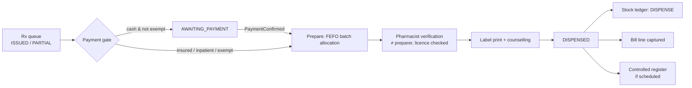
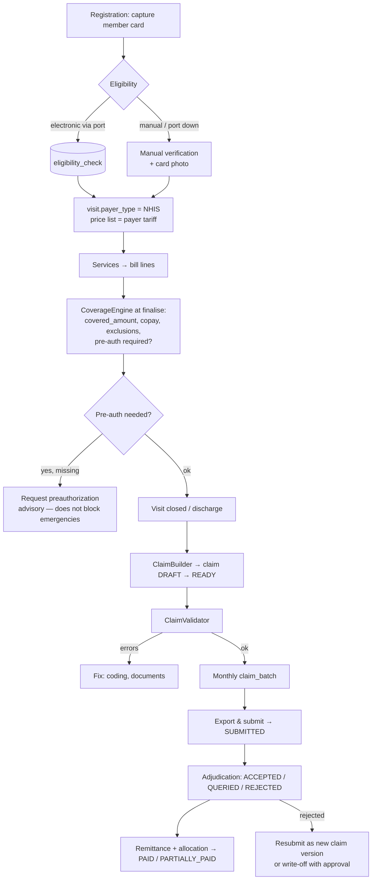

# 11 — Supply & Revenue Modules

Inventory, pharmacy, billing (patient money) and insurance (NHIS & private payers).
Conventions: [02](02-data-model.md) §1. Statuses: [02](02-data-model.md) §5. Events: [01](01-architecture-and-setup.md) §4.

> **Money invariants (apply everywhere below)**
> 1. Amounts are `numeric(14,2)` / `BigDecimal`, rounded `HALF_EVEN` **per line**; totals are sums of rounded lines.
> 2. Prices are **snapshotted** on the line (`unit_price`, `description`) — later price-list edits never change history.
> 3. Money movements and stock movements are **append-only ledgers**; corrections are compensating entries (ADR-010).
> 4. Every state change that moves money needs **maker ≠ checker** above a configured threshold (reuse the existing
>    `payments` approval pattern: creator cannot approve).
> 5. Tax (VAT/levies) treatment of any taxable items is **to be confirmed with Finance**; v1 prices are treated as
>    tax-inclusive and tax lines are post-v1.

---

## 1. Inventory & Procurement — Sprint 14

### 1.1 Tables (V21)

```sql
-- V21__inventory.sql
CREATE TABLE store (
  id uuid PRIMARY KEY DEFAULT gen_random_uuid(),
  code varchar(20) NOT NULL UNIQUE, name varchar(100) NOT NULL,
  store_type varchar(12) NOT NULL CHECK (store_type IN ('MAIN','PHARMACY','WARD','LAB','RADIOLOGY','THEATRE','GENERAL')),
  org_unit_id uuid REFERENCES org_unit(id), parent_store_id uuid REFERENCES store(id),
  is_dispensing boolean NOT NULL DEFAULT false, active boolean NOT NULL DEFAULT true
);
CREATE TABLE item_category (
  id uuid PRIMARY KEY DEFAULT gen_random_uuid(), code varchar(20) NOT NULL UNIQUE, name varchar(100) NOT NULL,
  parent_id uuid REFERENCES item_category(id)
);
CREATE TABLE item (
  id uuid PRIMARY KEY DEFAULT gen_random_uuid(),
  code varchar(30) NOT NULL UNIQUE, name varchar(200) NOT NULL,
  item_type varchar(12) NOT NULL CHECK (item_type IN ('DRUG','CONSUMABLE','REAGENT','EQUIPMENT','GENERAL')),
  category_id uuid REFERENCES item_category(id),
  uom varchar(15) NOT NULL, pack_size numeric(10,2) NOT NULL DEFAULT 1,        -- smallest dispensable unit
  is_batch_tracked boolean NOT NULL DEFAULT true, is_expiry_tracked boolean NOT NULL DEFAULT true,
  is_controlled boolean NOT NULL DEFAULT false,
  storage_condition varchar(10) NOT NULL DEFAULT 'AMBIENT' CHECK (storage_condition IN ('AMBIENT','COLD_CHAIN','FROZEN')),
  reorder_level numeric(14,3) NOT NULL DEFAULT 0, reorder_qty numeric(14,3) NOT NULL DEFAULT 0, max_level numeric(14,3),
  active boolean NOT NULL DEFAULT true
);
ALTER TABLE service_item ADD CONSTRAINT service_item_inventory_fk FOREIGN KEY (inventory_item_id) REFERENCES item(id);
ALTER TABLE drug ADD CONSTRAINT drug_inventory_fk FOREIGN KEY (inventory_item_id) REFERENCES item(id);

CREATE TABLE supplier (
  id uuid PRIMARY KEY DEFAULT gen_random_uuid(),
  code varchar(20) NOT NULL UNIQUE, name varchar(200) NOT NULL, tin varchar(20),
  contact_name varchar(100), phone varchar(25), email varchar(255), address varchar(255),
  payment_terms_days smallint NOT NULL DEFAULT 30, momo_number varchar(20), bank_details varchar(255),
  active boolean NOT NULL DEFAULT true
);
CREATE TABLE stock_batch (
  id uuid PRIMARY KEY DEFAULT gen_random_uuid(),
  store_id uuid NOT NULL REFERENCES store(id), item_id uuid NOT NULL REFERENCES item(id),
  batch_no varchar(40), expiry_date date, unit_cost numeric(14,4) NOT NULL CHECK (unit_cost >= 0),
  qty_on_hand numeric(14,3) NOT NULL DEFAULT 0, qty_reserved numeric(14,3) NOT NULL DEFAULT 0,
  status varchar(10) NOT NULL DEFAULT 'ACTIVE' CHECK (status IN ('ACTIVE','QUARANTINE','EXPIRED','RECALLED')),
  received_at timestamptz NOT NULL DEFAULT now(), supplier_id uuid REFERENCES supplier(id),
  CONSTRAINT stock_batch_qty_ck CHECK (qty_on_hand >= 0 AND qty_reserved >= 0 AND qty_reserved <= qty_on_hand),
  CONSTRAINT stock_batch_uq UNIQUE NULLS NOT DISTINCT (store_id, item_id, batch_no, expiry_date)
);
CREATE INDEX stock_batch_fefo_ix ON stock_batch(store_id, item_id, expiry_date NULLS LAST) WHERE status = 'ACTIVE' AND qty_on_hand > 0;
ALTER TABLE medication_administration ADD CONSTRAINT mar_batch_fk FOREIGN KEY (stock_batch_id) REFERENCES stock_batch(id);

CREATE TABLE stock_ledger (                                                   -- append-only
  id uuid PRIMARY KEY DEFAULT gen_random_uuid(), occurred_at timestamptz NOT NULL DEFAULT now(),
  store_id uuid NOT NULL REFERENCES store(id), item_id uuid NOT NULL REFERENCES item(id),
  batch_id uuid NOT NULL REFERENCES stock_batch(id),
  txn_type varchar(16) NOT NULL CHECK (txn_type IN
    ('GRN','TRANSFER_OUT','TRANSFER_IN','DISPENSE','DISPENSE_RETURN','CONSUMPTION',
     'ADJUST_IN','ADJUST_OUT','WRITE_OFF','STOCK_TAKE_ADJ','QUARANTINE')),
  qty_delta numeric(14,3) NOT NULL CHECK (qty_delta <> 0), unit_cost numeric(14,4) NOT NULL,
  balance_after numeric(14,3) NOT NULL,                                        -- batch balance after this entry
  ref_type varchar(20) NOT NULL, ref_id uuid NOT NULL, line_no int NOT NULL DEFAULT 1,
  reason varchar(300), created_by text NOT NULL,
  CONSTRAINT stock_ledger_ref_uq UNIQUE (ref_type, ref_id, line_no, batch_id, txn_type)    -- idempotent postings
);
CREATE INDEX stock_ledger_item_ix ON stock_ledger(store_id, item_id, occurred_at DESC);

CREATE TABLE requisition (
  id uuid PRIMARY KEY DEFAULT gen_random_uuid(), req_no varchar(20) NOT NULL UNIQUE,
  from_store_id uuid NOT NULL REFERENCES store(id),                            -- requester
  to_store_id uuid NOT NULL REFERENCES store(id),                              -- issuer
  status varchar(10) NOT NULL DEFAULT 'DRAFT' CHECK (status IN ('DRAFT','SUBMITTED','APPROVED','ISSUED','RECEIVED','REJECTED','CANCELLED')),
  requested_by text NOT NULL, approved_by text, issued_by text, received_by text, note varchar(300),
  requested_at timestamptz NOT NULL DEFAULT now(), CONSTRAINT requisition_stores_ck CHECK (from_store_id <> to_store_id)
);
CREATE TABLE requisition_line (
  id uuid PRIMARY KEY DEFAULT gen_random_uuid(), requisition_id uuid NOT NULL REFERENCES requisition(id) ON DELETE CASCADE,
  item_id uuid NOT NULL REFERENCES item(id), qty_requested numeric(14,3) NOT NULL CHECK (qty_requested > 0),
  qty_approved numeric(14,3), qty_issued numeric(14,3), qty_received numeric(14,3), UNIQUE (requisition_id, item_id)
);

CREATE TABLE purchase_order (
  id uuid PRIMARY KEY DEFAULT gen_random_uuid(), po_no varchar(20) NOT NULL UNIQUE,
  supplier_id uuid NOT NULL REFERENCES supplier(id), store_id uuid NOT NULL REFERENCES store(id),
  status varchar(18) NOT NULL DEFAULT 'DRAFT' CHECK (status IN
    ('DRAFT','APPROVED','SENT','PARTIALLY_RECEIVED','RECEIVED','CLOSED','CANCELLED')),
  order_date date NOT NULL, expected_date date, currency char(3) NOT NULL DEFAULT 'GHS',
  total_amount numeric(14,2) NOT NULL DEFAULT 0, created_by text NOT NULL, approved_by text, approved_at timestamptz
);
CREATE TABLE purchase_order_line (
  id uuid PRIMARY KEY DEFAULT gen_random_uuid(), purchase_order_id uuid NOT NULL REFERENCES purchase_order(id) ON DELETE CASCADE,
  item_id uuid NOT NULL REFERENCES item(id), qty_ordered numeric(14,3) NOT NULL CHECK (qty_ordered > 0),
  unit_price numeric(14,4) NOT NULL CHECK (unit_price >= 0), qty_received numeric(14,3) NOT NULL DEFAULT 0
);
CREATE TABLE goods_received_note (
  id uuid PRIMARY KEY DEFAULT gen_random_uuid(), grn_no varchar(20) NOT NULL UNIQUE,
  purchase_order_id uuid REFERENCES purchase_order(id), supplier_id uuid NOT NULL REFERENCES supplier(id),
  store_id uuid NOT NULL REFERENCES store(id), delivery_note_no varchar(40), invoice_no varchar(40),
  status varchar(10) NOT NULL DEFAULT 'DRAFT' CHECK (status IN ('DRAFT','POSTED','CANCELLED')),
  received_by text NOT NULL, received_at timestamptz NOT NULL DEFAULT now(), posted_at timestamptz
);
CREATE TABLE grn_line (
  id uuid PRIMARY KEY DEFAULT gen_random_uuid(), grn_id uuid NOT NULL REFERENCES goods_received_note(id) ON DELETE CASCADE,
  po_line_id uuid REFERENCES purchase_order_line(id), item_id uuid NOT NULL REFERENCES item(id),
  batch_no varchar(40), expiry_date date, qty_received numeric(14,3) NOT NULL CHECK (qty_received > 0),
  qty_rejected numeric(14,3) NOT NULL DEFAULT 0, unit_cost numeric(14,4) NOT NULL, reject_reason varchar(200)
);
CREATE TABLE stock_take (
  id uuid PRIMARY KEY DEFAULT gen_random_uuid(), store_id uuid NOT NULL REFERENCES store(id),
  take_type varchar(10) NOT NULL CHECK (take_type IN ('FULL','CYCLE','CONTROLLED')),
  status varchar(10) NOT NULL DEFAULT 'OPEN' CHECK (status IN ('OPEN','COUNTED','APPROVED','POSTED','CANCELLED')),
  snapshot_at timestamptz NOT NULL, started_by text NOT NULL, approved_by text, posted_at timestamptz
);
CREATE TABLE stock_take_line (
  id uuid PRIMARY KEY DEFAULT gen_random_uuid(), stock_take_id uuid NOT NULL REFERENCES stock_take(id) ON DELETE CASCADE,
  batch_id uuid NOT NULL REFERENCES stock_batch(id), system_qty numeric(14,3) NOT NULL, counted_qty numeric(14,3),
  variance numeric(14,3) GENERATED ALWAYS AS (counted_qty - system_qty) STORED, reason varchar(200),
  UNIQUE (stock_take_id, batch_id)
);
CREATE TABLE supplier_invoice (
  id uuid PRIMARY KEY DEFAULT gen_random_uuid(), supplier_id uuid NOT NULL REFERENCES supplier(id),
  invoice_no varchar(40) NOT NULL, invoice_date date NOT NULL, due_date date NOT NULL,
  purchase_order_id uuid REFERENCES purchase_order(id), grn_id uuid REFERENCES goods_received_note(id),
  amount numeric(14,2) NOT NULL, match_status varchar(10) NOT NULL DEFAULT 'UNMATCHED' CHECK (match_status IN ('MATCHED','VARIANCE','UNMATCHED')),
  status varchar(10) NOT NULL DEFAULT 'RECEIVED' CHECK (status IN ('RECEIVED','APPROVED','PAYMENT_BATCHED','PAID','DISPUTED')),
  payment_id uuid REFERENCES payments(id),                                       -- existing payout engine
  UNIQUE (supplier_id, invoice_no)
);
```

### 1.2 Posting stock (the only write path)

All stock changes go through `StockService.post(...)`; **no module updates `stock_batch` directly.**

```java
@Transactional
public StockPosting post(StockMovement m) {
    // 1. atomic, never-negative balance update
    int rows = jdbc.update("""
        UPDATE stock_batch SET qty_on_hand = qty_on_hand + :delta
         WHERE id = :batch AND qty_on_hand + :delta >= 0 AND (:delta > 0 OR qty_on_hand - qty_reserved + :delta >= 0)
        """, params(m));
    if (rows == 0) throw new BusinessRuleException("INSUFFICIENT_STOCK");
    // 2. ledger row; UNIQUE(ref_type, ref_id, line_no, batch_id, txn_type) makes replays a no-op
    ledger.insertIgnoringDuplicate(m.toLedgerRow(balanceAfter(m.batchId())));
    // 3. low-stock signal
    if (belowReorder(m.storeId(), m.itemId())) events.publishEvent(new StockBelowReorderLevel(m.storeId(), m.itemId()));
    return ...;
}
```

A nightly `LedgerReconciliationJob` asserts `Σ ledger.qty_delta = stock_batch.qty_on_hand` per batch and raises an alert on any difference.

### 1.3 Rules

| Area | Rule |
|---|---|
| **FEFO** | Picking sorts by `expiry_date NULLS LAST, received_at`; user may override with a reason (audited) |
| **Receiving (GRN)** | Batch + expiry mandatory for `is_batch_tracked/is_expiry_tracked`; refuse items with < `HAMS_MIN_SHELF_LIFE_DAYS` remaining unless approved; posting creates `GRN` ledger rows; PO status recomputed (`PARTIALLY_RECEIVED`/`RECEIVED`) |
| **Inter-store transfer** | Two-step: **issue** posts `TRANSFER_OUT` (stock becomes *in transit*), **receive** posts `TRANSFER_IN`; the in-transit view = Σ(out) − Σ(in) per requisition, and differences > 0 after 48 h alert both stores |
| **Requisitions** | Ward/department sub-stores replenish from MAIN; the issuer can approve less than requested; suggested lines from `reorder_level` (par-level replenishment) |
| **Reorder & expiry** | `ReorderPointJob`: `Σ on-hand (store) ≤ reorder_level` → suggested PO / requisition. `ExpiryAlertJob`: 90/60/30-day alerts; expired batches auto `EXPIRED` and blocked from picking |
| **Recall / quarantine** | `status = QUARANTINE|RECALLED` immediately excludes the batch; a recall report lists patients who received it (dispense_item → patient) |
| **Stock-take** | `snapshot_at` fixed; counts entered blind; variance posted as `STOCK_TAKE_ADJ` after approval (threshold by value — above it needs HOSPITAL_ADMIN); controlled items use `CONTROLLED` takes with two counters |
| **Write-off** | Expiry/damage `WRITE_OFF` needs reason + approver ≠ requester |
| **Procurement approval** | `purchase_order.total_amount` tiers (config): store keeper < tier 1; PROCUREMENT_OFFICER < tier 2; HOSPITAL_ADMIN above; creator ≠ approver |
| **3-way match** | PO line price × GRN received qty vs `supplier_invoice.amount` within tolerance → `MATCHED`; else `VARIANCE` with a reviewer. Approved invoices are added to a **payout batch** (`payments` with category `SUPPLIER`, recipients = suppliers' MoMo/bank) reusing the existing approval + MoMo engine |
| **Valuation** | Weighted-average per item per store from batch costs; `mv_stock_valuation` for finance; moving cost = GRN cost (no landed-cost allocation in v1) |
| **Barcode** | Item and batch labels via ZXing (Code 128/GS1-128 when supplied by manufacturer); scanning supported on GRN, issue, dispense, stock-take |

### 1.4 Tests (must exist)
100 concurrent dispenses of the last unit (exactly one succeeds, ledger = on-hand); replaying a posting is a no-op; transfer in-transit math; FEFO ordering with NULL expiries;
3-way match tolerance; recall excludes batch; reconciliation job detects a manual DB edit.

---

## 2. Pharmacy — prescribing Sprint 9, dispensing Sprint 15

### 2.1 Prescribing tables (V15)

```sql
-- V15__prescribing.sql
CREATE TABLE drug (
  id uuid PRIMARY KEY DEFAULT gen_random_uuid(),
  generic_name varchar(200) NOT NULL, brand_name varchar(200),
  form varchar(15) NOT NULL CHECK (form IN
    ('TABLET','CAPSULE','SYRUP','SUSPENSION','INJECTION','IV_FLUID','CREAM','OINTMENT','DROPS','INHALER','SUPPOSITORY','OTHER')),
  strength_value numeric(12,4), strength_unit varchar(15), strength_text varchar(60),
  default_route varchar(15), atc_code varchar(10),
  inventory_item_id uuid,                                              -- FK to item added in V21
  nhis_listed boolean NOT NULL DEFAULT false, essential_list boolean NOT NULL DEFAULT false,
  controlled_class varchar(10) NOT NULL DEFAULT 'NONE' CHECK (controlled_class IN ('NONE','SCHEDULE_2','SCHEDULE_3','SCHEDULE_4')),
  is_high_alert boolean NOT NULL DEFAULT false, is_antibiotic boolean NOT NULL DEFAULT false,
  otc_allowed boolean NOT NULL DEFAULT false, max_daily_dose numeric(12,3), dose_unit varchar(15),
  pregnancy_category varchar(2), active boolean NOT NULL DEFAULT true
);
CREATE INDEX drug_name_trgm_ix ON drug USING gin ((lower(generic_name || ' ' || coalesce(brand_name,''))) gin_trgm_ops);
ALTER TABLE patient_allergy ADD CONSTRAINT patient_allergy_drug_fk FOREIGN KEY (drug_id) REFERENCES drug(id);

CREATE TABLE drug_interaction (
  id uuid PRIMARY KEY DEFAULT gen_random_uuid(),
  generic_a varchar(200) NOT NULL, generic_b varchar(200) NOT NULL,
  severity varchar(16) NOT NULL CHECK (severity IN ('MINOR','MODERATE','MAJOR','CONTRAINDICATED')),
  effect varchar(500), management varchar(500), source varchar(100),
  CONSTRAINT drug_interaction_order_ck CHECK (generic_a < generic_b), UNIQUE (generic_a, generic_b)
);

CREATE TABLE prescription (
  id uuid PRIMARY KEY DEFAULT gen_random_uuid(), rx_no varchar(20) NOT NULL UNIQUE,
  order_id uuid UNIQUE REFERENCES clinical_order(id),
  encounter_id uuid NOT NULL REFERENCES encounter(id), patient_id uuid NOT NULL REFERENCES patient(id),
  visit_id uuid NOT NULL REFERENCES visit(id), admission_id uuid,                 -- FK to admission added in V19
  prescriber_staff_id uuid NOT NULL REFERENCES staff(id), prescriber_licence_no varchar(40),   -- snapshot
  status varchar(20) NOT NULL DEFAULT 'DRAFT' CHECK (status IN
    ('DRAFT','ISSUED','PARTIALLY_DISPENSED','DISPENSED','CANCELLED','EXPIRED')),
  issued_at timestamptz, valid_until date, notes varchar(500)
);
CREATE INDEX prescription_queue_ix ON prescription(issued_at) WHERE status IN ('ISSUED','PARTIALLY_DISPENSED');

CREATE TABLE prescription_item (
  id uuid PRIMARY KEY DEFAULT gen_random_uuid(),
  prescription_id uuid NOT NULL REFERENCES prescription(id) ON DELETE CASCADE, drug_id uuid NOT NULL REFERENCES drug(id),
  dose numeric(10,3) NOT NULL, dose_unit varchar(15) NOT NULL,
  frequency_code varchar(8) NOT NULL CHECK (frequency_code IN
    ('OD','BD','TDS','QID','Q4H','Q6H','Q8H','Q12H','NOCTE','STAT','PRN','WEEKLY')),
  route varchar(15) NOT NULL, duration_days smallint, quantity_prescribed numeric(12,3) NOT NULL CHECK (quantity_prescribed > 0),
  quantity_dispensed numeric(12,3) NOT NULL DEFAULT 0, is_prn boolean NOT NULL DEFAULT false, prn_reason varchar(200),
  instructions varchar(300), indication varchar(200), substitution_allowed boolean NOT NULL DEFAULT true,
  start_at timestamptz, stop_at timestamptz,
  status varchar(10) NOT NULL DEFAULT 'ACTIVE' CHECK (status IN ('ACTIVE','COMPLETED','STOPPED','CANCELLED')),
  stopped_reason varchar(200), alert_override_reason varchar(300),
  CONSTRAINT rx_item_qty_ck CHECK (quantity_dispensed <= quantity_prescribed)
);
```

### 2.2 Prescribing rules (`OrderSafetyService`, synchronous)
| Check | Behaviour |
|---|---|
| Allergy | Patient allergy × drug (and ingredient class) → **hard stop with override reason** for `SEVERE`/`LIFE_THREATENING`, warning otherwise |
| Interaction | Against the patient's **active** prescription items + new item; `CONTRAINDICATED`/`MAJOR` → stop with reason; `MODERATE` → warn |
| Duplicate therapy | Same generic active in another Rx → warn |
| Dose range | `max_daily_dose` (computed from dose × frequency); paediatric weight-based dosing when weight is recorded (config-driven rules; clinical governance approves) |
| Stewardship | `is_antibiotic` requires `indication`; reports per prescriber |
| Formulary | Non-formulary (`inventory_item_id` null/inactive) needs a reason; stock availability shown at ordering ("in stock at Pharmacy: 120") |
| Pregnancy/age | Warn on contraindicated categories for pregnant patients |
| Validity | `valid_until = issued_at + HAMS_PRESCRIPTION_VALID_DAYS`; `RxExpiryJob` sets `EXPIRED` |

Every override writes `audit_log(action='OVERRIDE')` and stores `alert_override_reason` on the item.

### 2.3 Dispensing tables (V22)

```sql
-- V22__pharmacy_dispensing.sql
CREATE TABLE dispense (
  id uuid PRIMARY KEY DEFAULT gen_random_uuid(), dispense_no varchar(20) NOT NULL UNIQUE,
  sale_type varchar(12) NOT NULL DEFAULT 'PRESCRIPTION' CHECK (sale_type IN ('PRESCRIPTION','OTC','WARD_SUPPLY')),
  prescription_id uuid REFERENCES prescription(id), patient_id uuid REFERENCES patient(id),
  visit_id uuid REFERENCES visit(id), admission_id uuid REFERENCES admission(id),
  store_id uuid NOT NULL REFERENCES store(id),
  status varchar(10) NOT NULL DEFAULT 'DRAFT' CHECK (status IN ('DRAFT','VERIFIED','DISPENSED','CANCELLED')),
  payment_status varchar(14) NOT NULL DEFAULT 'NOT_REQUIRED' CHECK (payment_status IN ('NOT_REQUIRED','AWAITING','CLEARED','OVERRIDDEN')),
  prepared_by_staff_id uuid REFERENCES staff(id), verified_by_staff_id uuid REFERENCES staff(id),
  dispensed_at timestamptz, counselled boolean NOT NULL DEFAULT false,
  CONSTRAINT dispense_rx_ck CHECK (sale_type <> 'PRESCRIPTION' OR prescription_id IS NOT NULL),
  CONSTRAINT dispense_verify_ck CHECK (status <> 'DISPENSED' OR verified_by_staff_id IS NOT NULL)
);
CREATE TABLE dispense_item (
  id uuid PRIMARY KEY DEFAULT gen_random_uuid(), dispense_id uuid NOT NULL REFERENCES dispense(id) ON DELETE CASCADE,
  prescription_item_id uuid REFERENCES prescription_item(id), drug_id uuid NOT NULL REFERENCES drug(id),
  stock_batch_id uuid NOT NULL REFERENCES stock_batch(id), quantity numeric(12,3) NOT NULL CHECK (quantity > 0),
  unit_price numeric(14,2) NOT NULL, substituted_for_drug_id uuid REFERENCES drug(id), label_text varchar(500)
);
CREATE TABLE dispense_return (
  id uuid PRIMARY KEY DEFAULT gen_random_uuid(), dispense_item_id uuid NOT NULL REFERENCES dispense_item(id),
  quantity numeric(12,3) NOT NULL CHECK (quantity > 0), reason varchar(300) NOT NULL,
  returned_by text NOT NULL, accepted_by_staff_id uuid NOT NULL REFERENCES staff(id), restock boolean NOT NULL DEFAULT false,
  returned_at timestamptz NOT NULL DEFAULT now()
);
CREATE TABLE controlled_drug_register (                                       -- append-only, one running balance per store+item
  id uuid PRIMARY KEY DEFAULT gen_random_uuid(), entry_no bigint GENERATED ALWAYS AS IDENTITY,
  store_id uuid NOT NULL REFERENCES store(id), item_id uuid NOT NULL REFERENCES item(id),
  batch_id uuid REFERENCES stock_batch(id), occurred_at timestamptz NOT NULL DEFAULT now(),
  txn_type varchar(12) NOT NULL CHECK (txn_type IN ('RECEIPT','DISPENSE','ADMINISTER','WASTE','TRANSFER','RETURN','ADJUSTMENT')),
  qty_delta numeric(12,3) NOT NULL, balance_after numeric(12,3) NOT NULL,
  patient_id uuid REFERENCES patient(id), prescription_item_id uuid REFERENCES prescription_item(id),
  performed_by_staff_id uuid NOT NULL REFERENCES staff(id), witnessed_by_staff_id uuid REFERENCES staff(id), note varchar(300),
  CONSTRAINT cd_witness_ck CHECK (txn_type IN ('RECEIPT','ADJUSTMENT') OR witnessed_by_staff_id IS NOT NULL)
);
CREATE TABLE pharmacy_intervention (
  id uuid PRIMARY KEY DEFAULT gen_random_uuid(), prescription_id uuid NOT NULL REFERENCES prescription(id),
  pharmacist_staff_id uuid NOT NULL REFERENCES staff(id),
  type varchar(14) NOT NULL CHECK (type IN ('DOSE_ADJUST','SUBSTITUTION','CLARIFICATION','REJECTION','INTERACTION','STOCKOUT')),
  description varchar(500) NOT NULL, outcome varchar(200), prescriber_notified_at timestamptz,
  created_at timestamptz NOT NULL DEFAULT now()
);
CREATE TABLE ward_stock_issue (                                                -- named-patient / floor-stock supply to wards
  id uuid PRIMARY KEY DEFAULT gen_random_uuid(), from_store_id uuid NOT NULL REFERENCES store(id),
  to_store_id uuid NOT NULL REFERENCES store(id), admission_id uuid REFERENCES admission(id),
  item_id uuid NOT NULL REFERENCES item(id), batch_id uuid NOT NULL REFERENCES stock_batch(id),
  quantity numeric(12,3) NOT NULL CHECK (quantity > 0), issued_by_staff_id uuid NOT NULL REFERENCES staff(id),
  issued_at timestamptz NOT NULL DEFAULT now()
);
```

### 2.4 Dispensing workflow



| Rule | Detail |
|---|---|
| **Partial dispensing** | Allowed; `quantity_dispensed` accumulates; Rx → `PARTIALLY_DISPENSED` until complete; stock-outs create a `STOCKOUT` intervention and a note on the label ("balance to be bought outside") |
| **Substitution** | Only when `substitution_allowed`; pharmacist records `substituted_for_drug_id` and an intervention; prescriber notified |
| **Verification** | `verified_by` must be an active `PHARMACIST` with licence; technicians may prepare but not verify; controlled drugs need a witness |
| **Near-expiry** | Batches inside `HAMS_NEAR_EXPIRY_BLOCK_DISPENSE_DAYS` are excluded from allocation |
| **Inpatients** | v1 = **named-patient supply**: pharmacy dispenses for the admission → `ward_stock_issue` + ward sub-store; nurses administer against the MAR (MAR row may reference `stock_batch_id`). Floor stock is replenished by requisition and reconciled at stock-take |
| **Returns** | Sealed, in-date, unbroken returns may be restocked (`restock = true` → `DISPENSE_RETURN` ledger + `credit_note`); otherwise write-off |
| **OTC / retail** | `sale_type = OTC` allowed only for `otc_allowed` drugs; walk-in patient may be anonymous (`patient_id` null) with immediate payment |
| **Posting** | `DispenseCompleted` → `StockService.post(DISPENSE)` per item (idempotent key = dispense_item id) → billing listener captures lines (idempotent on `(DISPENSE, dispense_item_id)`) |
| **Labels** | Patient, drug, strength, dose, frequency, route, quantity, expiry, date, pharmacy; auxiliary warnings; ZXing barcode of `dispense_item.id` |

### 2.5 Controlled-drug register
Append-only with a **running balance per store+item** (`balance_after`), written in the same transaction as the stock posting
(`controlled_drug_register` row ↔ `stock_ledger` row, same `ref`). `cd_witness_ck` makes an unwitnessed dispense/administer/waste impossible.
A daily `CONTROLLED` stock-take by two staff compares physical vs register; any discrepancy opens an incident (notification to HOSPITAL_ADMIN + pharmacist-in-charge).
The register is **never editable**; errors are reversed by `ADJUSTMENT` with approver.

### 2.6 Tests (must exist)
Allergy hard-stop and override audit; interaction severity matrix; FEFO + near-expiry exclusion; partial dispense accumulation; unverified dispense rejected (DB check too);
controlled dispense without witness rejected; dispense replay posts once; returns restock credit; Rx expiry job.

---

## 3. Billing (patient revenue) — charge master Sprint 8, core Sprint 10

Not to be confused with `payments` (staff payout batches, ADR-014).

### 3.1 Tables (V16)

```sql
-- V16__billing_core.sql   (service_item, price_list, price_list_item were created in V12)
CREATE TABLE bill (
  id uuid PRIMARY KEY DEFAULT gen_random_uuid(),
  bill_no varchar(20) NOT NULL UNIQUE,
  patient_id uuid NOT NULL REFERENCES patient(id),
  visit_id uuid REFERENCES visit(id), admission_id uuid,                          -- FK to admission added in V19
  payer_type varchar(12) NOT NULL CHECK (payer_type IN ('CASH','NHIS','PRIVATE','CORPORATE','STAFF','EXEMPT')),
  patient_insurance_id uuid, price_list_id uuid NOT NULL REFERENCES price_list(id),
  currency char(3) NOT NULL DEFAULT 'GHS',
  status varchar(15) NOT NULL DEFAULT 'OPEN' CHECK (status IN
    ('OPEN','FINALISED','PARTIALLY_PAID','PAID','CANCELLED','WRITTEN_OFF')),
  gross_amount numeric(14,2) NOT NULL DEFAULT 0, discount_amount numeric(14,2) NOT NULL DEFAULT 0,
  waiver_amount numeric(14,2) NOT NULL DEFAULT 0,
  insurer_amount numeric(14,2) NOT NULL DEFAULT 0, insurer_paid_amount numeric(14,2) NOT NULL DEFAULT 0,
  patient_amount numeric(14,2) NOT NULL DEFAULT 0,       -- = gross − discount − waiver − insurer
  paid_amount numeric(14,2) NOT NULL DEFAULT 0, deposit_applied numeric(14,2) NOT NULL DEFAULT 0,
  balance numeric(14,2) GENERATED ALWAYS AS (patient_amount - paid_amount - deposit_applied) STORED,
  finalised_at timestamptz, finalised_by text, version int NOT NULL DEFAULT 0,
  created_at timestamptz NOT NULL DEFAULT now(), created_by text,
  CONSTRAINT bill_amounts_ck CHECK (gross_amount >= 0 AND patient_amount >= 0 AND paid_amount >= 0)
);
CREATE INDEX bill_patient_ix ON bill(patient_id, created_at DESC);
CREATE INDEX bill_outstanding_ix ON bill(status) WHERE status IN ('FINALISED','PARTIALLY_PAID');

CREATE TABLE bill_line (
  id uuid PRIMARY KEY DEFAULT gen_random_uuid(), bill_id uuid NOT NULL REFERENCES bill(id) ON DELETE CASCADE,
  line_no int NOT NULL, service_item_id uuid NOT NULL REFERENCES service_item(id), description varchar(300) NOT NULL,
  source_type varchar(10) NOT NULL CHECK (source_type IN ('VISIT','ORDER','DISPENSE','BED_DAY','PROCEDURE','MANUAL')),
  source_id uuid, quantity numeric(10,3) NOT NULL CHECK (quantity > 0),
  unit_price numeric(14,2) NOT NULL, gross_amount numeric(14,2) NOT NULL,
  discount_amount numeric(14,2) NOT NULL DEFAULT 0, covered_amount numeric(14,2) NOT NULL DEFAULT 0,   -- insurer portion
  patient_amount numeric(14,2) NOT NULL,
  status varchar(8) NOT NULL DEFAULT 'BILLED' CHECK (status IN ('PENDING','BILLED','VOIDED')),
  price_flag varchar(14) CHECK (price_flag IN ('PRICE_MISSING','PRICE_OVERRIDDEN')),
  service_date date NOT NULL, performed_unit_id uuid REFERENCES org_unit(id),
  voided_by text, voided_reason varchar(300),
  UNIQUE (bill_id, line_no)
);
CREATE UNIQUE INDEX bill_line_source_ux ON bill_line(source_type, source_id)
  WHERE source_id IS NOT NULL AND status <> 'VOIDED';                          -- idempotent charge capture

CREATE TABLE cashier_session (
  id uuid PRIMARY KEY DEFAULT gen_random_uuid(),
  cashier_user_id text NOT NULL, till_code varchar(20) NOT NULL,
  opened_at timestamptz NOT NULL DEFAULT now(), opening_float numeric(14,2) NOT NULL DEFAULT 0,
  closed_at timestamptz, expected_cash numeric(14,2), counted_cash numeric(14,2),
  variance numeric(14,2) GENERATED ALWAYS AS (counted_cash - expected_cash) STORED,
  status varchar(10) NOT NULL DEFAULT 'OPEN' CHECK (status IN ('OPEN','CLOSED','RECONCILED')),
  reconciled_by text, reconciled_at timestamptz, note varchar(300)
);
CREATE UNIQUE INDEX cashier_session_one_open_ux ON cashier_session(cashier_user_id) WHERE status = 'OPEN';

CREATE TABLE patient_payment (
  id uuid PRIMARY KEY DEFAULT gen_random_uuid(),
  idempotency_key varchar(60) NOT NULL UNIQUE,
  bill_id uuid NOT NULL REFERENCES bill(id), patient_id uuid NOT NULL REFERENCES patient(id),
  method varchar(14) NOT NULL CHECK (method IN ('CASH','MOMO','CARD','BANK_TRANSFER','CHEQUE','DEPOSIT')),
  amount numeric(14,2) NOT NULL CHECK (amount > 0), currency char(3) NOT NULL DEFAULT 'GHS',
  status varchar(10) NOT NULL DEFAULT 'PENDING' CHECK (status IN ('PENDING','CONFIRMED','FAILED','REVERSED')),
  tendered numeric(14,2), change_given numeric(14,2),
  momo_reference_id varchar(100), momo_phone varchar(20), provider_status varchar(20), provider_checked_at timestamptz,
  cashier_session_id uuid REFERENCES cashier_session(id),
  received_by text NOT NULL, received_at timestamptz NOT NULL DEFAULT now(),
  reversal_of_id uuid REFERENCES patient_payment(id), reversal_reason varchar(300),
  CONSTRAINT payment_cash_session_ck CHECK (method <> 'CASH' OR cashier_session_id IS NOT NULL)
);
CREATE TABLE cashier_ledger (                                                  -- append-only
  id uuid PRIMARY KEY DEFAULT gen_random_uuid(), cashier_session_id uuid NOT NULL REFERENCES cashier_session(id),
  occurred_at timestamptz NOT NULL DEFAULT now(),
  entry_type varchar(14) NOT NULL CHECK (entry_type IN ('PAYMENT_IN','REFUND_OUT','FLOAT_IN','SAFE_DROP','REVERSAL','VARIANCE_ADJ')),
  method varchar(14) NOT NULL, amount numeric(14,2) NOT NULL, ref_type varchar(20), ref_id uuid, created_by text NOT NULL
);
CREATE TABLE receipt (
  id uuid PRIMARY KEY DEFAULT gen_random_uuid(), receipt_no varchar(20) NOT NULL UNIQUE,
  patient_payment_id uuid NOT NULL UNIQUE REFERENCES patient_payment(id), bill_id uuid NOT NULL REFERENCES bill(id),
  issued_at timestamptz NOT NULL DEFAULT now(), printed_count smallint NOT NULL DEFAULT 0,
  voided boolean NOT NULL DEFAULT false, pdf_attachment_id uuid
);
CREATE TABLE patient_deposit (
  id uuid PRIMARY KEY DEFAULT gen_random_uuid(), patient_id uuid NOT NULL REFERENCES patient(id),
  admission_id uuid, amount numeric(14,2) NOT NULL CHECK (amount > 0),
  balance numeric(14,2) NOT NULL CHECK (balance >= 0), received_payment_id uuid REFERENCES patient_payment(id),
  status varchar(10) NOT NULL DEFAULT 'ACTIVE' CHECK (status IN ('ACTIVE','APPLIED','REFUNDED'))
);
CREATE TABLE refund (
  id uuid PRIMARY KEY DEFAULT gen_random_uuid(), patient_payment_id uuid REFERENCES patient_payment(id),
  deposit_id uuid REFERENCES patient_deposit(id), bill_id uuid REFERENCES bill(id),
  amount numeric(14,2) NOT NULL CHECK (amount > 0), reason varchar(300) NOT NULL,
  status varchar(10) NOT NULL DEFAULT 'REQUESTED' CHECK (status IN ('REQUESTED','APPROVED','PAID','REJECTED')),
  requested_by text NOT NULL, approved_by text, paid_via varchar(14), cashier_session_id uuid REFERENCES cashier_session(id),
  CONSTRAINT refund_four_eyes_ck CHECK (approved_by IS NULL OR approved_by <> requested_by)
);
CREATE TABLE waiver_request (
  id uuid PRIMARY KEY DEFAULT gen_random_uuid(), bill_id uuid NOT NULL REFERENCES bill(id), bill_line_id uuid REFERENCES bill_line(id),
  amount numeric(14,2) NOT NULL CHECK (amount > 0),
  reason_code varchar(14) NOT NULL CHECK (reason_code IN ('INDIGENT','EMERGENCY','STAFF','CHARITY','ADMIN_ERROR','OTHER')),
  note varchar(500), evidence_attachment_id uuid,
  status varchar(10) NOT NULL DEFAULT 'REQUESTED' CHECK (status IN ('REQUESTED','APPROVED','REJECTED')),
  requested_by text NOT NULL, decided_by text, decided_at timestamptz,
  CONSTRAINT waiver_four_eyes_ck CHECK (decided_by IS NULL OR decided_by <> requested_by)
);
CREATE TABLE credit_note (
  id uuid PRIMARY KEY DEFAULT gen_random_uuid(), credit_note_no varchar(20) NOT NULL UNIQUE,
  bill_id uuid NOT NULL REFERENCES bill(id), amount numeric(14,2) NOT NULL CHECK (amount > 0),
  reason varchar(300) NOT NULL, issued_by text NOT NULL, issued_at timestamptz NOT NULL DEFAULT now()
);
```

### 3.2 Charge capture (event-driven, idempotent)

```java
@ApplicationModuleListener
void on(OrderPlaced e) {
    Bill bill = bills.openBillFor(e.visitId());                         // one OPEN bill per visit/admission
    ServiceItem item = catalogue.byId(e.serviceItemId());
    Price price = pricing.resolve(item, bill.priceList(), e.orderedAt().atZone(zone).toLocalDate());
    BillLine line = BillLine.of(bill, item, e.quantity(), price)        // PRICE_MISSING if none → line PENDING, never 0
            .source(SourceType.ORDER, e.orderId());                     // unique index makes a replay a no-op
    bills.addLineIfAbsent(bill, line);                                  // recompute totals, coverage, version++
    paymentGate.evaluate(e).ifPresent(g -> publish(new OrderGated(e.orderId(), g.amount())));
}

@ApplicationModuleListener
void on(OrderCancelled e) { bills.voidLine(SourceType.ORDER, e.orderId(), "Order cancelled"); }   // only if unperformed
```

Capture triggers: `VisitOpened` (registration/consultation), `OrderPlaced`, `DispenseCompleted`,
`BedDayAccrued`, procedure completion. `PRICE_MISSING` raises a work-item for `BILLING_OFFICER` and
blocks **finalisation** (not care).

### 3.3 Pay-before-service gate (`PaymentGate`)

```
evaluate(order):
  if !HAMS_PAY_BEFORE_SERVICE_OPD                          → ALLOW
  if visit.type == EMERGENCY or order.priority == STAT     → ALLOW_EMERGENCY   (bill accrues)
  if admission != null (inpatient)                         → ALLOW             (deposit/insurance rules apply instead)
  if visit.payer_type in (NHIS, PRIVATE, CORPORATE, EXEMPT)→ ALLOW (+ copay line if any → gate for copay only)
  else (cash)                                              → BLOCK until Σ confirmed payments ≥ gated line amounts
override: CASHIER/BILLING_OFFICER/UNIT_MANAGER with reason (audited)  → status OVERRIDDEN
```

`PaymentConfirmed` clears gated orders oldest-first and publishes `OrderCleared` (lab/radiology/pharmacy work-lists update).

### 3.4 Payments

| Method | Behaviour |
|---|---|
| **Cash** | Requires an `OPEN` cashier session; capture `tendered` → compute `change_given`; writes `cashier_ledger` + `patient_payment(CONFIRMED)` + `receipt` atomically |
| **MoMo (collection)** | `MomoGateway.requestToPay(phone, amount, externalId = payment.id)` (ported from `backend/src/lib/momo.ts` collection product) → payment `PENDING` + `momo_reference_id`; confirmation by **callback** (signature-verified) and a **poller** (`MomoCollectionPollJob`, every 20 s for 5 min then every 5 min up to 24 h); `SUCCESSFUL` → `CONFIRMED` + receipt; `FAILED`/timeout → `FAILED`; unmatched provider transactions land in a *reconciliation queue* for the billing officer |
| **Card / bank / cheque** | Recorded manually with reference; `CONFIRMED` immediately (cheque: `PENDING` until cleared) |
| **Deposit** | `patient_deposit.balance` applied to a bill → `deposit_applied`; unused balance refunded at discharge via `refund` |
| **Idempotency** | `Idempotency-Key` header = `patient_payment.idempotency_key`; double-clicks/retries return the original payment |
| **Receipts** | `RCP-YYYY-NNNNNN` gapless; immutable; reprints print "DUPLICATE" and increment `printed_count`; voiding a receipt requires reversing the payment |
| **Reversal** | New `patient_payment` row with `reversal_of_id` + negative `cashier_ledger` entry; original stays |
| **Cash-up** | Cashier enters the **blind count** at close; system computes `expected_cash = opening_float + Σ cash in − Σ cash out`; `|variance| > HAMS_CASHIER_VARIANCE_TOLERANCE` requires a supervisor note on reconciliation |
| **Refunds / waivers** | Maker-checker (DB checks enforce approver ≠ requester); waiver approval tiers by amount and role; approved waiver reduces `patient_amount` (or posts a `credit_note`) |

### 3.5 Bill lifecycle & invariants
- `OPEN → FINALISED` at visit close / discharge (requires no `PENDING`/`PRICE_MISSING` lines); finalisation computes coverage (`CoverageEngine`, §4) and freezes lines. Late charges after finalisation require `BILLING_OFFICER` **re-open** (audited) or a supplementary bill.
- `PARTIALLY_PAID`/`PAID` are **derived** from payments; `balance` is a generated column; concurrent updates use `@Version`.
- Totals invariant (tested with property-based tests): `gross − discount − waiver − insurer = patient_amount`, and `Σ bill_line.gross = bill.gross`.
- **Never block care for payment.** Outstanding balances age in `BillAgeingJob` (30/60/90) and route to Accounts.
- **Accounting export** (no GL in v1): daily CSV of revenue by `service_item.category × payer_type × cashier`, cash-ups, MoMo settlements, and insurer receivables.

### 3.6 Tests (must exist)
Idempotent charge capture under event replay; price missing → pending + blocks finalise; STAT/emergency never gated; gate clears on confirmed payment;
cash payment without session rejected; blind cash-up variance; MoMo callback + poll race (single confirmation); refund approver ≠ requester (API and DB);
bill totals invariants (property tests); concurrent payments on one bill; receipt number gapless under load.

---

## 4. Insurance — NHIS & private payers — Sprint 16

### 4.1 Tables (V23)

```sql
-- V23__insurance.sql
CREATE TABLE payer (
  id uuid PRIMARY KEY DEFAULT gen_random_uuid(), code varchar(20) NOT NULL UNIQUE, name varchar(200) NOT NULL,
  payer_type varchar(12) NOT NULL CHECK (payer_type IN ('NHIS','PRIVATE','CORPORATE','GOVERNMENT')),
  contact_name varchar(100), phone varchar(25), email varchar(255), address varchar(255),
  claim_format varchar(20) NOT NULL DEFAULT 'CSV', price_list_id uuid REFERENCES price_list(id),
  credit_limit numeric(14,2), payment_terms_days smallint NOT NULL DEFAULT 60, active boolean NOT NULL DEFAULT true
);
ALTER TABLE price_list ADD CONSTRAINT price_list_payer_fk FOREIGN KEY (payer_id) REFERENCES payer(id);

CREATE TABLE insurance_plan (
  id uuid PRIMARY KEY DEFAULT gen_random_uuid(), payer_id uuid NOT NULL REFERENCES payer(id),
  code varchar(20) NOT NULL, name varchar(150) NOT NULL, price_list_id uuid REFERENCES price_list(id),
  copay_percent numeric(5,2) NOT NULL DEFAULT 0 CHECK (copay_percent BETWEEN 0 AND 100),
  annual_limit numeric(14,2), requires_referral boolean NOT NULL DEFAULT false, active boolean NOT NULL DEFAULT true,
  UNIQUE (payer_id, code)
);
CREATE TABLE coverage_rule (
  id uuid PRIMARY KEY DEFAULT gen_random_uuid(), plan_id uuid NOT NULL REFERENCES insurance_plan(id),
  service_category varchar(15), service_item_id uuid REFERENCES service_item(id),     -- item rule overrides category rule
  covered_percent numeric(5,2) NOT NULL DEFAULT 100 CHECK (covered_percent BETWEEN 0 AND 100),
  per_visit_limit numeric(14,2), requires_preauth boolean NOT NULL DEFAULT false, is_exclusion boolean NOT NULL DEFAULT false,
  effective_from date NOT NULL, effective_to date,
  CONSTRAINT coverage_rule_target_ck CHECK (service_category IS NOT NULL OR service_item_id IS NOT NULL)
);
CREATE TABLE patient_insurance (
  id uuid PRIMARY KEY DEFAULT gen_random_uuid(), patient_id uuid NOT NULL REFERENCES patient(id),
  payer_id uuid NOT NULL REFERENCES payer(id), plan_id uuid REFERENCES insurance_plan(id),
  member_no varchar(40) NOT NULL, card_expiry date, principal_member_name varchar(150),
  relationship varchar(8) NOT NULL DEFAULT 'SELF' CHECK (relationship IN ('SELF','SPOUSE','CHILD','PARENT','OTHER')),
  is_primary boolean NOT NULL DEFAULT true,
  status varchar(10) NOT NULL DEFAULT 'ACTIVE' CHECK (status IN ('ACTIVE','EXPIRED','SUSPENDED','INACTIVE')),
  verified_at timestamptz, verified_by text, verification_method varchar(12) CHECK (verification_method IN ('ELECTRONIC','MANUAL','CARD_PHOTO')),
  card_attachment_id uuid, UNIQUE (payer_id, member_no, patient_id)
);
ALTER TABLE visit ADD CONSTRAINT visit_insurance_fk FOREIGN KEY (patient_insurance_id) REFERENCES patient_insurance(id);
ALTER TABLE bill  ADD CONSTRAINT bill_insurance_fk  FOREIGN KEY (patient_insurance_id) REFERENCES patient_insurance(id);

CREATE TABLE eligibility_check (
  id uuid PRIMARY KEY DEFAULT gen_random_uuid(), patient_insurance_id uuid NOT NULL REFERENCES patient_insurance(id),
  checked_at timestamptz NOT NULL DEFAULT now(), checked_by text NOT NULL,
  method varchar(10) NOT NULL CHECK (method IN ('ELECTRONIC','MANUAL')),
  status varchar(12) NOT NULL CHECK (status IN ('ACTIVE','EXPIRED','NOT_FOUND','UNAVAILABLE')),
  reference varchar(100), response_summary varchar(500)
);
CREATE TABLE preauthorization (
  id uuid PRIMARY KEY DEFAULT gen_random_uuid(), patient_insurance_id uuid NOT NULL REFERENCES patient_insurance(id),
  visit_id uuid REFERENCES visit(id), admission_id uuid REFERENCES admission(id),
  service_item_id uuid REFERENCES service_item(id), description varchar(300) NOT NULL,
  requested_amount numeric(14,2), approved_amount numeric(14,2),
  status varchar(10) NOT NULL DEFAULT 'REQUESTED' CHECK (status IN ('REQUESTED','APPROVED','DENIED','EXPIRED','USED')),
  auth_number varchar(60), valid_until date, requested_by text NOT NULL, requested_at timestamptz NOT NULL DEFAULT now(),
  decided_at timestamptz, decision_note varchar(300)
);

CREATE TABLE claim_rejection_code (
  code varchar(15) PRIMARY KEY, description varchar(300) NOT NULL,
  category varchar(15) NOT NULL CHECK (category IN ('ELIGIBILITY','CODING','TARIFF','DOCUMENTATION','DUPLICATE','TIMELY_FILING','OTHER')),
  resubmittable boolean NOT NULL DEFAULT true
);
CREATE TABLE claim_batch (
  id uuid PRIMARY KEY DEFAULT gen_random_uuid(), batch_no varchar(20) NOT NULL UNIQUE,
  payer_id uuid NOT NULL REFERENCES payer(id), period_year smallint NOT NULL, period_month smallint NOT NULL CHECK (period_month BETWEEN 1 AND 12),
  status varchar(10) NOT NULL DEFAULT 'DRAFT' CHECK (status IN ('DRAFT','SUBMITTED','CLOSED')),
  claim_count int NOT NULL DEFAULT 0, total_claimed numeric(14,2) NOT NULL DEFAULT 0,
  submitted_at timestamptz, submitted_by text, submission_reference varchar(100), export_attachment_id uuid
);
CREATE TABLE claim (
  id uuid PRIMARY KEY DEFAULT gen_random_uuid(), claim_no varchar(20) NOT NULL UNIQUE,
  payer_id uuid NOT NULL REFERENCES payer(id), patient_insurance_id uuid NOT NULL REFERENCES patient_insurance(id),
  patient_id uuid NOT NULL REFERENCES patient(id), bill_id uuid NOT NULL REFERENCES bill(id),
  visit_id uuid REFERENCES visit(id), admission_id uuid REFERENCES admission(id),
  claim_batch_id uuid REFERENCES claim_batch(id), claim_type varchar(3) NOT NULL CHECK (claim_type IN ('OPD','IPD')),
  service_from date NOT NULL, service_to date NOT NULL, primary_icd10 varchar(10) REFERENCES icd10_code(code), drg_code varchar(15),
  status varchar(15) NOT NULL DEFAULT 'DRAFT' CHECK (status IN
    ('DRAFT','READY','SUBMITTED','QUERIED','ACCEPTED','REJECTED','PARTIALLY_PAID','PAID','WRITTEN_OFF')),
  claimed_amount numeric(14,2) NOT NULL DEFAULT 0, approved_amount numeric(14,2), paid_amount numeric(14,2) NOT NULL DEFAULT 0,
  copay_amount numeric(14,2) NOT NULL DEFAULT 0, submitted_at timestamptz,
  resubmission_of_id uuid REFERENCES claim(id), version int NOT NULL DEFAULT 0,
  CONSTRAINT claim_dates_ck CHECK (service_to >= service_from)
);
CREATE UNIQUE INDEX claim_one_active_per_bill_ux ON claim(bill_id) WHERE status NOT IN ('REJECTED','WRITTEN_OFF');
CREATE TABLE claim_line (
  id uuid PRIMARY KEY DEFAULT gen_random_uuid(), claim_id uuid NOT NULL REFERENCES claim(id) ON DELETE CASCADE,
  bill_line_id uuid NOT NULL REFERENCES bill_line(id), service_item_id uuid NOT NULL REFERENCES service_item(id),
  tariff_code varchar(30), quantity numeric(10,3) NOT NULL, claimed_amount numeric(14,2) NOT NULL,
  approved_amount numeric(14,2), rejection_code varchar(15) REFERENCES claim_rejection_code(code), rejection_note varchar(300),
  status varchar(10) NOT NULL DEFAULT 'PENDING' CHECK (status IN ('PENDING','APPROVED','REJECTED','ADJUSTED')),
  UNIQUE (claim_id, bill_line_id)
);
CREATE TABLE remittance (
  id uuid PRIMARY KEY DEFAULT gen_random_uuid(), remittance_no varchar(20) NOT NULL UNIQUE,
  payer_id uuid NOT NULL REFERENCES payer(id), received_date date NOT NULL, amount numeric(14,2) NOT NULL CHECK (amount > 0),
  method varchar(8) NOT NULL CHECK (method IN ('BANK','MOMO','CHEQUE')), reference varchar(100),
  status varchar(11) NOT NULL DEFAULT 'UNALLOCATED' CHECK (status IN ('UNALLOCATED','PARTIAL','ALLOCATED')),
  recorded_by text NOT NULL, recorded_at timestamptz NOT NULL DEFAULT now()
);
CREATE TABLE remittance_allocation (
  id uuid PRIMARY KEY DEFAULT gen_random_uuid(), remittance_id uuid NOT NULL REFERENCES remittance(id),
  claim_id uuid NOT NULL REFERENCES claim(id), amount numeric(14,2) NOT NULL CHECK (amount > 0),
  allocated_by text NOT NULL, allocated_at timestamptz NOT NULL DEFAULT now()
);
```

### 4.2 Insured-patient flow



### 4.3 Rules

| Area | Rule |
|---|---|
| **Coverage engine** | For each bill line: resolve rule `item → category → plan default`; `covered_amount = round(gross × covered%)` capped by `per_visit_limit`/`annual_limit` remaining; exclusions and `requires_preauth` without an `APPROVED` pre-auth ⇒ patient pays (flagged) |
| **Eligibility** | `EligibilityGateway.check(member_no)` (feature-flagged; `manual` implementation records the verifier + card photo). An `EXPIRED/NOT_FOUND` result downgrades `visit.payer_type` to `CASH` only after a clerk confirms — never automatically for emergencies |
| **NHIS tariffs** | Services map to NHIS tariff/G-DRG via `service_item.nhis_tariff_code`/`gdrg_code`; amounts come from the NHIS price list; **diagnosis (ICD-10) is mandatory** on claims (comes from encounter diagnoses) |
| **Claim assembly** | OPD: one claim per visit (or per day by payer rule); IPD: one claim per admission with all bill lines; `claim_line.bill_line_id` is unique so a line can never be claimed twice |
| **Validation** (`ClaimValidator`) | Active membership at service date; primary ICD-10 present and sex/age-consistent; tariff exists; drugs NHIS-listed; no duplicate (patient, service, date); within filing deadline (`HAMS_CLAIM_SUBMISSION_DEADLINE_DAYS`); required attachments (e.g., discharge summary for IPD); returns *all* errors, grouped by severity |
| **Batches** | `claim_batch` per payer & month; `ClaimExporter` strategy per `payer.claim_format` (CSV now; payer-specific XML/portal upload later — Q10); exported file stored as an attachment and the batch is immutable after `SUBMITTED` |
| **Adjudication** | Payer decisions imported/entered per line: `approved_amount`, `rejection_code`; `QUERIED` claims return to the claims officer; resubmission is a new row with `resubmission_of_id` (history kept) |
| **Remittance** | Lump-sum payments allocated to claims (Σ allocations ≤ remittance amount, enforced in service + deferred constraint trigger); variance (claimed − paid) → write-off request with approval, posted to the bill as `insurer_paid_amount`/waiver |
| **Private & corporate** | Same engine with `payer_type PRIVATE/CORPORATE`; letters of guarantee modelled as pre-authorizations; corporate accounts invoice monthly using `payer.payment_terms_days`, `credit_limit` warns at 90 % |
| **Ageing & analytics** | `mv_claims_ageing` (0–30/31–60/61–90/90+ by payer), rejection rate by code/department/clinician, days-to-payment |
| **Privacy** | Sharing patient data with insurers requires the `INSURER_SHARING` consent (or statutory basis recorded); exports contain the minimum necessary fields |

### 4.4 Tests (must exist)
Coverage % and limits with rounding; exclusion and pre-auth paths; a bill line cannot be claimed twice (unique); validator catches expired membership and missing ICD-10;
batch immutability after submit; remittance allocation cannot exceed amount; resubmission preserves history; consent missing → export refused.
