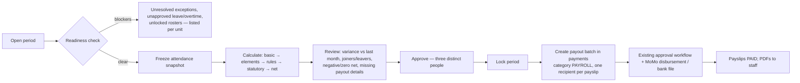

# 12 — Leave, Payroll & Reporting

Conventions: [02](02-data-model.md) §1. Workforce foundations (staff, rosters, attendance): [09](09-module-workforce.md).
Existing payout engine (`payments`, `payment_recipients`, MoMo): [00](00-context-and-decisions.md) §1.

---

## 1. Leave & HR administration — Sprint 17

### 1.1 Tables (V24)

```sql
-- V24__leave.sql
CREATE TABLE leave_type (
  id uuid PRIMARY KEY DEFAULT gen_random_uuid(),
  code varchar(20) NOT NULL UNIQUE, name varchar(100) NOT NULL,
  is_paid boolean NOT NULL DEFAULT true,
  entitlement_days numeric(5,1) NOT NULL DEFAULT 0,                     -- per leave year
  accrual_method varchar(8) NOT NULL DEFAULT 'UPFRONT' CHECK (accrual_method IN ('UPFRONT','MONTHLY','NONE')),
  carry_over_max_days numeric(5,1) NOT NULL DEFAULT 0,
  counts_calendar_days boolean NOT NULL DEFAULT false,                  -- true for maternity etc.
  min_notice_days smallint NOT NULL DEFAULT 0, max_consecutive_days smallint,
  requires_attachment_after_days smallint,                              -- e.g. sick leave > 2 days needs a certificate
  gender_restriction varchar(6) CHECK (gender_restriction IN ('FEMALE','MALE')),
  applies_to varchar(12) NOT NULL DEFAULT 'ALL' CHECK (applies_to IN ('ALL','CLINICAL','NON_CLINICAL')),
  active boolean NOT NULL DEFAULT true
);
CREATE TABLE leave_balance (
  id uuid PRIMARY KEY DEFAULT gen_random_uuid(),
  staff_id uuid NOT NULL REFERENCES staff(id), leave_type_id uuid NOT NULL REFERENCES leave_type(id), leave_year smallint NOT NULL,
  entitled numeric(5,1) NOT NULL DEFAULT 0, accrued numeric(5,1) NOT NULL DEFAULT 0,
  carried_over numeric(5,1) NOT NULL DEFAULT 0, adjusted numeric(5,1) NOT NULL DEFAULT 0,
  taken numeric(5,1) NOT NULL DEFAULT 0, pending numeric(5,1) NOT NULL DEFAULT 0,
  available numeric(5,1) GENERATED ALWAYS AS (accrued + carried_over + adjusted - taken - pending) STORED,
  UNIQUE (staff_id, leave_type_id, leave_year)
);
CREATE TABLE leave_request (
  id uuid PRIMARY KEY DEFAULT gen_random_uuid(), request_no varchar(20) NOT NULL UNIQUE,
  staff_id uuid NOT NULL REFERENCES staff(id), leave_type_id uuid NOT NULL REFERENCES leave_type(id),
  start_date date NOT NULL, end_date date NOT NULL, start_half_day boolean NOT NULL DEFAULT false, end_half_day boolean NOT NULL DEFAULT false,
  days numeric(5,1) NOT NULL CHECK (days > 0),                          -- from LeaveDayCalculator
  status varchar(12) NOT NULL DEFAULT 'DRAFT' CHECK (status IN
    ('DRAFT','SUBMITTED','APPROVED_L1','APPROVED','REJECTED','CANCELLED','RECALLED')),
  reason varchar(500), relief_staff_id uuid REFERENCES staff(id), attachment_id uuid,
  submitted_at timestamptz, coverage_warning varchar(300),
  CONSTRAINT leave_dates_ck CHECK (end_date >= start_date),
  CONSTRAINT leave_overlap_ex EXCLUDE USING gist
    (staff_id WITH =, daterange(start_date, end_date, '[]') WITH &&)
    WHERE (status IN ('SUBMITTED','APPROVED_L1','APPROVED'))
);
CREATE TABLE leave_approval (
  id uuid PRIMARY KEY DEFAULT gen_random_uuid(), leave_request_id uuid NOT NULL REFERENCES leave_request(id) ON DELETE CASCADE,
  step smallint NOT NULL CHECK (step IN (1,2)),                         -- 1 unit manager, 2 HR
  approver_user_id text NOT NULL, approver_staff_id uuid REFERENCES staff(id),
  decision varchar(8) NOT NULL CHECK (decision IN ('APPROVED','REJECTED')), comment varchar(300),
  decided_at timestamptz NOT NULL DEFAULT now(), UNIQUE (leave_request_id, step)
);
CREATE TABLE overtime_request (
  id uuid PRIMARY KEY DEFAULT gen_random_uuid(), staff_id uuid NOT NULL REFERENCES staff(id),
  attendance_record_id uuid REFERENCES attendance_record(id), work_date date NOT NULL,
  minutes int NOT NULL CHECK (minutes > 0), reason varchar(300),
  source varchar(10) NOT NULL DEFAULT 'SUGGESTED' CHECK (source IN ('SUGGESTED','REQUESTED','PRE_APPROVED')),
  status varchar(10) NOT NULL DEFAULT 'PENDING' CHECK (status IN ('PENDING','APPROVED','REJECTED')),
  approved_by text, approved_at timestamptz, UNIQUE (attendance_record_id)
);
```

### 1.2 Rules

| Area | Rule |
|---|---|
| **Days calculation** (`LeaveDayCalculator`) | `FIXED_WEEKDAY` staff: weekdays in range minus public holidays. `ROSTERED` staff: count of *rostered working days* in the range (off days inside the range are **not** deducted). `counts_calendar_days` types (e.g. maternity) count every calendar day. Half-day flags subtract 0.5 |
| **Chain** | Step 1 unit manager (scoped via `UnitAccessEvaluator`), step 2 HR manager. A manager cannot approve their own request (service + DB: approver staff ≠ requester). Unit managers' own leave goes straight to HR + HOSPITAL_ADMIN |
| **Balance** | Submit → `pending += days`; approve → `pending -= days, taken += days`; reject/cancel → release. `LeaveAccrualJob` (monthly) accrues `entitlement/12` for `MONTHLY` types; `LeaveYearEndJob` applies `carry_over_max_days` |
| **Coverage check** | At submit, `CoverageChecker` compares the unit's `unit_staffing_requirement` with rostered staff minus approved leave for each day; shortfalls are written to `coverage_warning` and shown to approvers. Approving below minimum for a 24-h ward needs an override reason |
| **Roster integration** | `LeaveApproved` → scheduling cancels ACTIVE roster entries in range (kept as history) and suppresses `FIXED_WEEKDAY` materialisation; attendance's `AbsenceDetectionJob` treats `LeaveApi.isOnLeave` as excused; `RECALLED`/`CANCELLED` regenerates entries and notifies the roster officer |
| **Documents** | Sick leave beyond `requires_attachment_after_days` needs an attachment (medical certificate) |
| **Overtime** | `AttendanceClosed` with `overtime_minutes > 0` creates `overtime_request(SUGGESTED)`; only `APPROVED` overtime flows to payroll; pre-approved overtime (by unit manager before the shift) is auto-approved on matching |
| **Licences** | `staff_license` ([09](09-module-workforce.md) §5.6) with `LicenceExpiryJob` (90/30/7 days) notifying staff + manager; an **expired licence blocks clinical acts** (ADR-004a) and optionally roster placement in clinical units |
| **Other HR data** | Staff documents (`attachment`, class `HR`), emergency contacts, qualifications, disciplinary notes (restricted classification) — modelled as attachments + `staff_note(HR)` post-v1 |

### 1.3 Tests (must exist)
Leave days for rostered vs weekday staff across holidays; overlapping request blocked; self-approval blocked; roster entries cancelled on approval and restored on recall;
coverage warning; balance arithmetic incl. carry-over; absence not raised on leave days; overtime suggestion → approval → payroll feed.

---

## 2. Payroll — Sprints 18–19

**Scope assumption (Q11):** the facility pays staff funded from internally generated funds plus allowances; central-government payroll
(if any) is run elsewhere. Where the facility runs full payroll, the same model applies. Rules for pay grades, allowances and statutory
bands are **data**, supplied and versioned by Finance/HR, never hard-coded.

### 2.1 Tables (V25)

```sql
-- V25__payroll.sql
CREATE TABLE salary_scale (
  id uuid PRIMARY KEY DEFAULT gen_random_uuid(), code varchar(20) NOT NULL, grade varchar(20) NOT NULL, step smallint NOT NULL DEFAULT 1,
  base_amount numeric(14,2) NOT NULL CHECK (base_amount >= 0), effective_from date NOT NULL, effective_to date,
  UNIQUE (code, grade, step, effective_from)
);
CREATE TABLE staff_compensation (
  id uuid PRIMARY KEY DEFAULT gen_random_uuid(), staff_id uuid NOT NULL REFERENCES staff(id),
  salary_scale_id uuid REFERENCES salary_scale(id), base_salary numeric(14,2) NOT NULL CHECK (base_salary >= 0),
  payout_method varchar(6) NOT NULL CHECK (payout_method IN ('MOMO','BANK')),
  momo_number varchar(20), momo_name varchar(200),                              -- moved from staff in this sprint
  bank_name varchar(100), bank_account varchar(40), ssnit_number varchar(20), tin varchar(20),
  effective_from date NOT NULL, effective_to date,
  CONSTRAINT staff_comp_overlap_ex EXCLUDE USING gist
    (staff_id WITH =, daterange(effective_from, effective_to, '[]') WITH &&)
);
CREATE TABLE pay_element (
  id uuid PRIMARY KEY DEFAULT gen_random_uuid(), code varchar(20) NOT NULL UNIQUE, name varchar(100) NOT NULL,
  element_type varchar(12) NOT NULL CHECK (element_type IN ('EARNING','DEDUCTION','STATUTORY','EMPLOYER')),
  calc_method varchar(12) NOT NULL CHECK (calc_method IN ('FIXED','PCT_OF_BASIC','PER_UNIT','ATTENDANCE','STATUTORY')),
  is_taxable boolean NOT NULL DEFAULT true, is_pensionable boolean NOT NULL DEFAULT false,
  is_recurring boolean NOT NULL DEFAULT true, export_code varchar(30), sort_order smallint NOT NULL DEFAULT 100, active boolean NOT NULL DEFAULT true
);
CREATE TABLE staff_pay_element (                                                 -- recurring allowances / deductions (e.g. loan repayment)
  id uuid PRIMARY KEY DEFAULT gen_random_uuid(), staff_id uuid NOT NULL REFERENCES staff(id),
  pay_element_id uuid NOT NULL REFERENCES pay_element(id), amount numeric(14,2), percent numeric(7,4),
  effective_from date NOT NULL, effective_to date, note varchar(200),
  CONSTRAINT staff_pay_element_ck CHECK (amount IS NOT NULL OR percent IS NOT NULL)
);
CREATE TABLE allowance_rule (                                                    -- attendance-driven pay (night duty, weekend, call…)
  id uuid PRIMARY KEY DEFAULT gen_random_uuid(), code varchar(30) NOT NULL UNIQUE, name varchar(120) NOT NULL,
  pay_element_id uuid NOT NULL REFERENCES pay_element(id),
  shift_category varchar(12) CHECK (shift_category IN ('STANDARD','MORNING','AFTERNOON','NIGHT')),
  day_type varchar(8) CHECK (day_type IN ('WEEKDAY','WEEKEND','HOLIDAY')),
  staff_category varchar(12) CHECK (staff_category IN ('CLINICAL','NON_CLINICAL')),
  job_role_id uuid REFERENCES job_role(id), org_unit_type varchar(15),
  unit_of_measure varchar(9) NOT NULL CHECK (unit_of_measure IN ('PER_SHIFT','PER_HOUR','PER_DAY')),
  rate numeric(14,2), multiplier numeric(5,2),                                   -- flat rate OR multiple of hourly basic (overtime)
  min_worked_minutes int NOT NULL DEFAULT 0, effective_from date NOT NULL, effective_to date, active boolean NOT NULL DEFAULT true,
  CONSTRAINT allowance_rule_rate_ck CHECK ((rate IS NOT NULL) <> (multiplier IS NOT NULL))
);
CREATE TABLE statutory_rate (                                                    -- SSNIT / PAYE bands etc. — values supplied by Finance
  id uuid PRIMARY KEY DEFAULT gen_random_uuid(),
  rate_type varchar(16) NOT NULL CHECK (rate_type IN ('SSNIT_EMPLOYEE','SSNIT_EMPLOYER','TIER2','PAYE_BAND','TAX_RELIEF','OTHER')),
  band_from numeric(14,2) NOT NULL DEFAULT 0, band_to numeric(14,2), rate_percent numeric(7,4), fixed_amount numeric(14,2),
  effective_from date NOT NULL, effective_to date, source_note varchar(200),
  UNIQUE (rate_type, band_from, effective_from)
);

CREATE TABLE payroll_period (
  id uuid PRIMARY KEY DEFAULT gen_random_uuid(), pay_year smallint NOT NULL, pay_month smallint NOT NULL CHECK (pay_month BETWEEN 1 AND 12),
  period_start date NOT NULL, period_end date NOT NULL,
  status varchar(10) NOT NULL DEFAULT 'OPEN' CHECK (status IN ('OPEN','CALCULATED','REVIEWED','APPROVED','LOCKED','PAID')),
  locked_at timestamptz, locked_by text, UNIQUE (pay_year, pay_month)
);
CREATE TABLE payroll_run (
  id uuid PRIMARY KEY DEFAULT gen_random_uuid(), run_no varchar(20) NOT NULL UNIQUE,
  payroll_period_id uuid NOT NULL REFERENCES payroll_period(id),
  run_type varchar(13) NOT NULL DEFAULT 'REGULAR' CHECK (run_type IN ('REGULAR','SUPPLEMENTARY','ARREARS')),
  status varchar(10) NOT NULL DEFAULT 'DRAFT' CHECK (status IN ('DRAFT','CALCULATED','REVIEWED','APPROVED','PAID','CANCELLED')),
  calculation_version int NOT NULL DEFAULT 0,
  run_by text NOT NULL, reviewed_by text, approved_by text,
  staff_count int NOT NULL DEFAULT 0, total_gross numeric(16,2) NOT NULL DEFAULT 0, total_deductions numeric(16,2) NOT NULL DEFAULT 0,
  total_net numeric(16,2) NOT NULL DEFAULT 0, total_employer_cost numeric(16,2) NOT NULL DEFAULT 0,
  payout_batch_id uuid REFERENCES payments(id),                                  -- existing payout engine
  CONSTRAINT payroll_run_three_eyes_ck CHECK (
    (reviewed_by IS NULL OR reviewed_by <> run_by) AND
    (approved_by IS NULL OR (approved_by <> run_by AND approved_by IS DISTINCT FROM reviewed_by)))
);
CREATE UNIQUE INDEX payroll_run_one_regular_ux ON payroll_run(payroll_period_id) WHERE run_type = 'REGULAR' AND status <> 'CANCELLED';
CREATE TABLE attendance_snapshot (                                              -- frozen inputs; makes a run reproducible
  id uuid PRIMARY KEY DEFAULT gen_random_uuid(), payroll_run_id uuid NOT NULL REFERENCES payroll_run(id) ON DELETE CASCADE,
  staff_id uuid NOT NULL REFERENCES staff(id), org_unit_id uuid REFERENCES org_unit(id),     -- unit at period end (cost allocation)
  scheduled_days numeric(5,1) NOT NULL, worked_days numeric(5,1) NOT NULL, absent_days numeric(5,1) NOT NULL,
  paid_leave_days numeric(5,1) NOT NULL DEFAULT 0, unpaid_leave_days numeric(5,1) NOT NULL DEFAULT 0,
  late_minutes int NOT NULL DEFAULT 0, overtime_minutes_approved int NOT NULL DEFAULT 0,
  night_shifts int NOT NULL DEFAULT 0, weekend_shifts int NOT NULL DEFAULT 0, holiday_shifts int NOT NULL DEFAULT 0,
  UNIQUE (payroll_run_id, staff_id)
);
CREATE TABLE payslip (
  id uuid PRIMARY KEY DEFAULT gen_random_uuid(), payslip_no varchar(24) NOT NULL UNIQUE,
  payroll_run_id uuid NOT NULL REFERENCES payroll_run(id), staff_id uuid NOT NULL REFERENCES staff(id),
  status varchar(8) NOT NULL DEFAULT 'DRAFT' CHECK (status IN ('DRAFT','APPROVED','PAID','FAILED')),
  basic_pay numeric(14,2) NOT NULL, gross_pay numeric(14,2) NOT NULL, taxable_income numeric(14,2) NOT NULL,
  paye numeric(14,2) NOT NULL DEFAULT 0, ssnit_employee numeric(14,2) NOT NULL DEFAULT 0, ssnit_employer numeric(14,2) NOT NULL DEFAULT 0,
  other_deductions numeric(14,2) NOT NULL DEFAULT 0, net_pay numeric(14,2) NOT NULL,
  payout_method varchar(6) NOT NULL, payout_account_masked varchar(40),
  payment_recipient_id uuid REFERENCES payment_recipients(id),
  UNIQUE (payroll_run_id, staff_id),
  CONSTRAINT payslip_net_ck CHECK (net_pay = gross_pay - paye - ssnit_employee - other_deductions)
);
CREATE TABLE payslip_line (
  id uuid PRIMARY KEY DEFAULT gen_random_uuid(), payslip_id uuid NOT NULL REFERENCES payslip(id) ON DELETE CASCADE,
  pay_element_id uuid NOT NULL REFERENCES pay_element(id), description varchar(150) NOT NULL,       -- snapshot
  quantity numeric(10,3) NOT NULL DEFAULT 1, rate numeric(14,4), amount numeric(14,2) NOT NULL,
  line_type varchar(12) NOT NULL CHECK (line_type IN ('EARNING','DEDUCTION','STATUTORY','EMPLOYER')),
  source_type varchar(12) NOT NULL CHECK (source_type IN ('BASIC','STAFF_ELEMENT','ALLOWANCE_RULE','OVERTIME','LEAVE','ABSENCE','ADJUSTMENT')),
  source_ref uuid
);
```

### 2.2 Payroll cycle



| Step | Rule |
|---|---|
| **Readiness** (`PayrollReadinessService`) | Blocks calculation while any attendance exception in the period is `OPEN`, a leave/overtime request is undecided, a roster period in the range is not `LOCKED`, or a staff member lacks active `staff_compensation`/payout details. Result lists each blocker with the responsible unit manager |
| **Snapshot** | `attendance_snapshot` per staff per run from `attendance_record`, `leave_request`, `overtime_request`, `roster_entry`: *scheduled* vs *worked* days (roster-based, so clinical off days are not "absences"), night/weekend/holiday shift counts, **unit at period end** for cost allocation |
| **Calculation** (pure, deterministic `PayrollCalculator`) | 1) basic (effective-dated, pro-rated by calendar days for joiners/leavers) → 2) recurring `staff_pay_element`s → 3) `allowance_rule` matches against the snapshot counts (e.g. NIGHT × night_shifts × rate; overtime = approved minutes × hourly basic × multiplier) → 4) unpaid-leave/absence deduction (policy-driven) → 5) gross → 6) SSNIT on the pensionable base → 7) taxable income = gross − pre-tax reliefs → 8) PAYE from the dated `statutory_rate` bands → 9) other deductions → 10) net. `HALF_EVEN` rounding per line; same inputs ⇒ same payslip (golden-file tests) |
| **Recalculation** | Allowed while run `< APPROVED`; increments `calculation_version`, replaces draft payslips |
| **Controls** | `payroll_run_three_eyes_ck`: preparer ≠ reviewer ≠ approver (HR_MANAGER reviews, ACCOUNTS/HOSPITAL_ADMIN approves). Negative net, > ±15 % month-on-month change, missing SSNIT/TIN numbers are *review flags* |
| **Payout** | On approval, `PayoutBatchService` creates a `payments` row (category `PAYROLL`) + `payment_recipients` (amount = `net_pay`, MoMo from `staff_compensation`); the **existing** state machine (`draft → pending_approval → approved → processing → completed`) and MoMo polling are reused. `BANK` payouts export a bank-upload file. `payslip.status` follows recipient status; failures are retried or switched to another method |
| **After approval** | Never edit. Fix via a `SUPPLEMENTARY`/`ARREARS` run referencing the original period |
| **Payslips** | PDF (OpenPDF/Thymeleaf) per staff; self-service read of *own* payslips only; emails are optional and contain no amounts (link requires login) |
| **Statutory outputs** | SSNIT contribution schedule, PAYE schedule, payroll journal (by `pay_element.export_code` × unit), bank/MoMo schedule — formats confirmed with Finance (Q11) |
| **Data protection** | Payroll is a `SENSITIVE` class: PAYROLL_OFFICER, HR_MANAGER, ACCOUNTS, AUDITOR (read), and the staff member themself. Reads audited; amounts masked in logs; exports require a purpose |

### 2.3 Migration of existing payment data
`staff.momo_number/momo_name` are copied into `staff_compensation` (effective from hire date or the earliest payment) at V25; the columns stay (deprecated) until the legacy
payments screens are ported. Existing historical `payments` stay as-is, tagged with the legacy category.

### 2.4 Tests (must exist)
Golden payslips (basic only; with night allowance; with overtime; joiner mid-month; leaver; unpaid leave) — hand-calculated by Finance and frozen as fixtures;
statutory band edges; determinism across reruns; three-eyes (API + DB); readiness blockers; payout batch amounts equal payslip nets; failed recipient retry;
clinical staff with off days not flagged as absent; staff transferred mid-period → cost to the period-end unit, attendance from both.

---

## 3. Reporting & analytics — Sprint 20

### 3.1 Architecture

```
OLTP tables ──► materialised views (reporting schema, refreshed nightly / on demand) ──► report API ──► UI charts, tables, exports
            └─► kpi_snapshot (daily numerators/denominators per KPI & unit)  ──► trends
Statutory: dhims2_mapping ─► monthly dataset ─► review ─► lock ─► export
```

- **No ad-hoc joins on live transactional tables from the UI** (ADR-018). Each report is a *named query* over `reporting.*` views, parameterised and permission-tagged in `report_definition`.
- Views use the facility date everywhere: `facility_date(ts) = (ts AT TIME ZONE (SELECT timezone FROM facility_setup))::date` (STABLE SQL function).
- Large exports are **asynchronous** (`report_run`); XLSX via POI SXSSF streaming, PDF via OpenPDF; files stored as attachments with expiry (7 days) and signed download URLs.
- A **read replica** (Postgres streaming replica) can be introduced without code change by pointing the `reporting` datasource at it.

### 3.2 Tables (V26)

```sql
-- V26__reporting.sql
CREATE FUNCTION facility_date(ts timestamptz) RETURNS date LANGUAGE sql STABLE
AS $$ SELECT (ts AT TIME ZONE (SELECT timezone FROM facility_setup LIMIT 1))::date $$;

CREATE TABLE report_definition (
  id uuid PRIMARY KEY DEFAULT gen_random_uuid(), code varchar(40) NOT NULL UNIQUE, name varchar(150) NOT NULL,
  module varchar(20) NOT NULL, description varchar(500), query_ref varchar(80) NOT NULL,         -- named SQL / view
  parameters_schema jsonb NOT NULL DEFAULT '{}',
  allowed_roles text[] NOT NULL, export_formats text[] NOT NULL DEFAULT '{XLSX,CSV,PDF}',
  contains_personal_data boolean NOT NULL DEFAULT false, active boolean NOT NULL DEFAULT true
);
CREATE TABLE report_run (
  id uuid PRIMARY KEY DEFAULT gen_random_uuid(), report_id uuid NOT NULL REFERENCES report_definition(id),
  requested_by text NOT NULL, purpose varchar(200), params jsonb NOT NULL DEFAULT '{}', format varchar(5) NOT NULL,
  status varchar(8) NOT NULL DEFAULT 'QUEUED' CHECK (status IN ('QUEUED','RUNNING','READY','FAILED','EXPIRED')),
  requested_at timestamptz NOT NULL DEFAULT now(), started_at timestamptz, finished_at timestamptz,
  row_count bigint, file_attachment_id uuid, expires_at timestamptz, error varchar(500)
);
CREATE TABLE kpi_snapshot (
  kpi_code varchar(40) NOT NULL, period_date date NOT NULL, org_unit_id uuid, value numeric(18,4), numerator numeric(18,4),
  denominator numeric(18,4), computed_at timestamptz NOT NULL DEFAULT now()
);
CREATE UNIQUE INDEX kpi_snapshot_ux ON kpi_snapshot(kpi_code, period_date, COALESCE(org_unit_id, '00000000-0000-0000-0000-000000000000'));
CREATE TABLE dhims2_mapping (
  id uuid PRIMARY KEY DEFAULT gen_random_uuid(), dataset_code varchar(40) NOT NULL, data_element_code varchar(60) NOT NULL,
  label varchar(200) NOT NULL, source_view varchar(60) NOT NULL, filter_expression varchar(500),
  disaggregation varchar(40), active boolean NOT NULL DEFAULT true, UNIQUE (dataset_code, data_element_code, disaggregation)
);

-- Example materialised view (each has a UNIQUE index to allow REFRESH ... CONCURRENTLY).
-- A bed is "occupied at midnight" on census_date if its assignment spans the instant that ends that facility-local day.
CREATE SCHEMA IF NOT EXISTS reporting;
CREATE MATERIALIZED VIEW reporting.mv_bed_occupancy_daily AS
WITH days AS (SELECT gs::date AS census_date FROM generate_series(current_date - 730, current_date, interval '1 day') gs),
     tz   AS (SELECT timezone FROM facility_setup LIMIT 1)
SELECT d.census_date, b.org_unit_id,
       count(DISTINCT b.id) FILTER (WHERE b.active) AS beds_available,
       count(ba.id)                                 AS beds_occupied_midnight
FROM days d
CROSS JOIN tz
CROSS JOIN bed b
LEFT JOIN bed_assignment ba
  ON ba.bed_id = b.id
 AND ba.assigned_from <  ((d.census_date + 1)::timestamp AT TIME ZONE tz.timezone)
 AND (ba.assigned_to IS NULL OR ba.assigned_to >= ((d.census_date + 1)::timestamp AT TIME ZONE tz.timezone))
GROUP BY d.census_date, b.org_unit_id;
CREATE UNIQUE INDEX ON reporting.mv_bed_occupancy_daily(census_date, org_unit_id);
```

### 3.3 Read models

| View | Grain | Used for |
|---|---|---|
| `mv_opd_daily` | date × clinic × payer × visit_type × sex × age band × new/return | OPD attendance, DHIMS2 |
| `mv_morbidity_monthly` | month × ICD-10 (code, chapter) × sex × age band × new case | Top-10 diagnoses, DHIMS2 morbidity, notifiable diseases |
| `mv_bed_occupancy_daily` | date × ward | Occupancy, bed-days, admissions/discharges/deaths |
| `mv_admission_outcomes_monthly` | month × ward × discharge_type | ALOS, mortality, LAMA |
| `mv_wait_times_daily` | date × clinic × stage | Queue/wait KPIs (`queue_ticket` issued → called → completed) |
| `mv_lab_tat_daily` / `mv_imaging_tat_daily` | date × department/modality × priority | TAT compliance |
| `mv_pharmacy_dispensing_daily` | date × store × drug | Consumption, top drugs, stock-out risk |
| `mv_stock_valuation` | store × item (batch roll-up) | Stock value, expiry exposure |
| `mv_revenue_daily` | date × service category × payer × cashier | Revenue, collection rate |
| `mv_claims_ageing` | payer × ageing bucket | NHIS/insurer receivables |
| `mv_attendance_daily` | date × unit × staff category | Present/late/absent/leave/overtime |
| `mv_roster_coverage_daily` | date × unit × shift | Required vs rostered vs present |
| `mv_payroll_cost_monthly` | period × unit × pay element | Cost allocation |
| `mv_leave_utilisation` | year × leave type × unit | Leave KPIs |

Refresh: `ReportRefreshJob` (02:30) refreshes in dependency order with `CONCURRENTLY`, writes the duration to Micrometer (`report.refresh.seconds{view}`) and alerts on failure; a light live view `v_today_dashboard` (not materialised) supplies "today so far" tiles.

### 3.4 KPI catalogue (definitions are code; the numbers come from the views)

| Area | KPI | Definition |
|---|---|---|
| Inpatient | Bed occupancy rate | occupied bed-days ÷ available bed-days |
| | Average length of stay | Σ LOS (discharged) ÷ discharges |
| | Bed turnover rate / interval | discharges ÷ beds / (available − occupied days) ÷ discharges |
| | Boarders in ED | admissions with `PENDING_BED` > 4 h |
| | Mortality / LAMA rate | deaths (or LAMA) ÷ discharges |
| Outpatient | OPD attendance (new/return) | visits by `is_new_attendance` |
| | Wait time | `queue_ticket` issued → called (p50, p90) |
| | No-show rate | `NO_SHOW` ÷ booked |
| Diagnostics | TAT compliance | % results validated within `tat_*_minutes` |
| | Critical-result acknowledgement | % acknowledged within threshold |
| Pharmacy & stores | Stock-out rate | items with zero on-hand ÷ active formulary |
| | Expiry exposure | value of stock expiring in 90 days |
| Finance | Collection rate | confirmed payments ÷ patient amount billed |
| | Claim rejection rate | rejected claimed amount ÷ submitted |
| | Days to payment (NHIS) | remittance date − submission date |
| | Cash variance | Σ \|cashier variance\| |
| Workforce | Attendance rate / punctuality | present ÷ scheduled; on-time ÷ present |
| | Absenteeism, overtime hours | unexcused absent ÷ scheduled; approved OT minutes |
| | Roster coverage | rostered (or present) ÷ required per `unit_staffing_requirement` |
| Quality | Discharge-summary completion | signed within 24 h ÷ discharges |
| | EWS escalation response | HIGH band → first documented action (minutes) |

### 3.5 Report catalogue by audience

| Audience | Reports |
|---|---|
| **Executive** (HOSPITAL_ADMIN, REPORT_VIEWER) | Executive dashboard (today + 12-month trend), occupancy & throughput, revenue & receivables, workforce summary |
| **Clinical heads / unit managers** | Unit census, OPD workload by clinician, top diagnoses, TAT, wait times, roster coverage, attendance exceptions, leave calendar |
| **Finance / accounts** | Daily revenue & cash-up, aged receivables (patient, NHIS, private), claims status, supplier payables, payroll journal |
| **Pharmacy & stores** | Consumption, stock valuation, expiry, stock-outs, controlled-drug register extract, procurement status |
| **HR** | Headcount by unit/category/role, attendance & punctuality, overtime, leave balances, licence expiry, transfers history |
| **Records / quality** | Duplicate candidates, missing diagnoses, incomplete discharge summaries, unmatched MoMo, data-quality scorecard |
| **Statutory** | DHIMS2 monthly datasets (OPD attendance, morbidity, admissions/discharges/deaths, maternal/child where captured) built from `dhims2_mapping`, reviewed and locked before export (CSV/Excel template first; electronic submission after Q-confirmation) |
| **Audit / DPO** | Break-glass log with review status, restricted-record access, export/print log, role changes, failed logins |

### 3.6 Security & privacy for reporting
- Aggregates by default; **line-level (patient/staff) reports** carry `contains_personal_data = true`, need a stated purpose, appear in the audit log as `EXPORT`, and are role-limited.
- **Small-cell suppression**: counts < 5 in sensitive categories (HIV/STI, mental health, adolescent SRH) are masked in management dashboards and exports.
- Unit managers see only their unit subtree (`UnitAccessEvaluator`); payroll/compensation reports are restricted to payroll roles.
- Export files are encrypted at rest, expire, and are never emailed as attachments.

### 3.7 Tests (must exist)
View definitions vs hand-computed fixtures (occupancy across midnight, ALOS with transfers); `REFRESH CONCURRENTLY` works (unique indexes present — checked by a test that scans `pg_matviews`);
facility-date boundary (a 23:30 UTC event in Accra); export role/purpose enforcement; small-cell suppression; async run lifecycle and expiry; DHIMS2 dataset reproducible after lock.
