# Hospital Administration Management System (HAMS) — Implementation Guide

Sprint-ready delivery plan for a Hospital Administration Management System built on the existing
staff-payment codebase (`backend/` Express 5 + Drizzle + Neon Postgres + Better Auth + MTN MoMo, and `frontend/`
Refine + shadcn/ui), re-platformed to a **Spring Boot 3 modular monolith** (`backend-spring/`) that takes over from
Express module by module (strangler pattern) on the same PostgreSQL database and the same Refine frontend.

Modules covered: **workforce** (clinical / non-clinical staff, shifts and duty rosters, fingerprint & ID-card attendance,
unit/ward assignment and re-shuffling), **patients**, **appointments & OPD**, **admissions & beds**, **nursing**,
**pharmacy**, **laboratory & radiology**, **billing & insurance (NHIS)**, **inventory & procurement**, **leave & payroll**,
and **reporting & analytics**.

## Read in this order

| # | Document | Purpose |
|---|----------|---------|
| 0 | [00-context-and-decisions.md](00-context-and-decisions.md) | What exists today, keep/extend/rename, ADRs, scope map, NFRs, glossary, assumptions & open questions |
| 1 | [01-architecture-and-setup.md](01-architecture-and-setup.md) | Repo layout, module template and dependency rules, event catalogue, request pipeline, environments, env vars, `pom.xml`, local bootstrap, device topology |
| 2 | [02-data-model.md](02-data-model.md) | Conventions, ER overview, table inventory (≈150 tables), platform DDL, state-machine registry, indexing, **migration sequence V1–V27**, seed plan |
| 3 | [03-api-contract.md](03-api-contract.md) | Envelope, error codes, list-query contract, endpoint map for every module, handler conventions, idempotency, rate limits |
| 4 | [04-frontend-blueprint.md](04-frontend-blueprint.md) | Refine providers (data/auth/access control), resource registry, screen inventory, clinical UI patterns, kiosk & offline punch queue |
| 5 | [05-sprint-plan.md](05-sprint-plan.md) | **Sprint 0 → Sprint 22**: goals, stories, points, acceptance, demos, risks, release train |
| 6 | [06-security-privacy-compliance.md](06-security-privacy-compliance.md) | Ghana DPA 2012 (Act 843) & health-sector context, classification, RBAC matrix, break-glass, consent, retention, DSR, incident response |
| 7 | [07-testing-quality-cicd.md](07-testing-quality-cicd.md) | Test strategy, critical journeys, CI/CD, observability, scheduled jobs, performance budget, release checklist, downtime, clinical safety & go-live |
| 8 | [08-backlog.csv](08-backlog.csv) | Importable backlog (Jira/Linear/GitHub Projects) — generated from the sprint plan |
| 9 | [09-module-workforce.md](09-module-workforce.md) | **Workforce module spec:** staff categories, shifts, rosters, attendance (fingerprint/ID card), assignments & transfers — DDL, algorithms, APIs |
| 10 | [10-module-clinical.md](10-module-clinical.md) | **Clinical modules:** patients (MPI), appointments/visits/OPD, admissions & beds, nursing, laboratory, radiology |
| 11 | [11-module-supply-and-revenue.md](11-module-supply-and-revenue.md) | **Supply & revenue:** inventory & procurement, pharmacy, billing (cash/MoMo), insurance & NHIS claims |
| 12 | [12-module-hr-payroll-reporting.md](12-module-hr-payroll-reporting.md) | **Corporate:** leave & overtime, payroll, reporting & analytics (DHIMS2) |

Documents 9–12 follow the structure *purpose → tables (DDL) → workflows & rules → code sketches → tests* and are the
authoritative source for each module; documents 2–3 index them.

## Delivery shape at a glance

- **Cadence:** 2-week sprints, 23 sprints (Sprint 0 + 22 delivery sprints ≈ 46 weeks).
- **Team assumption:** 2 backend, 1 frontend, 1 full-stack, 1 QA, 0.5 PO, plus a named clinical lead and finance lead. Velocity target **≈ 40 pts/sprint** (calibrate after Sprint 2).
- **Release train:** every sprint ships to `staging`; production releases at the end of Sprints **6, 10, 13, 16, 20, 22**.
- **Definition of MVP (end of Sprint 10):** workforce (rosters + attendance) + patient registry + appointments + OPD (encounters, orders, prescribing) + billing/cashier (cash & MoMo).

| Release | Sprint | Contents |
|---|---|---|
| **R1 Workforce** | 6 | Org units, staff (clinical / non-clinical), assignments & transfers, rosters, fingerprint/ID-card attendance, kiosk |
| **R2 MVP** | 10 | + patients, appointments, OPD, prescribing, billing & cashier |
| **R3 Clinical** | 13 | + laboratory, radiology, admissions & beds, nursing |
| **R4 Supply & revenue** | 16 | + inventory, pharmacy dispensing, insurance & NHIS claims |
| **R5 Corporate** | 20 | + leave, payroll & payouts (legacy payment routes ported), reporting & DHIMS2 |
| **v1.0** | 22 | Privacy centre, retention, hardening, UAT, go-live |

## Module → sprint map

```mermaid
gantt
    title HAMS delivery (weeks)
    dateFormat X
    axisFormat W%d
    section Platform
    Foundation & Spring skeleton     :0, 2
    Platform hardening               :2, 2
    section Workforce
    Organisation & staff             :4, 2
    Assignments & transfers          :6, 2
    Rostering                        :8, 2
    Attendance capture & operations  :10, 4
    section Front office & OPD
    Patient registry                 :14, 2
    Appointments & charge master     :16, 2
    OPD encounters & prescribing     :18, 2
    Billing core (MVP)               :20, 2
    section Inpatient & diagnostics
    Laboratory & radiology           :22, 2
    Admissions & beds                :24, 2
    Nursing                          :26, 2
    section Supply & revenue
    Inventory & procurement          :28, 2
    Pharmacy dispensing              :30, 2
    Insurance & NHIS claims          :32, 2
    section Corporate
    Leave & HR                       :34, 2
    Payroll engine                   :36, 2
    Payout & legacy port             :38, 2
    Reporting & analytics            :40, 2
    section Close-out
    Privacy centre & data quality    :42, 2
    Hardening, UAT, launch           :44, 2
```

## How the three workforce requirements map to the plan

| Requirement | Where it is specified | Sprints |
|---|---|---|
| **R1** Clinical vs non-clinical staff; non-clinical + some clinical on 07:00–16:00, weekdays only for non-clinical; clinical shifts Morning 07–14, Afternoon 14–20, Night 20–07; clinical off days from duty rosters | [09](09-module-workforce.md) §1.1, §5–§6; [02](02-data-model.md) | 2, 4 |
| **R2** Daily clock-in/out by fingerprint or ID card (QR/barcode) | [09](09-module-workforce.md) §7; [04](04-frontend-blueprint.md) §9; [06](06-security-privacy-compliance.md) §4 | 5, 6 |
| **R3** Assignment to units/departments/wards and re-shuffling | [09](09-module-workforce.md) §8 | 2, 3 |

## How to run a sprint from this guide

1. Import [08-backlog.csv](08-backlog.csv) into the tracker; each row is a story with points, epic and component. The *Acceptance Criteria* column holds the **sprint-level** acceptance; refine story-level criteria during backlog refinement to meet the Definition of Ready.
2. At sprint planning, pull the sprint section from [05-sprint-plan.md](05-sprint-plan.md); confirm the **Entry criteria** and the privacy/clinical-safety impact of each story.
3. Every story must satisfy the shared **Definition of Done** in [05-sprint-plan.md](05-sprint-plan.md#definition-of-done).
4. Schema work always lands as a reviewed **Flyway migration** (never edit a released migration; see [02](02-data-model.md) §8).
5. Demo using the **Demo** script at the end of each sprint; clinical sprints also need the clinical-safety review ([07](07-testing-quality-cicd.md) §9).
6. `08-backlog.csv` is generated from the sprint tables; if you change a story in [05](05-sprint-plan.md), regenerate the CSV (or edit both) so they stay in step.

## Assumptions to confirm in Sprint 0

Ghana as the regulatory context (DPA Act 843, NHIA, DHIMS2), `Africa/Accra` facility timezone, a ~500-bed referral hospital,
MTN MoMo for patient collection and payouts, the Better Auth JWT bridge, and the team size above — see
[00](00-context-and-decisions.md) §6 for the full question list and the defaults this plan uses.
